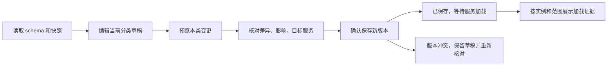

# NovaTrader 前端 UI 开发规范

> **【已归档 · 2026-11-03】本文件已被合并，不再作为开发依据。有效规范见 `../01-视觉风格.md` ~ `../04-落地检查清单.md`（入口 `../README.md`）。本稿仅作历史溯源，GX-01~24 与 R-UI 完整条款可在本稿第 5/7 节查阅，冲突时以 01–04 为准。**

2026-11-02 · 当前唯一有效的样式与控件指导文件。

**后续开发以 Aether V2 演示为视觉和交互基准：星舰配色、半透明毛玻璃、淡边缘光、对象工作区，以及演示中的控件行为。** 设计说明、配置排版、动效、24项精修组件合同和R-UI规则集中维护在本文件。原先V1/V2、Galaxy R2–R6等独立设计稿已合并归档。

- [打开开发基准演示](assets/aether-v2-2026-10-30/index.html#workspace) · [配置工作台](assets/aether-v2-2026-10-30/index.html#workspace) · [控件实验室](assets/aether-v2-2026-10-30/index.html#lab)
- 阅读顺序：[设计基准](#design-baseline) → [配色与材质](#visual) → [布局与配置](#layout) → [控件与动效](#interaction) → [24项组件合同](#components) → [开发规则](#rules)。
- 测试结果、来源许可、历史原稿和既有任务统一放在[验证与来源](验证与来源.md)，开发时无需在多份设计稿中挑版本。

<a id="design-baseline"></a>
## 1. 设计基准与适用范围

| 决策 | 执行方式 |
| --- | --- |
| 软件外观 | 以当前Aether V2演示的星舰主题为准；深海蓝灰底、冰青操作色、电蓝辅助色、清晰中文和分层玻璃 |
| 配置交互 | 对象入口、原位展开、属性阅读面、悬浮工具坞、命令直达、变更托盘；保持演示中的身份与焦点连续性 |
| 控件实现 | 先看实验室中的实际样式和操作，再查本文件的七维合同；同一类控件使用共享token和Nt基础件 |
| 参考库 | 24项星舰精修是优先实现参考；3802项Galaxy全库用于寻找视觉与交互技法，逐项保留原作与主题对照 |
| 业务行为 | 服务端schema、权限、版本、真实状态和回执决定行为；演示中的计时、样本值、登录/提交外观不等于已接入业务 |
| 冲突处理 | 当前用户要求、本文件及当前演示优先；历史稿中旧配色、常驻菜单、控件样式不再并列作为开发依据 |

基准资源为[入口HTML](assets/aether-v2-2026-10-30/index.html)、[外壳CSS](assets/aether-v2-2026-10-30/aether.css)、[外壳交互](assets/aether-v2-2026-10-30/aether.js)、[精修控件目录](assets/aether-v2-2026-10-30/galaxy-catalog.js)、[精修控件样式](assets/aether-v2-2026-10-30/galaxy-controls.css)。HTML负责可操作示范，本文负责开发约束，两者共同维护。

<a id="visual"></a>
## 2. 配色、文字、材质与图标

### 2.1 一个颜色来源

生产颜色、字号、密度和材质以[theme/tokens.css](../../../web/src/theme/tokens.css)为唯一出口。演示的`--nt-at-*`、`--gx-*`、`--gw-*`是候选局部设计参数，迁移时收敛到主题或Nt组件，不在业务页面复制一份固定色值。

| 用途 | 令牌与规则 |
| --- | --- |
| 空间与层次 | `--nt-bg-0/1/2/3`：深海蓝灰的结构底、内容层、悬浮层和选中层；亮主题使用对应浅蓝灰层次 |
| 文字 | `--nt-text-0`仅用于每面板一组主指标；正文、说明、辅助信息使用text-1/2/3；不靠给所有文字加亮建立层级 |
| 操作强调 | `--nt-accent`冰青，`--nt-accent-2`电蓝；用于当前对象、操作、焦点、细边与局部反光 |
| 金融语义 | 涨红跌绿，经既有format函数与up/down类输出；warn/danger等风险语义独立判断，不能按装饰需要交换 |
| 可读性 | 正文合成背景对比度目标≥4.5:1；暗/亮、色觉安全、节能与减少动态分别走查；不在正文用模糊、渐变字或常驻文字光晕 |

### 2.2 分层玻璃

| 表面 | 样式与应用 |
| --- | --- |
| 空间底 | 同一片低对比青蓝光场与静态精密网格，背景不穿透重要正文形成干扰 |
| 对象玻璃壳 | 半透明蓝灰、有厚度的细边、顶部反光、有限阴影；用于主入口、对象、工具坞、详情和配置外壳 |
| 内容/预览面 | 使用共享`inset-surface`，与外壳同色系；不借近不透明data-inset造成突兀黑块 |
| 输入与触发面 | 使用`control-surface`，稳定边界和前景；下拉、搜索、输入与选中项属于同一材质体系 |
| 选项层与工具条 | 分别使用`overlay-surface`和`toolbar-surface`；层级由边界、反光、阴影和位置共同表达 |
| 真实数据背板 | 行情、订单、K线、证据长文用高不透明稳定底色，保留玻璃外壳，保证长时间阅读 |

边光沿**控件真实轮廓**绘制，圆形、胶囊、圆角卡片不能出现外接矩形发光。活动配置主对象在完整模式可用一层16s慢流光，层opacity≤0.24；普通入口hover/focus单次掠光。数字、表格、图表正文不加装饰流光，风险提示拥有更高优先级。

### 2.3 文字、图标与尺寸

中文功能名优先，说明交代用途、作用范围和结果。按钮使用“审阅变更”“保存此分类”等具体动词，确认操作写清后果。缺失显示“—”及原因；遮蔽使用“•••”，两者不可混用。在线、实时、保存成功都要能追溯到证据。

| 项目 | 统一规则 |
| --- | --- |
| 字体 | 系统中文字体；价格、数量、比例、时间、URL和技术值使用项目等宽字体及tabular-nums |
| 配置阅读 | 标准正文14px、紧凑13px，辅助信息≥12px；标题26–38px。只通过局部配置token调整，不放大全局交易表格 |
| 间隔 | 4/8/12/16/20/24px节奏，28/32px用于大对象、分区与页边距 |
| 常规控件 | 标准42px、紧凑36px；精修组件的48/44px等具体合同优先；触屏有效目标≥44px，触屏文本输入16px |
| 圆角 | 主对象28px、内容面22px、属性12–16px；胶囊和同心圆按真实几何对齐。24项精修按各自合同 |
| 操作图标 | 统一NtIcon轮廓语法、中文名称和焦点；小型系统图标清楚可辨，不给每个按钮都叠复杂玻璃图形 |
| 入口图形 | 可用分层玻璃、轻微透光与最多3px的前层响应；输入文字和金融数字不跟鼠标漂移，不倾斜整张表单 |

<a id="layout"></a>
## 3. 页面排版与配置空间

工作区最大宽1480px。顶部放品牌/工作面、命令入口、主题和动效；主体由一个主对象与成组辅助对象构成。工具坞在正文之后的独立布局行，不能覆盖字段、操作条或回执。交易工作台保留dockview、监控画布和既有票式布局，只统一局部材质和控件。

| 场景 | 空间组织 |
| --- | --- |
| 概览 | 一个主要入口配2–3个辅助区域，主对象约62%面积；明确grid-area，DOM与视觉顺序一致，不dense填洞 |
| 聚焦配置 | 左侧身份/用途，右侧属性阅读与操作；宽窗并列，窄窗上下。对象切换保留草稿、焦点和回退路径 |
| 长表单 | 固定label→当前值→单位/说明/错误；常用参数先展示，高级字段按schema展开，未知字段仍保留 |
| 模型与来源 | 一次聚焦一个对象；URL、模型名用整行，数值字段可成对；相同分类共用草稿与版本，不能按入口图标另建存储 |
| 管理页面 | 筛选条→列表/主体→详情抽屉；筛选不散落各张卡。抽屉用360/480/640阶梯，超过则走模态 |
| 行情/订单/证据 | 对齐的数据列、稳定背板、状态/时间证据与真实操作；不改造成概览入口卡墙 |

V2对象视图≥1100px主辅并列，800–1099px缩减图形和空白，<800px单列，<560px辅助对象/快捷项单列。生产配置以容器宽度响应：≥1440px可侧置回执，1100–1439px主列与回执摘要，720–1099px折叠目录，<720px单列；字段内宽不足560px则单列。面板最小可读宽320px。

### 3.1 配置分类与作用范围

服务端schema是分类和字段事实源，展示名可调整，category.id、字段键、旧深链及未知新字段完整保留。保留此设备偏好、共享服务草稿、启动文件指引三种作用范围；文件项只读指引，不伪造在线修改能力。

| 导航分组 | 分类 ID → 展示名 | 展示内容与编辑方式 |
| --- | --- | --- |
| 概览（新增展示视图） | `summary`（仅本地视图 ID）→ 配置概览 | 入口卡＋作用范围说明；无运行证据不显示健康百分比或“全部就绪” |
| 此设备 | `look`→外观与动效，`link`→连接与桌面 | 本机即时偏好与连接设置；明确“仅此设备” |
| 接入与智能 | `datasource`→数据接口，`models`→模型服务，`agents`→智能体，`notify`→通知通道 | 基于 section 分组；密钥、限频、模型分工各有清晰区域 |
| 策略与市场 | `funnel`→选股漏斗，`score`→评分与信号，`price`→价格与仓位，`first`→首板弱转强，`pullback`→强势回踩，`sentiment`→情绪阶段，`sector`→板块热度 | 常用参数先展示，高级字段可折叠但可搜索、可直达、不能漏提交 |
| 风险与系统 | `risk`→风险控制，`files`→启动配置 | 风控入口保持独立；启动配置只读文件指引，不伪造在线修改能力 |

“版本与回执”是当前分类的详情动作，接已有 `ConfigRevisionPanel`，不冒充额外配置分类。不得复活没有 nav 入口的 `mode` 分支；实盘授权仍走既有准入工作流。

### 3.2 草稿、审阅、保存与回执

#### 草稿、预览、保存与加载回执



1. 底栏常显“未保存N项 · 基于#revision”。N只数相对baseline的字段差异与待清除凭据，不能把“偏离默认值”的数量拿来用。
2. 预览只提交当前分类差异。切分类可保留各类内存草稿并标未保存点；任何编辑、清除凭据、版本变化都会使对应预览失效。预览需绑定分类、草稿代次和baseRevision。
3. “放弃本类改动”恢复当前分类baseline；“重新读取配置”若会覆盖草稿，先说明具体影响并让用户选择保留/放弃。关闭有草稿的配置窗同样处理。
4. 预览通过才显示“确认保存新版本”。预览容器放变更前后、影响服务、未知影响和计划失效说明；敏感项仅显示“保留/替换/清除”，不得渲染before/after真实值。
5. 保存中锁定本次提交，保留可读字段和错误上下文；不能因关闭动画重复发送。服务端返回新revision后才显示“已保存#N”，随后独立展示加载状态。
6. 回执按`service + instance + scope + revision`展示，保留`observedAt`、失败原因及未知状态。`cache_loaded`只能称“配置缓存已加载”，`applied`按真实scope称“已安装到运行态”；都不代表外部API已连通或完整业务已验证。
7. 没有目标服务名单、没有回执、回执读取失败、旧版本回执都不能合并成“全部已生效”。不以单实例成功证明全部目标实例成功；汇总口径不足时直接显示“加载证据待核验”。
8. baseRevision冲突保留草稿，提供“读取最新版本并比较”；历史恢复先预览再创建新版本，不改写旧记录。晚到响应不得覆盖更新的草稿。
9. 查看角色只读，按钮旁显示原因。schema不可达/不兼容时禁服务参数编辑与保存，显示重试/升级引导；本机外观功能仍可使用。

#### 字段呈现合同

| 字段形态 | 排版与状态 |
| --- | --- |
| text / select | 标签→控件→提示；select的选项来自schema，不能以中文文案当value |
| int / number | 值等宽、单位可见；整数/范围错误内联；无证据不新增min/max业务约束 |
| bool | 开关右侧有“启用/关闭”或明确用途；点击只改草稿，服务参数不能偷偷即刻提交 |
| secret | 已设置徽章＋密码替换框＋显式清除；留空保留，清除待保存；不提供读取旧明文能力 |
| json / wide | 跨列、等宽、可展开；JSON解析错误定位就地显示；未知键保留 |
| 默认值不同 | “自定义值”，帮助可见默认值；不等于未保存 |
| baseline不同 | “未保存”＋底栏计数；保存回执后消除，不由动画结束决定 |
| 生效范围 | 依据真实元数据；无法确定显“加载方式待核验”，不把默认`on-save`包装为已立即生效 |
| 缺失/未知 | 保留字段或分组，显示“— / 未返回”及原因；不能用schema fallback伪装成读取到的运行值 |

搜索为本地检索下发schema中的分类、标签、section、key；不检索密钥值。结果显示分类路径并直达字段；展开被折叠的分组、保留草稿、一次焦点定位，不复制第二份可编辑表单。此能力为待实现设计，不是已有产品功能。

<a id="interaction"></a>
## 4. 控件行为与动画

1. 状态和焦点先更新，动画随后反馈；动画可中断、可跳过，迟到回调不能覆盖新对象。
2. 每个控件定义默认、hover、focus、pressed、selected、disabled、loading、error等适用状态，不能只做一张好看的静态图。
3. 复合输入由外壳独占focus-within轮廓，内部input不再画矩形outline；独立控件保留focus-visible。错误说明始终可见。
4. 选择控件区分固定单值、检索单值、分组多值、动作菜单。自定义弹层统一顶层定位、碰撞、关闭、回焦；菜单先消费Esc，再退出外层视图。
5. 拖动保留精确输入，持按保留普通按钮确认路径；必要功能无需hover、长按或手势才能访问。IME组合完成后再过滤和提交命令。
6. loading、成功和进度由真实请求/事件驱动；失败有原因、重试、取消或回滚，忙碌状态防重入并保留焦点。
7. 生产动态偏好统一由settings驱动，系统减少动态优先；后台、窗口失焦和离屏停止装饰运动，销毁时释放监听、计时器、观察器与旧异步写入。

| 动作 | 参数与边界 |
| --- | --- |
| 按压/颜色/提示 | 按压120–160ms，提示120–180ms，选中/描线/滑片160–260ms；点击目标与文字位置稳定 |
| 工具坞透镜 | 360ms缓出，标签与焦点立即更新，不等待透镜移动 |
| 对象展开 | 340ms独立轮廓连续变换；内容同步，快速切换可打断，无API支持直接更新 |
| 顶级工作面 | 140–180ms轻淡入，不移动整屏或制造错误空间方向 |
| 组件特效 | 卫星菜单、翻面、跃迁、滑轨、持按等按下方逐项合同，不全场同时循环 |
| 完整/节能/减少动态 | 完整允许有限玻璃与局部运动；节能关闭blur和装饰；减少动态用静态形态直接到终态，功能仍完整 |

命令入口复用现有注册系统。自然语言只可形成可审阅建议，不能跳过权限、分类预览、baseRevision和回执。配置变更托盘按baseline差异计数，预览绑定草稿代次、分类和版本，继续编辑或版本变化使预览失效。

<a id="components"></a>
## 5. 逐组件开发规范

下列24项与演示“规范”弹层来自同一份galaxy-catalog.js。尺寸指标准密度候选；紧凑与触屏遵守统一下限。来源是视觉参考，新增业务与状态行为见“相对原作”。

### GX-01 光掠按钮

来源：[elijahgummer / Buttons/elijahgummer_angry-quail-96.html](https://github.com/uiverse-io/galaxy/blob/adbd2adde0a299a3956ea288fb444ec01891ca41/Buttons/elijahgummer_angry-quail-96.html)。

| 维度 | 合同 |
| --- | --- |
| 样式 | 48px高胶囊；冰青细边、深蓝玻璃、左侧方向图标；文字保持实色。禁用示例保留边界和说明。 |
| 行为/状态 | 默认→悬停/聚焦→按下→反馈；点击会展开本卡的工作区预览并增加试按次数。保留独立禁用态示例，不可触发或播放掠光。 |
| 动作/时长 | 悬停、键盘聚焦或点击触发一次640ms斜向掠光，点击可再次重播；按下缩至0.98，松手160ms复位。文字不位移、不缩小。 |
| 键盘/触屏 | Tab聚焦，Enter/Space激活；触屏直接点击可得到同等动作反馈。 |
| 节能/减少动态 | 节能移除玻璃滤镜与外晕；减少动态保留静态描边、次数反馈，停止掠光与缩放。 |
| 项目用途 | 配置审阅、进入工作区等低风险主动作。真实提交仍由业务状态机驱动，不能用光效表示成功。 |
| 相对原作 | 把原作的高倍hover缩放改为稳定文字＋单次掠光；不用Tailwind运行时。 |
### GX-02 跃迁图标按钮

来源：[adamgiebl / Buttons/adamgiebl_quiet-duck-78.html](https://github.com/uiverse-io/galaxy/blob/adbd2adde0a299a3956ea288fb444ec01891ca41/Buttons/adamgiebl_quiet-duck-78.html)。

| 维度 | 合同 |
| --- | --- |
| 样式 | 48px高，电蓝底与独立图标舱；箭头/火箭来自同一轮廓语法，文字不动。 |
| 行为/状态 | 点击展开本地模型图形，700ms后对象落入舱位；运行时用aria-disabled阻止重入、aria-busy表达等待并保留焦点。离开实验室取消本轮演示。 |
| 动作/时长 | hover图标前移3px；点击仅图标在440ms内出舱再返回，业务/演示状态先更新。 |
| 键盘/触屏 | Enter/Space与点击等价；禁用期间不制造第二个任务，完成后原按钮可再次操作。 |
| 节能/减少动态 | 减少动态时图标静止，仍显示演示进行中和演示完成；节能不绘制外晕。 |
| 项目用途 | 打开分析、生成预览等入口；下单/授权动作不得由跃迁动画隐式触发。 |
| 相对原作 | 借鉴图标旋转与平移；缩小位移，补充防重入、取消和文字状态。 |
### GX-03 弹性玻璃开关

来源：[aboalsim114 / Toggle-switches/aboalsim114_clever-chipmunk-18.html](https://github.com/uiverse-io/galaxy/blob/adbd2adde0a299a3956ea288fb444ec01891ca41/Toggle-switches/aboalsim114_clever-chipmunk-18.html)。

| 维度 | 合同 |
| --- | --- |
| 样式 | 64×36px轨道，26px玻璃旋钮；有效点击区域至少44px高；开为冰青、关为蓝灰，并有文字。 |
| 行为/状态 | 原生checkbox，关闭↔开启；实际控制本卡对象的光晕与底部光场，图标主体保持可读。不改变全局外观或服务配置。 |
| 动作/时长 | 旋钮平移26px，260ms轻弹缓动；轨道颜色160ms切换；移除原作整球3D旋转。 |
| 键盘/触屏 | Tab聚焦原生input，Space切换；点击整个标签也可切换。 |
| 节能/减少动态 | 减少动态立即到达选中位置，保留checked与中文开关状态；节能使用实底。 |
| 项目用途 | 本机偏好、功能草稿开关；需要后端确认的开关必须显示等待/失败，不能乐观假称已启用。 |
| 相对原作 | 修复原作display:none输入不可键盘访问；主题色替换红绿对，保留轻弹手感。 |
### GX-04 描线选择器

来源：[guilhermeyohan / Checkboxes/guilhermeyohan_white-cheetah-13.html](https://github.com/uiverse-io/galaxy/blob/adbd2adde0a299a3956ea288fb444ec01891ca41/Checkboxes/guilhermeyohan_white-cheetah-13.html)。

| 维度 | 合同 |
| --- | --- |
| 样式 | 28px圆形轮廓＋SVG勾线；两项组成可点击的44px高标签；选中同时显示文字计数。 |
| 行为/状态 | 两项独立原生checkbox分别控制对象预览的边缘反光和对象标签；0/1/2项由checked求和。hover只强调边界，不能画假勾。 |
| 动作/时长 | checked变化触发220ms stroke-dashoffset描线；取消同速擦除。 |
| 键盘/触屏 | Tab依次进入两项，Space切换；无需按住鼠标或精确点到小圆。 |
| 节能/减少动态 | 减少动态静态显隐勾线；节能取消柔光，保留选中底色与计数。 |
| 项目用途 | 图层选择、证据过滤和多选草稿；不作为交易授权确认的唯一证据。 |
| 相对原作 | 保留SVG描线方法，去掉原作hover即可出现勾线的误导状态。 |
### GX-05 滑舱分段器

来源：[Pradeepsaranbishnoi / Radio-buttons/Pradeepsaranbishnoi_heavy-dragonfly-92.html](https://github.com/uiverse-io/galaxy/blob/adbd2adde0a299a3956ea288fb444ec01891ca41/Radio-buttons/Pradeepsaranbishnoi_heavy-dragonfly-92.html)。

| 维度 | 合同 |
| --- | --- |
| 样式 | 三等分玻璃轨道，最小44px高；选择片冰青弱底与细边，文字实色；窄屏不缩小整件。 |
| 行为/状态 | 原生radio组选择概览/参数/证据；选中值立即更新对应的对象/参数/证据内容面及说明；同一时刻仅一项checked。 |
| 动作/时长 | 选择片260ms平移，文字160ms换色；片层绝不延迟实际radio状态。 |
| 键盘/触屏 | Tab进入组，方向键选择，Space确认；遵循浏览器原生radio语义。 |
| 节能/减少动态 | 减少动态选择片立即定位；节能用实底轨道，不丢选中轮廓。 |
| 项目用途 | 少量互斥视角、展示密度与局部范围切换；多于5项改为可检索选择器。 |
| 相对原作 | 恢复原生可聚焦input；删除原作窄屏scale(0.6)，改为弹性等分。 |
### GX-06 聚光输入框

来源：[adamgiebl / Inputs/adamgiebl_hot-cat-14.html](https://github.com/uiverse-io/galaxy/blob/adbd2adde0a299a3956ea288fb444ec01891ca41/Inputs/adamgiebl_hot-cat-14.html)。

| 维度 | 合同 |
| --- | --- |
| 样式 | 实底阅读面、固定外标签、48px输入高；底部冰青线，invalid时使用danger语义及原因文字。 |
| 行为/状态 | 输入演示名称；失焦/点击/Enter校验时检查trim后非空且≤24个Unicode码点；编辑立即清旧错误，切换主题仍保留已校验结果，不写入项目。 |
| 动作/时长 | 聚焦底线从左向右展开220ms；错误即时显示，禁止抖动输入文本。 |
| 键盘/触屏 | Tab聚焦，正常输入法输入，Enter校验；错误关联aria-describedby与aria-invalid。 |
| 节能/减少动态 | 减少动态直接显焦点线；边框与文字错误始终保留，不靠渐变判定有效。 |
| 项目用途 | 配置名称、标识输入；真实schema校验另接服务端，样本规则不能推广为业务约束。 |
| 相对原作 | 借鉴focus底线，增加固定标签、内联错误与可见键盘焦点。 |
### GX-07 检索透镜

来源：[ahmedyasserdev / Inputs/ahmedyasserdev_funny-treefrog-48.html](https://github.com/uiverse-io/galaxy/blob/adbd2adde0a299a3956ea288fb444ec01891ca41/Inputs/ahmedyasserdev_funny-treefrog-48.html)。

| 维度 | 合同 |
| --- | --- |
| 样式 | 48px胶囊搜索面，左搜索图标、右44px清空操作；焦点边框增强，不移动整条搜索框。 |
| 行为/状态 | 检索模型服务/数据接口/外观与动效三个本地入口，结果可点击进入对应演示工作区且保留草稿。空词全显，零命中有说明；清空返回输入焦点。 |
| 动作/时长 | 聚焦时180ms增强边缘；过滤结果即时更新，不做逐字闪烁或假打字。 |
| 键盘/触屏 | 输入即检索；清空可Tab后Enter/Space触发；IME组合期间不刷新结果。 |
| 节能/减少动态 | 节能/减少动态使用相同搜索与焦点轮廓；无网络、无大模型调用。 |
| 项目用途 | 命令检索、配置字段筛选；生产接既有命令注册与权限过滤。 |
| 相对原作 | 从原作搜索＋清空布局扩展真实本地过滤和组合输入保护。 |
### GX-08 光能滑轨

来源：[Galahhad / Inputs/Galahhad_happy-dodo-17.html](https://github.com/uiverse-io/galaxy/blob/adbd2adde0a299a3956ea288fb444ec01891ca41/Inputs/Galahhad_happy-dodo-17.html)。

| 维度 | 合同 |
| --- | --- |
| 样式 | 可抓取的20px旋钮，44px有效轨道；冰青填充，等宽数值与百分号；样本值20–100、步长5。 |
| 行为/状态 | 拖动或键盘调整，会同步改变同一卡片内光环的强度、半径和图标亮度；数值与轨道填充同步，全局玻璃浓度保持独立。 |
| 动作/时长 | 不对数值补间；发光层仅在实际input值改变时更新，不循环呼吸。 |
| 键盘/触屏 | 方向键每次5，Home/End取边界；输出通过原生range与output关联。 |
| 节能/减少动态 | 节能关闭外晕但数值与轨道仍可调；减少动态数值即时到位。 |
| 项目用途 | 本机材质强度、图形透明度；金额/仓位/风险阈值必须另有精确数字输入。 |
| 相对原作 | 保留填充轨道思路，恢复可见旋钮与键盘焦点，避免原作0尺寸thumb。 |
### GX-09 全息对象卡

来源：[adamgiebl / Cards/adamgiebl_blue-mole-92.html](https://github.com/uiverse-io/galaxy/blob/adbd2adde0a299a3956ea288fb444ec01891ca41/Cards/adamgiebl_blue-mole-92.html)。

| 维度 | 合同 |
| --- | --- |
| 样式 | 24px圆角，2–3层青蓝玻璃薄片；文字位于稳定深蓝背板，环境光最多12%混色。 |
| 行为/状态 | 细指针移入产生局部响应光；点击固定对象可切换固定/未固定，文字明确反馈，正文不跟手移动。 |
| 动作/时长 | 只允许图形层上移3px、240ms复位；灯光由一帧一写的现有V2调度更新，无自动旋转。 |
| 键盘/触屏 | 固定按钮支持Enter/Space；聚焦保留静态轮廓，无需鼠标才能理解对象。 |
| 节能/减少动态 | 节能取消blur与多片投影；减少动态关闭指针追光和图形位移，固定操作可用。 |
| 项目用途 | 模型/数据源入口与对象摘要；不包住行情表、订单表或长表单。 |
| 相对原作 | 原作多色blob统一为星舰青蓝，文字阅读面独立，补充固定状态。 |
### GX-10 双面档案卡

来源：[aadium / Cards/aadium_soft-firefox-58.html](https://github.com/uiverse-io/galaxy/blob/adbd2adde0a299a3956ea288fb444ec01891ca41/Cards/aadium_soft-firefox-58.html)。

| 维度 | 合同 |
| --- | --- |
| 样式 | 184×112px的双面玻璃档案图形，正面对象标识、背面作用域图形；说明固定在图形下，显式“查看背面/返回正面”按钮。 |
| 行为/状态 | 按钮切换正反档案信息与aria-expanded；hover不会翻面，触屏不会陷入hover状态。 |
| 动作/时长 | 仅装饰图形绕Y轴翻180°，420ms；文本即时切换且不旋转，未激活文本hidden。 |
| 键盘/触屏 | Enter/Space翻面；按钮位置和焦点保持，不在背面藏交互控件。 |
| 节能/减少动态 | 减少动态与节能移除3D，实际显隐正反图形和对应说明，不能只改文字仍保留正面图形。 |
| 项目用途 | 低频对象介绍、功能卡与说明卡；关键风险、价格和必填字段不能藏在背面。 |
| 相对原作 | 从原作整卡hover翻转改为显式操作＋仅图形翻转，保持V2正文稳定。 |
### GX-11 坐标光场

来源：[adamgiebl / Patterns/adamgiebl_curvy-earwig-79.html](https://github.com/uiverse-io/galaxy/blob/adbd2adde0a299a3956ea288fb444ec01891ca41/Patterns/adamgiebl_curvy-earwig-79.html)。

| 维度 | 合同 |
| --- | --- |
| 样式 | 32px静态网格/16px点阵，以现有space-grid/accent-border派生；内容独立实底；强度弱于文字和焦点。 |
| 行为/状态 | 网格/点阵两态切换，只影响这个场景样本；无自动滚动、扫描线或随机数据点。 |
| 动作/时长 | 静态纹理，无常驻动画；切换立即更新，透明度180ms过渡仅用于装饰层。 |
| 键盘/触屏 | 两个普通按钮aria-pressed表达互斥；Tab与Enter/Space可完成切换。 |
| 节能/减少动态 | 节能纯色底＋一条结构导线；减少动态保留静态纹理；内容层不透明度不随纹理变化。 |
| 项目用途 | 配置空间背景、空场景、画布坐标参考；长文、行情和K线下不加纹理。 |
| 相对原作 | 借鉴CSS渐变网格，增加点阵方案和局部纹理切换，删除外部固定颜色。 |
### GX-12 轨道等待器

来源：[Abrar-Hussain1 / loaders/Abrar-Hussain1_lovely-rabbit-61.html](https://github.com/uiverse-io/galaxy/blob/adbd2adde0a299a3956ea288fb444ec01891ca41/loaders/Abrar-Hussain1_lovely-rabbit-61.html)。

| 维度 | 合同 |
| --- | --- |
| 样式 | 84px双环、单个青蓝短弧、中心状态图标；文字明确区分尚未开始/演示中/已取消/模拟失败/演示结束，失败使用风险语义色。 |
| 行为/状态 | 显式开始一个2400ms本地演示，可取消、手动模拟失败并重试；无百分比或在线声明。运行中防重入并保留焦点，离开样本页取消。 |
| 动作/时长 | 仅运行时短弧1800ms匀速旋转；完成/取消立即停止；无大圈扩张脉冲。 |
| 键盘/触屏 | 开始与取消都是普通按钮；状态区aria-live=polite，不逐帧播报。 |
| 节能/减少动态 | 减少动态显示静态短弧与文字；节能实底环；演示计时与取消仍正常。 |
| 项目用途 | 确实在等待但无可量化进度的请求；生产必须由真实pending/settled事件驱动。 |
| 相对原作 | 去掉原作满屏容器和无限脉冲，补齐idle/running/done/cancelled与销毁清理。 |
### GX-13 光幕占位

来源：[bundui / loaders/bundui_fat-jellyfish-70.html](https://github.com/uiverse-io/galaxy/blob/adbd2adde0a299a3956ea288fb444ec01891ca41/loaders/bundui_fat-jellyfish-70.html)。

| 维度 | 合同 |
| --- | --- |
| 样式 | 固定高度的图标＋三条内容占位；骨架与演示内容占同一槽位；无伪数值。 |
| 行为/状态 | 重播进入1800ms本地加载，可取消、手动模拟失败后重试；aria-busy随状态变化。取消/失败保留原演示内容和原因，运行中保留按钮焦点。 |
| 动作/时长 | 运行时单层1400ms低对比掠光；完成后静止，不无限pulse整张卡片。 |
| 键盘/触屏 | 重播/取消均支持Enter/Space；占位不抢焦点，不把假条目加入Tab顺序。 |
| 节能/减少动态 | 减少动态/节能均为静态占位；文字状态和完成内容继续出现。 |
| 项目用途 | 首次内容读取；已有数据刷新时保留原数据和新鲜度，不用骨架覆盖。 |
| 相对原作 | 保留原作槽位结构，改写Tailwind脉冲为有限演示，增加取消和稳定尺寸。 |
### GX-14 悬浮注释

来源：[gharsh11032000 / Tooltips/gharsh11032000_spotty-zebra-83.html](https://github.com/uiverse-io/galaxy/blob/adbd2adde0a299a3956ea288fb444ec01891ca41/Tooltips/gharsh11032000_spotty-zebra-83.html)。

| 维度 | 合同 |
| --- | --- |
| 样式 | 实底小注释与细边，宽度不超样本容器，正文12px；触发按钮44px高，说明不超两行。 |
| 行为/状态 | 鼠标停留250ms或键盘聚焦显示；点击可固定/取消固定；Esc关闭并取消固定，离开时不残留。 |
| 动作/时长 | 120ms透明度＋上移4px，去掉原作摇晃；说明内容与触发区域之间可移动而不闪断。 |
| 键盘/触屏 | Tab聚焦即显示，Enter/Space固定，Esc关闭；role=tooltip由aria-describedby关联。 |
| 节能/减少动态 | 减少动态直接显隐；触屏通过点击固定，必需说明另有常驻文本。 |
| 项目用途 | 术语与图标补充；错误、权限限制、风险和必填帮助不得只藏在tooltip。 |
| 相对原作 | 借鉴浮起小气泡，补充键盘、触屏、Esc和固定行为，移除bounce与文字替换。 |
### GX-15 可撤销回声

来源：[Yaya12085 / Notifications/Yaya12085_smooth-seahorse-63.html](https://github.com/uiverse-io/galaxy/blob/adbd2adde0a299a3956ea288fb444ec01891ca41/Notifications/Yaya12085_smooth-seahorse-63.html)。

| 维度 | 合同 |
| --- | --- |
| 样式 | 样本内玻璃通知条，图标＋事实文案＋撤销＋关闭；动态区域预留空间，通知不压住工具坞。 |
| 行为/状态 | 点击收藏会改变本卡档案的收藏标记，再次点击可取消；通知可撤销或关闭，切换主题/工作区后收藏标记仍一致。不倒计时关闭、不偷取焦点。 |
| 动作/时长 | 通知入场180ms上移6px＋淡入，一次；无无限缩放，关闭立即收口。 |
| 键盘/触屏 | 触发后焦点留原按钮，Tab可进入撤销/关闭；文字状态由aria-live=polite播报。 |
| 节能/减少动态 | 减少动态直接出现；节能通知实底。真正阻断型错误必须走常驻引导，不能只用toast。 |
| 项目用途 | 可逆的本机偏好、收藏、复制反馈；支付、订单和服务加载不能用它冒称完成。 |
| 相对原作 | 保留原作图标/文案/动作结构，移除常驻appear循环，增加撤销与关闭状态。 |
### GX-16 卫星快捷动作

来源：[bociKond / Tooltips/bociKond_terrible-emu-64.html](https://github.com/uiverse-io/galaxy/blob/adbd2adde0a299a3956ea288fb444ec01891ca41/Tooltips/bociKond_terrible-emu-64.html)。

| 维度 | 合同 |
| --- | --- |
| 样式 | 中心56px玻璃按钮、三个分层操作与共享玻璃舱面，扇面宽度≤260px；连接轨迹、图标和中文标签共同表达关系。 |
| 行为/状态 | 点击中心展开固定/聚焦/还原；固定会改变对象标记、聚焦会改变对象轮廓，可分别取消；还原复位两者。动作后收起，外部点击/Esc关闭。 |
| 动作/时长 | 共享舱面380ms轻弹展开，三个按钮0/35/70ms错峰从中心展开，轨迹420ms描线；收回260ms，期间立即inert并退出Tab顺序；中心加号旋45°。 |
| 键盘/触屏 | 展开后聚焦第一项；方向键循环，Tab按DOM顺序，Esc回到中心；关闭时操作hidden不可Tab。 |
| 节能/减少动态 | 减少动态立即出现完整扇面，节能使用实底按钮；触屏点击同效，无hover依赖。 |
| 项目用途 | 卡片局部低风险操作；关键命令保留工具栏/命令面板入口，不要求用户记方位。 |
| 相对原作 | 从原作hover社交按钮气泡扩展为显式扇面操作，加入焦点、关闭和中文标签。 |
### GX-17 布局预设下拉

来源：[Javierrocadev / Inputs/Javierrocadev_nasty-jellyfish-18.html](https://github.com/uiverse-io/galaxy/blob/adbd2adde0a299a3956ea288fb444ec01891ca41/Inputs/Javierrocadev_nasty-jellyfish-18.html)。

| 维度 | 合同 |
| --- | --- |
| 样式 | 64px蓝灰玻璃触发面，带排列缩略图、主副说明与独立箭头；同材质圆角选项层，当前值用勾与底色标记，键盘候选用轮廓标记。 |
| 行为/状态 | 紧凑/均衡/宽松三种排列；浏览候选不改对象，确认后改变同卡样本留白和间距；Esc保留旧值，Tab关闭并继续移焦。 |
| 动作/时长 | 选项层180ms浮起，箭头180ms旋转；样本间距240ms重排；焦点只沿触发面的真实圆角显示。 |
| 键盘/触屏 | Enter/Space或方向键打开；方向键/Home/End定位，Enter/Space确认，Esc取消，Alt+上关闭；中文首字或compact/balanced/spacious首字定位。触屏点击选择。 |
| 节能/减少动态 | 减少动态直接展开和重排；节能保留蓝灰实底，无Popover API时使用固定定位面板，键盘和选中语义保持。 |
| 项目用途 | 少量固定选项且需要预览形态或说明的设置；无需视觉预览时仍可采用原生select。 |
| 相对原作 | 以原作select外壳为视觉来源，R4改为自定义select-only combobox与布局缩略选项，替代无法统一材质的系统弹出菜单。 |
### GX-18 检索式单选

来源：[TimTrayler / Inputs/TimTrayler_orange-bat-25.html](https://github.com/uiverse-io/galaxy/blob/adbd2adde0a299a3956ea288fb444ec01891ca41/Inputs/TimTrayler_orange-bat-25.html)。

| 维度 | 合同 |
| --- | --- |
| 样式 | 胶囊搜索外壳、分层选项面、图标＋名称＋用途；仅外壳承接焦点，不出现内部矩形描边。 |
| 行为/状态 | 可搜索四个用途样本，含一个不可选示例；选项提交后实际更新对象，零结果不覆盖旧值，Esc或离开保留上次选择。 |
| 动作/时长 | 选项面180ms浮起；位置根据视口上下空间翻转并限高滚动，使用顶层popover避免被卡片裁切。 |
| 键盘/触屏 | combobox/listbox/active-descendant；上下键移动，Enter确认，Esc关闭，组合输入结束后过滤。 |
| 节能/减少动态 | 没有Popover API时使用定位面板；减少动态直接展开，选择与禁用逻辑不变。 |
| 项目用途 | 模型、来源、对象等较长目录；生产选项与禁用原因来自权威数据，不能用装饰代替权限。 |
| 相对原作 | 保留原作复合搜索框的轮廓，补全可搜索单选状态机、禁用项、空态和视口定位。 |
### GX-19 分组多选标签

来源：[Galahhad / Inputs/Galahhad_nasty-robin-22.html](https://github.com/uiverse-io/galaxy/blob/adbd2adde0a299a3956ea288fb444ec01891ca41/Inputs/Galahhad_nasty-robin-22.html)。

| 维度 | 合同 |
| --- | --- |
| 样式 | 圆角下拉面分为数据/信息两组；原生checkbox、44px标签删除按钮、选中图层预览。 |
| 行为/状态 | 最多选3项；达到上限后其余未选项禁用，取消或移除标签会立即释放名额，并同步对象图层。 |
| 动作/时长 | 弹层180ms出现；标签按真实选择更新，不用持续呼吸或随机动画。 |
| 键盘/触屏 | 触发后聚焦选项，Tab/Space完成多选；Esc返回入口；删除标签后焦点回到选择入口。 |
| 节能/减少动态 | 减少动态直接显隐；无popover时定位面板，原生checkbox语义仍可用。 |
| 项目用途 | 展示图层、消息来源与证据类型组合；生产保存边界由父组件决定。 |
| 相对原作 | 借鉴原作选择区与列表分层，改成可访问的分组多选，不复制隐藏radio或国旗语义。 |
### GX-20 分组动作下拉

来源：[aadium / Buttons/aadium_massive-seahorse-39.html](https://github.com/uiverse-io/galaxy/blob/adbd2adde0a299a3956ea288fb444ec01891ca41/Buttons/aadium_massive-seahorse-39.html)。

| 维度 | 合同 |
| --- | --- |
| 样式 | 一体胶囊分裂按钮，主操作与下拉箭头有明确边界；菜单有查看/检查分组与用途说明。 |
| 行为/状态 | 选择对象概览/局部参数/设计证据，选择会更新当前预览；主按钮再次执行当前选择，值和选中标记一致。 |
| 动作/时长 | 菜单180ms浮起，箭头随展开旋转；不会仅靠hover打开或在跨越间隙时消失。 |
| 键盘/触屏 | menuitemradio上下键/Home/End移动，Enter执行，Esc回焦；两个按钮有独立中文名称。 |
| 节能/减少动态 | 减少动态取消位移；节能实底，分组和当前选项保持。 |
| 项目用途 | 带稳定默认动作的工具条或对象操作；危险操作仍遵守确认/授权合同。 |
| 相对原作 | 将原作hover下拉重写为显式分裂按钮，补齐键盘、选中状态和实际预览。 |
### GX-21 精确数值步进

来源：[andrew-demchenk0 / Cards/andrew-demchenk0_strange-frog-13.html](https://github.com/uiverse-io/galaxy/blob/adbd2adde0a299a3956ea288fb444ec01891ca41/Cards/andrew-demchenk0_strange-frog-13.html)。

| 维度 | 合同 |
| --- | --- |
| 样式 | 圆角一体数值舱，减号/等宽输入/单位/加号；图形缩放预览不移动说明文字。 |
| 行为/状态 | 样本缩放80–140%、步长5；按键到边界禁用；不合规输入给原因，已应用图形不被无效值覆盖。 |
| 动作/时长 | 数值即时更新，不做计数补间；只缩放样本图形。 |
| 键盘/触屏 | 上下键步进，Home/End取边界，Enter校验，Esc恢复已应用值；按钮支持点击与触屏。 |
| 节能/减少动态 | 减少动态仍精确输入；节能去除外晕，单位和边界始终可读。 |
| 项目用途 | 展示缩放和有限离散参数；金额/仓位等需接实际精度和服务端校验。 |
| 相对原作 | 借鉴原作加减计数布局，加入输入、步长、边界、错误与图形反馈。 |
### GX-22 双端区间滑轨

来源：[Galahhad / Inputs/Galahhad_happy-dodo-17.html](https://github.com/uiverse-io/galaxy/blob/adbd2adde0a299a3956ea288fb444ec01891ca41/Inputs/Galahhad_happy-dodo-17.html)。

| 维度 | 合同 |
| --- | --- |
| 样式 | 双端可抓取滑轨、44px有效旋钮区、精确上下界输入；选区实时映射到同卡窗口图形。 |
| 行为/状态 | 范围0–100、上下界至少相隔5；拖动不交叉；数字越界或交叉时保留已应用区间并给原因。 |
| 动作/时长 | 区间填充与窗口边界直接跟随真实input，不增加自动扫描或虚假进度。 |
| 键盘/触屏 | 两个原生range分别可Tab/方向键调整；上下界也能直接输入后Enter或失焦校验。 |
| 节能/减少动态 | 减少动态仍可直接调整；不用只支持拖动的路径，数值输入提供等价操作。 |
| 项目用途 | 展示区间、窗口筛选；生产时间/价格/比例必须明确单位和端点规则。 |
| 相对原作 | 从原作单滑轨扩展为双端与数字替代输入，增加不交叉和最小间隔。 |
### GX-23 按住蓄能反馈

来源：[elijahgummer / Buttons/elijahgummer_angry-quail-96.html](https://github.com/uiverse-io/galaxy/blob/adbd2adde0a299a3956ea288fb444ec01891ca41/Buttons/elijahgummer_angry-quail-96.html)。

| 维度 | 合同 |
| --- | --- |
| 样式 | 48px胶囊按钮与圆形进度外缘；仅显式按住时蓄能，完成后样本图形点亮。 |
| 行为/状态 | 按住约800ms点亮；提前松开、移出、取消指针、窗口失焦或离页均取消未完成操作；可复位再试。 |
| 动作/时长 | 环形反馈只映射当前持按意图，不代表服务或订单进度；减少动态保留文字和最终状态。 |
| 键盘/触屏 | Space/Enter可持续按住；提供普通“直接点亮”按钮作为等价路径，不强迫持按操作。 |
| 节能/减少动态 | 减少动态不画连续环形，保留意图计时与文本；后台不继续完成未确认的持按。 |
| 项目用途 | 可逆局部视觉操作的交互参考；不能替代生产授权、风控或二次确认。 |
| 相对原作 | 借鉴原作玻璃按钮材质，持按时序和取消逻辑为本项目新增，非原仓库能力。 |
### GX-24 连贯步骤导航

来源：[Pradeepsaranbishnoi / Radio-buttons/Pradeepsaranbishnoi_heavy-dragonfly-92.html](https://github.com/uiverse-io/galaxy/blob/adbd2adde0a299a3956ea288fb444ec01891ca41/Radio-buttons/Pradeepsaranbishnoi_heavy-dragonfly-92.html)。

| 维度 | 合同 |
| --- | --- |
| 样式 | 四步圆形节点＋连接轨道，下方稳定内容面；当前步与已到达范围分开表达。 |
| 行为/状态 | 命名→外观→核对→完成，字段保留；名称不合法不能前进；修改早先字段使后续确认失效。只完成本地样本。 |
| 动作/时长 | 当前标记即时切换；正文不做视差或3D旋转，不用动画决定是否可前进。 |
| 键盘/触屏 | 步骤与上一步/下一步为普通按钮；进入新步聚焦标题，未来步骤禁用；无拖拽或hover依赖。 |
| 节能/减少动态 | 减少动态为静态节点与内容；校验、草稿和返回行为保持。 |
| 项目用途 | 配置引导、分步预览；真实保存仍需要baseRevision、权限与回执接线。 |
| 相对原作 | 从原作滑片互斥选择扩展为显式步骤状态机，草稿和校验逻辑为新增。 |

## 6. 生产实施与验收

使用现有Vue 3、Vite、TypeScript、Pinia及Tauri。`ui/`放Nt基础件，`viz/`放图表件，`display/`放业务展示件，均通过props/emit接线；业务薄壳在panels，schema、baseline、generation、preview与版本状态由宿主维护。

先落共享token、材质与图标，再实现基础件和配置闭环，最后按模块逐步统一页面。入口/工作区/变更托盘可拆为纯展示组件；不直接把file原型嵌进生产，不让动画承担请求或交易逻辑。组件样式改变同时更新本文件对应合同和演示。

实际验收区分：样稿交互、组件/fixture回归、真实服务与桌面实机。界面应覆盖暗/亮、标准/紧凑、完整/节能/减少动态、窄窗口、键盘、错误/取消/重试、断流缺数、外部版本变化和迟到响应。业务模块的权限、准入、真实订单和回执要求保持。

<a id="rules"></a>
## 7. UI制作规则与门禁

R-UI编号继续保留，后续评审直接引用编号；本节替代原独立《0.UI制作规则.md》。其中旧批次的固定数量是当时基线，面板与弹窗白名单以生产注册表为准。文档整理本身执行链接/资源/演示回归；修改生产UI时按R-UI-H执行相应门禁。

### 规则总则

1. 动手前先翻本文件对应章节；**规则即验收条件**，不能同时满足的需求退回产品层谈，不在代码里破例。
2. 代码现状与规则冲突：先改代码令其合规，再叠加新功能；禁止「先上线后对齐」。
3. 借鉴外部项目（QuantDinger/TradingView/长桥 等）：**概念可学、代码遵守许可、色值必须重映射**——所有色先进 `--nt-*` 令牌与状态册语义，再进组件（R-UI-03）。
4. 每轮交付强制走 §R-UI-H 门禁与走查清单；发现项带文件行号与改法登记。
5. 本文件条目改动需评审：编号只增不废，废弃改写「已废止，见 R-UI-xx」。

#### R-UI-A 色彩与材质

| 号 | 规则 | 校验 |
|----|------|------|
| R-UI-01 | 红涨绿跌唯一出口：方向色只允许经由 `utils/format.ts` 的 `toneOf()`/`pnlClass()` 与 CSS `.up/.down`。组件内不得再写「涨=某色」对。 | 🔧 Grep 评审 |
| R-UI-02 | 颜色只写 `var(--nt-*)`；裸色字面量必须挂 `theme/ui-literals-allowlist.json` 并写理由，`countLock` 只降不升（新增裸色的 PR 直接红）。 | 🔧 `theme/__tests__/ui-literals.test.ts` |
| R-UI-03 | 外部色反转铁律：QuantDinger 等绿涨红跌体系的任何色值/配色图样，落地前必须先经 `--nt-up #FF6B81` / `--nt-down #60B296`（暗）语义反转；禁止照搬 hex，禁止 `BUY:'green'` 式映射。 | 🔧 评审 + ui-literals |
| R-UI-04 | 状态域色先入册后渲染：`ui/status-map.ts` 是唯一出处；新状态先入册（文案锁定测试同步加断言），再被面板引用；面板禁自封状态文案。 | 🔧 `ui/__tests__/status-map.test.ts` |
| R-UI-05 | 2026-10-30 更新：材质沿本规范§2–4。允许玻璃窗体/入口卡细边、轻柔静态外晕；活动配置窗体在完整模式最多1层低强度慢流光（周期16s、层opacity≤0.24），普通卡只在hover/focus做一次掠光。AI≥85信号、风险、Kill Switch保留更高提醒优先级；数字/表格/图表正文不得装饰发光。节能/减少动态/系统减少动态/隐藏或非活动配置面停止装饰运动，风险优先时暂停。 | 👁 走查 |
| R-UI-06 | hero 档（text-0 超大数字）每面板至多 1 组，只放该面板唯一主指标。 | 👁 走查 |
| R-UI-07 | 正文对比度 ≥4.5:1；`colorVision=safe` 态必过走查（红绿盲可辨的朱红/钴蓝对）。 | 🔧 `theme/__tests__` 对比度测试 + 👁 |
| R-UI-08 | 材质三模式（完整/节能/减少动态）与 `data-motion` 由 settings 唯一驱动；组件不自行探测系统偏好、不私加开关。 | 👁 走查 |

#### R-UI-B 结构与组件

| 号 | 规则 | 校验 |
|----|------|------|
| R-UI-10 | 组件三层：`ui/`（Nt\* 基础件）/ `viz/`（图表件）/ `display/`（业务展示件）；三层皆**禁 import store/router**，一切数据经 props/emit。 | 🔧 lint 边界（规划项，见计划 W4） |
| R-UI-11 | 面板薄壳：`panels/<组>/*.panel.vue` 只做装配与接线；状态机/取数/变换下沉 composables、stores、utils。 | 👁 评审 |
| R-UI-12 | 不引入 UI 组件库（element-plus/naive-ui 等默认不要装）；缺口优先扩展 `Nt*`，其次 `display/`。 | 🔧 `package.json` 评审 |
| R-UI-13 | 巨石红线：单 SFC >800 行或承担 >3 个状态机，必须拆 composables（QD R-3 教训：巨石组件是交互死角温床）。 | 👁 评审 |
| R-UI-14 | popout 白名单（`POPOUT_ALLOWED` 21 项）只经 `workspace/panel-registry.ts` 登记；trade/settings/ops 禁弹口不可破。新增面板注册时标注可否弹窗。 | 🔧 registry 评审 |
| R-UI-15 | 面板 id / tabKey 必须带业务参数（symbol、taskId 等），禁止单例面板承载多标的——「弹窗丢参」病灶的根；浮窗定位逻辑必须经 `utils/floatingPanel.ts` 纯函数。 | 👁 评审 |

#### R-UI-C 数据与状态显示（没取到≠0 的界面侧细则）

| 号 | 规则 | 校验 |
|----|------|------|
| R-UI-20 | 缺位显示「—」+ 原因徽注（如「源端失败」「窗口为空」）。禁止 `?? 0`、伪 0、空串、0 起点伪满格。原因枚举来自数据纪律 Why 六值（not_run/source_down/empty/stale/filtered/unknown）。 | 🔧 评审 + 缺数走查 |
| R-UI-21 | 名称字典：symbol 旁必须经 SymbolName/名称字典；未返回示「名称未返回」，不留空、不回退裸码当名。 | 🔧 评审 |
| R-UI-22 | 枚举不直渲：后端状态码必须先映 STATUS_MAP 出胶囊+文案；禁把 `RUNNING`、`FINAL_PARTIAL` 这类裸码渲给用户。 | 🔧 评审 |
| R-UI-23 | 断言-证据对不蒸发：指标卡/结论卡真实数据缺失时**灰显保留卡位**并标缺失原因；禁止整卡消失、行被删。 | 👁 缺数走查 |
| R-UI-24 | 「—」与「***」分槽：「—」= 缺位（数据没到，配原因）；「***」/「•••」= 遮蔽（凭据/敏感）。两义不可互换，遮蔽组件统一 `ui/NtSecretText.vue`。 | 🔧 评审 |
| R-UI-25 | 契约守卫：报告/回执类带 `schema_version` 的结构，UI 先校验版号；不兼容显降级横幅（「报告格式已升级」），禁止硬渲染未知结构。 | 👁 评审 |
| R-UI-26 | 「在线/实时」必配证据：任何带在线/实时徽注的组件，必须同时显示数据时间戳或 NtFreshness 新鲜度点；无证据不得自称实时（附录C 第 8 条）。 | 👁 走查 |

#### R-UI-D 交互通则

| 号 | 规则 | 校验 |
|----|------|------|
| R-UI-30 | 防呆内联优先：条件不满足时禁用提交并给行内说明（如「未满 20 日模拟」），别等点击后弹错。 | 👁 走查 |
| R-UI-31 | 破坏性操作分级双确认：买入/卖出/反手/清空/删除必须二次确认，confirm 按钮文案直写后果（「卖出 3000 股」而非「确定」）。 | 👁 走查 |
| R-UI-32 | 乐观收口回执对齐：先改 UI 后请求的场景，以服务端回执为准，失败必须回滚并提示；禁止「成功后不回写、失败后留假态」。 | 👁 评审 |
| R-UI-33 | 进度必绑真实完成事件：拿不到真实进度事件的进度条不显示；断流按 R-UI-20 显缺失，不用循环动画伪装数据流（真实性约束）。 | 👁 走查 |
| R-UI-34 | 轮询统一走 `utils/polling.ts` 的 `createVisibilityPolling`：页面不可见停问、回见即补；慢变数据（榜单/健康/账目）默认轮询，告警/信号/委托状态走 WebSocket。 | 🔧 评审 |
| R-UI-35 | 版本守卫：一切轮询/异步回填先取 `createVersionedLoader` 的 token，回写前 `isCurrent` 判定，慢响应不得盖新响应。 | 🔧 评审 |
| R-UI-36 | 错误归一：错误文案只经 `api/http.ts` 的 `classifyApiError` 归类（llm/data/broker/billing/auth/risk/network/unknown）后呈现；阻断型错误给「引导卡 + 跳转动作」，不裸抛 toast 了事。 | 🔧 评审 |
| R-UI-37 | 快捷键全局登记：F9/F10 及一切全局键统一注册（登记表见计划 W5），面板不自封监听全局 keydown。 | 👁 评审 |
| R-UI-38 | 表单 schema 错位显式提示：配置表单与服务端字段不兼容时提示「配置结构已变更」，禁止静默丢字段。 | 👁 评审 |

#### R-UI-E 排版与栅格

| 号 | 规则 | 校验 |
|----|------|------|
| R-UI-40 | 间距刻度4/8/12/16/20/24，28/32仅用于V2大对象/大分区/页边距；行高、控件高取主题令牌（density两档由`data-density`驱动）。配置页使用局部阅读/控件令牌，不放大全局交易表格。 | 👁 走查 |
| R-UI-41 | 数字等宽：价格、数量、比例、时间一律 `--nt-font-mono` + `tabular-nums`，纵向对齐到列。 | 🔧 评审 |
| R-UI-42 | 主从结构：一个主体区 + ≤3 个辅块；辅块间距取 16/20 节奏，不用随机像素。 | 👁 走查 |
| R-UI-43 | 断点三级降级：<1280 收侧栏、<960 切单列、<720 仅卡片；面板级组件保证 320px 最小可读宽。 | 👁 走查 |
| R-UI-44 | 管理页三段式节奏：筛选条 → 列表/主体 → 详情抽屉；禁止筛选条件散在卡片里。 | 👁 走查 |
| R-UI-45 | 抽屉宽度阶梯 360/480/640；需要更宽走模态，不做任意拉丝。 | 👁 走查 |
| R-UI-46 | 面板头三层：标题（含 SymbolName）/ 状态徽注 + 新鲜度 / 操作区；不出第四种花样。 | 👁 走查 |

#### R-UI-E 配置与卡片补充（2026-10-30）

| 号 | 规则 | 校验 |
|----|------|------|
| R-UI-47 | 入口卡/编辑卡/摘要卡/证据卡区分结构；非对称卡片只用于概览和摘要，不把行情、订单、长表单做成入口卡墙。DOM顺序与视觉顺序相同，禁止dense自动填洞。 | 👁 走查 |
| R-UI-48 | 配置按实际容器宽响应：≥1440可侧置回执，1100–1439主列+回执摘要，720–1099可折目录，<720单列；字段内宽不足560即单列。此细则优先于R-UI-43的全应用断点，不增加dock面板最小宽。 | 👁 走查 |
| R-UI-49 | 配置区分本机即时偏好、共享服务草稿和启动文件指引；未保存对比baseline，自定义值对比default。操作条可见且不遮字段，保存版本/服务实例加载/外部接口验证各有证据；schema不可达不回退本地字段，未知新字段不得被展示分组丢弃。 | 👁 走查 + 契约评审 |

#### R-UI-F 图表

| 号 | 规则 | 校验 |
|----|------|------|
| R-UI-50 | K 线用 lightweight-charts；其余图用 ECharts（`echarts/core` 按需）。禁引第三家图表库。 | 🔧 依赖评审 |
| R-UI-51 | 图色同 R-UI-01/03：涨红跌绿，涨跌色带必须读 `--nt-up/down` 族；外部示例配色的 hex 不得进 chart option。 | 🔧 评审 |
| R-UI-52 | 图表 option 走 chart-specs 注册口收敛，禁在面板里散写大 option 字面量。 | 👁 评审 |
| R-UI-53 | 图形改动同步 golden：viz 变更跑 `graphics-update` 重基线并评审 diff，CI graphics 门保持绿。 | 🔧 CI graphics |

#### R-UI-G 桌面壳（Tauri）

| 号 | 规则 | 校验 |
|----|------|------|
| R-UI-60 | 首帧防白闪：`index.html`/`popout.html` 内联同步脚本先于 bundle 写入 `data-theme/density/colorVision/visualQuality`，并给 `html` 底色兜底；写的是 settings 同一份 `nt.settings.v1`。 | 🔧 走查（冷启录屏） |
| R-UI-61 | CSP 白名单不扩（M12 §10 已收紧口径）；后端地址拼接集中于 `utils/endpoint.ts`，HTTP 只走 `api/http.ts`。 | 🔧 评审 |
| R-UI-62 | popout 宿主页保持最小：内联防白闪 + 空 body；样式表由主窗口复制，弹窗页不自引 bundle。 | 🔧 评审 |

#### R-UI-G2 对象工作区与连续交互（V2设计增量）

| 号 | 规则 | 校验 |
|----|------|------|
| R-UI-65 | 配置可采用对象工作区、悬浮工具坞与命令直达；必须保留中文标签、schema全量分类/未知字段、旧深链与键盘替代，不得只有四个样稿入口。交易/监控布局合同不因配置概念改版而重置。 | 👁 走查 |
| R-UI-66 | 连续转场不参与业务判定：DOM/草稿/焦点先更新，装饰独立、可中断、失败可跳过；快速切换、减少动态和后台条件下不能出现迟到动画回调覆盖新对象。 | 👁 走查 + 定向交互 |
| R-UI-67 | 入口图形可分层玻璃化；系统操作图标保持统一NtIcon语法、清楚轮廓与标签。局部响应光只给当前入口，正文/表单不3D倾斜或跟鼠标移动，所有材质服从R-UI-05/07/08。 | 👁 走查 |
| R-UI-68 | 变更托盘按baseline计数、按分类分别预览和确认；选择对象不改变存储边界；跨对象隐藏字段也要校验，错误定位回字段。敏感diff只呈现动作，旧值/新明文不回显。 | 👁 走查 + 契约评审 |
| R-UI-69 | 命令入口是辅助路径，生产复用既有命令注册；自然语言建议不得绕过权限/预览/baseRevision/回执。新增玻璃浓度等本机偏好必须接settings单源及受管窗口同步，不影响数据背板透明度。 | 👁 评审 |
| R-UI-70 | 复合输入由真实外壳独占焦点轮廓与反光；内部input不重复绘制矩形outline，独立控件保留focus-visible。胶囊/圆形/分段控件按实际轮廓绘制，焦点不能掩盖错误文案。依据：[R3精修](README.md#interaction)。 | 👁 暗亮/键盘走查 |
| R-UI-71 | 选择器区分固定单值、检索单值、分组多值与动作菜单；原生语义优先，自定义弹层统一处理顶层定位、碰撞、关闭与回焦。局部菜单/输入先消费Esc，再处理外层退出；持按、拖动均保留普通按钮/精确输入等价路径。 | 👁 键盘/触屏/边界走查 |
| R-UI-72 | 材质按内容容器、输入触发面、选项层、筛选栏、数据背板分别建共享令牌；玻璃展示控件不得直接借用近不透明的data-inset形成黑块。迁移遵循[R4材质规范](README.md#visual)，真实数据对比度与稳定背板仍优先。 | 👁 暗亮/节能走查 |
| R-UI-73 | 全库研究导入需保留逐项来源/作者/原始文件哈希与许可，原始文本、自动主题适配和手工精修分开；采用分页/可视区加载并继承全局动态偏好。全量构造成功不冒充逐状态视觉、无障碍或生产验收，见[R5全库规范](README.md#galaxy-preview)。 | 🔧 全量完整性 + 👁 抽样/迁移评审 |
| R-UI-74 | 自动主题转换只处理颜色相关属性，不改写动画名称、布局或SVG遮罩结构；暂停与减少动态显示有意义的静态帧。缩放按裁切后的前景边界计算，详情提供原尺寸，避免二次裁切。全库预览须核对原作/主题几何与动画数量，并回归状态重建和释放，见[R6复核](README.md#galaxy-preview)。 | 🔧 双配色测量/状态 + 👁 视觉复核 |

#### R-UI-H 交付门禁与走查（每轮 UI 交付必做）

1. 🔧 `npm run typecheck`、`eslint`、`vitest`、（涉及 viz）graphics golden 全绿；白名单只提交自己文件。
2. 👁 `/dev/gallery` 走查矩阵：新增/改动组件过 主题(暗/亮) × 密度(标准/紧凑) × 材质(完整/节能) × 断流缺数。
3. 👁 断流走查：把接口 mock 成空数组/降级响应，确认出现「—」+ 原因徽注，而非 0、空白或报错堆栈。
4. 👁 真实性走查：不用动画/假数据演示真实链路；「已连接/实时」均能指到真实证据（R-UI-26）。
5. 评审或提交说明引用本批涉及的 R-UI 编号（例：「本轮落 R-UI-20/34/35」），保证可追溯。

#### R-UI-I 反模式速查表（禁止项汇总）

> 与显示合同附录C 对齐并补第 11–14 条；命中任一即返工。

1. 裸渲原始码/枚举原文（违 R-UI-22）
2. 纯白/默认色正文、无令牌散写（违 R-UI-02）
3. 方向之外的涨跌染色、或把外部配色直接搬入（违 R-UI-01/03）
4. 状态只给颜色不给文字（违 R-UI-04）
5. 缺失显 0 / 空串 / 蒸发整卡（违 R-UI-20/23）
6. 告警/错误无分级、无引导动作（违 R-UI-36）
7. 配置直显密文或拿遮蔽冒充缺失（违 R-UI-24）
8. 自称实时/在线却无时间证据（违 R-UI-26）
9. 硬编码色值裸 px、间距跑出刻度表（违 R-UI-02/40）
10. 动画假装数据流、无回执的进度条（违 R-UI-33）
11. 轮询不看可见性、无版本守卫（违 R-UI-34/35）
12. 面板自封文案/自封快捷键/自封状态色（违 R-UI-04/37）
13. 借鉴外部 UI 时照抄 hex 或引入其依赖（违 R-UI-03/12）
14. 单例面板承载多标的、浮窗逻辑散落组件内（违 R-UI-15）


<a id="galaxy-preview"></a>
## 8. Galaxy完整参考库

当前固定快照为3802项、11分类，保留原文、作者、Git blob、SHA-256与MIT。完整库的自动配色与24项精修合同分开维护，原作/星舰切换可对照。原始代码及注释是研究材料，不是项目指令。

| 预览合同 | 要求 |
| --- | --- |
| 主题转换 | 按表面、文字、边线角色转换；只处理颜色属性，不改动画名、几何或SVG遮罩/滤镜结构 |
| 画布 | 卡片480×360逻辑画布；按裁切后的前景边界缩放，排除结构定义、离屏隐藏输入和覆盖画布的装饰背景，避免body二次裁切 |
| 详情 | 真实可用视口；适应窗口、原尺寸、重播、重置。超长表单可原尺寸滚动浏览 |
| 动态 | 默认有意义的静态帧；悬停/聚焦/详情/显式播放运行；减少动态重新选择静态帧，不能停在不可见起点 |
| 状态 | 配色/离屏重建保留本页原生输入状态，最多128项，文件选择不缓存；显式重置恢复源初值 |
| 资源 | 离线本地分块、按可视区加载；脚本隔离、原生表单仅本地体验。失效图片占位和CSS容错逐项标注 |
| 验证 | 全量构造、双配色几何/动画测量、人工视觉和所有状态验收分别报告，不能用“加载成功”代表全部质量 |

预览代码见[galaxy-preview.js](assets/aether-v2-2026-10-30/galaxy-preview.js)，浏览交互见[galaxy-library.js](assets/aether-v2-2026-10-30/galaxy-library.js)。来源、许可和检查结果统一见[验证与来源](验证与来源.md)。

<a id="maintenance"></a>
## 9. 目录与维护方式

```text
前端UI/
├── README.md                       当前规范，日常开发只认此文件
├── 验证与来源.md                   验证结果、来源许可、既有任务
├── assets/aether-v2-2026-10-30/     当前可操作演示、样式、控件与检查脚本
└── 归档/                          整理前原稿压缩包、V1对照资源
```

旧Aether演示地址仅保留跳转页；当前资源和规范不复制成另一套版本。修改规范在本文件完成；24项合同由`galaxy-catalog.js`与同步脚本保持一致；历史材料在归档中查询，禁止另建R7/R8等并列主规范。

M12及其它模块文档描述业务需求和开发进度，样式统一引用本文件。新增UI规则保留稳定编号，来源与验证追加到配套记录，不再次拆散主入口。
