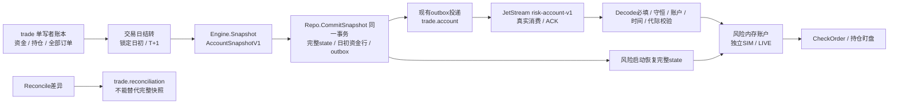

# N0-01 · trade → risk 完整账户合同实施记录

日期：2026-10-15。状态：**代码、领域合同与隔离PostgreSQL事务/NATS总线验收通过；完整服务级故障联调待补**。本记录不能作为自动交易或实盘准入证明。

## 1. 本次数据流



## 2. 合同和具体实现

- 共享合同为 `backend/pkg/accountstate.Snapshot`（AccountSnapshotV1），`version=1`、`kind=full`；显式 `account_type`、`account_id`、`snapshot_id`、递增 `generation`、`as_of`、上海 `trading_day`。
- 当前仅支持一个 SIM 和一个 LIVE 账本，各自 `account_id=default`，风险键包含账户类型；陌生 ID 拒绝，不合并成同一账户。尚未宣称支持多券商多账户。
- `cash` 是未扣在途冻结的账面现金；`frozen_cash` 为在途买单剩余金额加费用；`available = cash - frozen_cash`。负数或不守恒的完整快照拒绝，不能截断成零伪装正确。
- 持仓包含数量、T+1 后可用、在途卖出冻结、成本和账面市值。`available` 尚含在途卖出占用，最终可卖是 `available - frozen_sell`。在途单 `volume` 是**尚未成交量**；待确认、已报、部成、提交中、撤单中和 UNKNOWN 保留占用。
- `observed_order_ids` 来自权威订单账本，包含完整/部分成交和终态。风险预留仅在原订单 ID 被完整账本观察到后清除；经过两秒或 TTL 不是失败证明。超过 60 秒仍未观察到的预留保留，阻断新买单并要求核对原单。
- 对账状态有 `matched / blocked / unavailable`、时刻和原因。SIM 的 matched 表示本地完整账本通过合同检查；LIVE 尚无柜台读回，始终 unavailable，不编造初始实盘资金。快照时间和对账时间都要在有效期内才就绪。
- 对账差异单独发 `trade.reconciliation`；缺差异字段不再把持仓清空。成功的再次比对也不自动解除既有停止开仓状态。

金额沿用现有浮点/数据库 decimal 合同，守恒校验容差 0.02 元。不存在已实现的第二本账。

## 3. 日初、T+1 与快照事务

`trade_cash` 追加 `day_start_date/day_start_equity`，`account_snapshots` 追加可空 JSON `state`。旧聚合快照仍保留，风险不把旧摘要恢复成完整账户。使用 `go generate ./ent` 生成，启动仍走原自动迁移，无手写建表 SQL。

新的 SIM 账本以配置初始资金建立可信基线，快照和基线同事务保存。进程重启不以当前权益重置日初。旧账本缺少可信日初时显示未知并停止执行，不自动用当前数值回填；需要后续受控恢复/迁移核对。

交易日首次下单、撮合或快照在任何当日价格更新之前结转旧有效账期：以旧账面市值锁定日初，旧股转可卖，当日随后买入仍不可卖。同一天 `RollDay` 幂等，不能反复解锁股票或累加天数；非交易日不结转。若当日已经有成交、却没有当日日初记录，拒绝推定结转并保留原可卖数量。

自动结转不累加旧 `paper_days`。旧手动计数也不是连续运行证据，N7-03 必须另按真实交易日、覆盖、异常和对账证据登记准入。

完整快照行、初始化/日初资金行和对应 outbox 在**一个数据库事务**内写入；快照 generation 使用持久快照行 ID，失败回滚不会产生有效快照事件。此前“摘要写库成功但 outbox 未写”的窗口已消除。订单/成交/现金/持仓原 Commit 仍是自身账本事务。

读取账本和建立快照受当前单个 Engine 的写锁保护；**尚未提供跨多个 trade 实例的数据库 claim/lease/资金预留事务保证**。快照不是每笔成交同事务附带的读模型，仍按现有约十秒周期生成。N7 的持久执行意图、并发唯一约束、提交前最终风控和崩溃对账仍必需。

修正了两个相关账本问题：部分撮合后不会再用旧仓位覆盖新数量；没有在途委托时仍更新已有持仓的分钟线账面价格。账面价格为已有 last price，缺时回退成本；不把它冒充柜台实时估值或已验证的源时间。

## 4. 风险恢复与安全拒绝

风险启动先恢复参数、模式、Kill Switch、当日统计和最新完整账户 state，之后才标记服务启动完成并消费账户事件。恢复数据查询失败不就绪；恢复的旧完整状态可保留持仓可见性，但过期时拒绝订单和自动盯盘退出。

真实账户消费者使用 `accountstate.Decode` 检查 JSON 必填字段，明确空数组与缺数组不同；缺字段、null、错误版本/kind/账户、负现金、持仓或冻结不守恒拒绝。重复或较小 generation、较早 as_of、重复 snapshot_id 不覆盖已知状态。坏新帧不抹掉上一个有效快照，也不恢复执行资格。

`CheckOrder` 只有完整、新鲜、日初可信且对账 matched 的账户才能放行，人工卖出也不能以未知可卖量推定成功。原 Kill Switch / 模式 / 实盘准入政策保留；本次未开放任何实盘或 L3 权限。

账户主题改为持久消费者 `risk-account-v1`，新消费者从最后一条完整事件开始，先以数据库恢复各账本；已有消费者依其持久游标重放。全量事件使业务状态可按较新代际替换。非法信封终止，非法/陈旧载荷记拒绝后 ACK；可信来源固定为 trade。停机 Drain 保留 durable。

账户派生的仓位/损失限额在缺失、陈旧、日初未知或未对账时沿用既有 `-1 = 不可得` 协议并给原因；桌面必须归一化为“未知”，不能显示负仓位或 -100%。原引擎独立计数与参数限额保留。

## 5. 已运行的验证

在 `backend/`：

```powershell
go generate ./ent
go test ./pkg/accountstate ./app/trade/internal/... ./app/risk/internal/...
go vet ./pkg/accountstate ./app/trade/internal/... ./app/risk/internal/...
```

已通过的离线验收包括：

1. 真实 `Engine.Snapshot` 生产载荷与共享 `trade-produced-full-v1.json` 对拍；真实 `risk.ConsumeAccount` 消费同一 fixture，核对现金、冻结、持仓可卖和剩余订单。只规范化随机 snapshot_id，不跨 Go internal 边界强行导入。
2. JSON 必填、null、未知版本、部分载荷、错误账户、资金/权益/冻结不守恒；重复、乱序、过期和未来时间不清空已知账户。
3. SIM/LIVE 隔离；LIVE 未接入不编造资金；日初/代际跨 Engine 重启保留；风险恢复先于就绪，恢复失败不就绪。
4. 部分买入与再次撮合、挂单冻结、撤单释放、双重卖出阻断、当日 T+1、同日反复 RollDay、次日先锁定日初再撮合、缺基线且当日已成交不得解锁。
5. 缺账户/旧账户/缺日初/对账失败拒绝订单；风险预留不按时间静默释放；超时未知预留阻断新买，原 ID 被观察后释放。

`app/trade/internal/data/TestCompleteSnapshotAndOutboxCommitOrRollbackTogether` 在最初5432不可用时跳过；主任务随后启动本批独立PostgreSQL 55432，两个子用例已实际PASS，包含成功事务和注入outbox失败的原子回滚，并通过`-race`。只使用独立 `novatrader_account_contract_test` 库与随机测试账本，清理仅按本次行/事件ID，不触碰用户 `novatrader` 账本。显式指定`NT_TEST_PG_PORT`时不可达为FAIL，不再静默跳过。

本次没有实际 NATS 断线/重启、数据库崩溃或交易日长时运行测试，也没有真实委托。不得把离线合同测试写成这些环境验证已通过。

## 6. 下一步和回退

- 隔离PostgreSQL事务与NATS总线已验证，见[首批集成记录](首批集成-2026-10-15.md)。下一步演练真实trade/risk进程启动顺序、risk离线期间生成快照、重连与拒绝旧帧，不把单独总线测试当完整服务演练。
- N7 补持久风险批准/执行意图及跨实例原子占用，处理批准后崩溃到订单落账的窗口；当前风险内存预留不构成跨重启资金保证。
- 当前读取完整订单/成交历史以证明观察状态，规模增长后需持久意图和有水位的有界查询；尚未做高负载性能验收。
- 持仓保护价、持有交易日与原信号/持仓代际的可靠绑定仍属后续计划，不伪填；当前使用既有默认保护规则，持有日无信息时为 0，不触发时间止损。
- 旧账本日初缺失需受控核对；源行情时间、重复分钟线撮合、真实柜台撤单/UNKNOWN 恢复与完整最终风控属于后续执行验收，未由本合同替代。
- 回退仅回退本批业务代码，保留追加列和原账本；旧生产者摘要将被新风险消费者拒绝，不能为兼容而恢复“未知当空仓”。停新单并完成版本匹配后再恢复 SIM。
