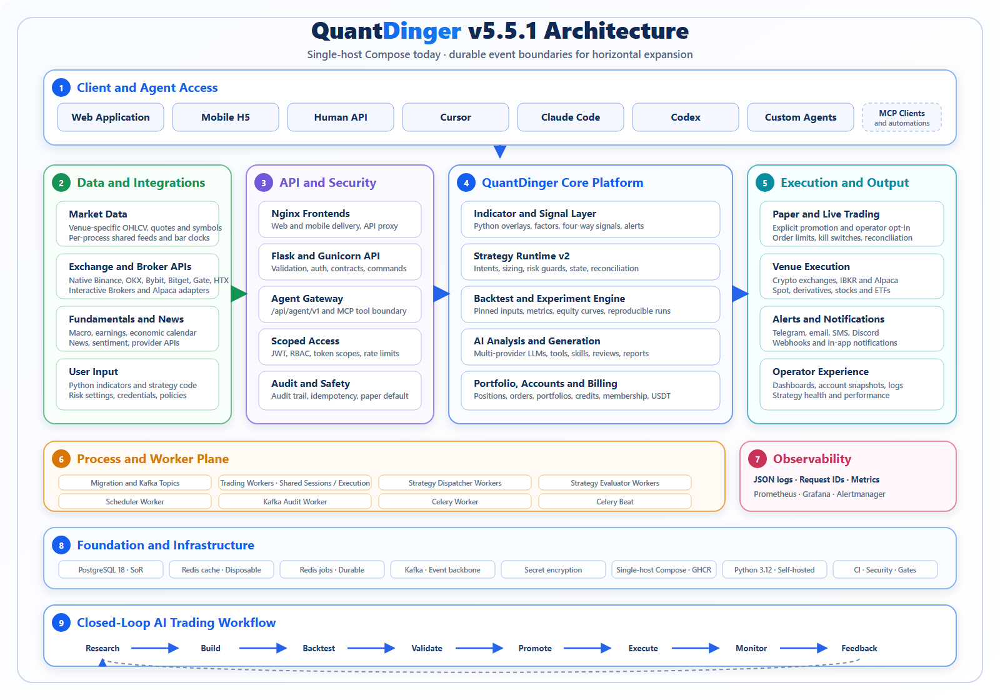
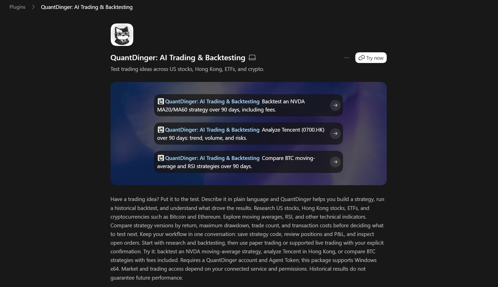
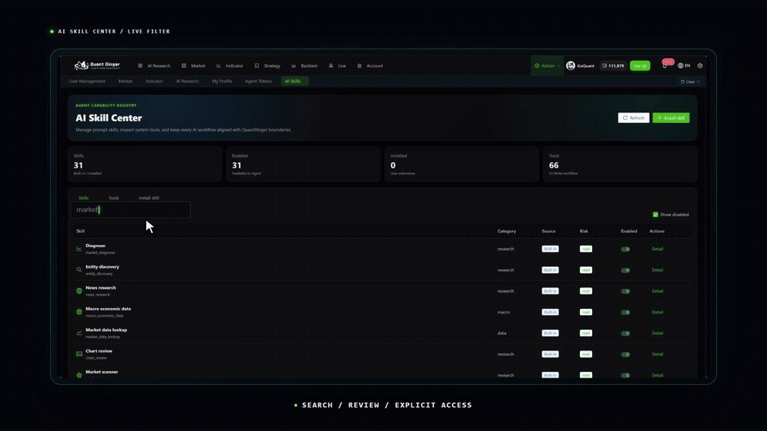
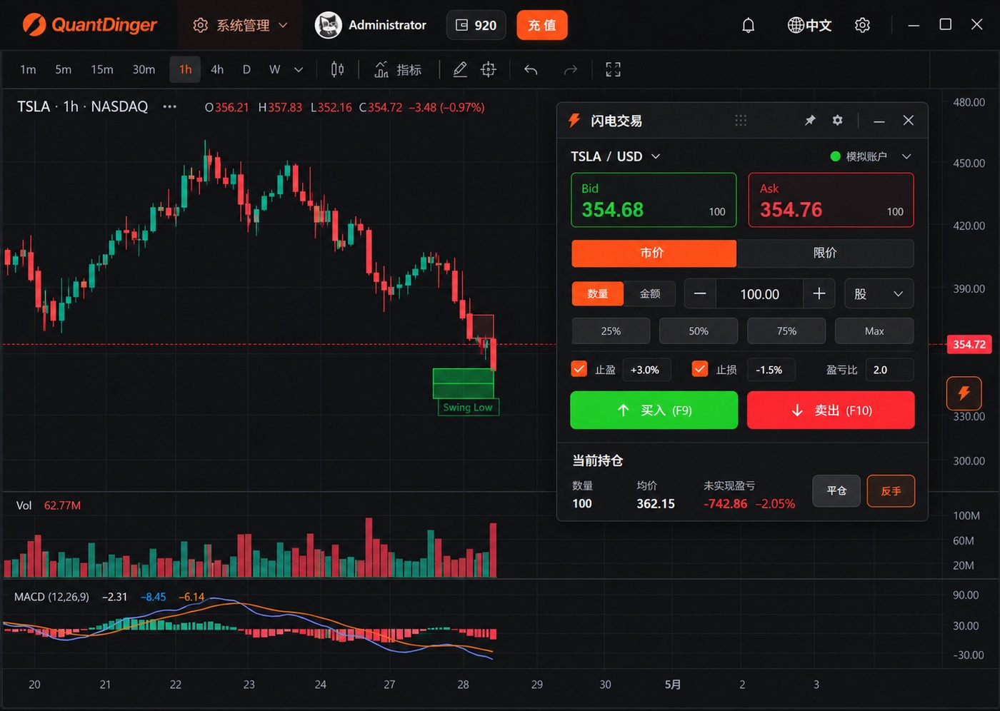

# QuantDinger 项目研究与 UI 深度分析（2026-10-25）

> 研究对象：<https://github.com/OpenByteInc/QuantDinger>（后端+文档，v5.6.1）与 <https://github.com/OpenByteInc/QuantDinger-Vue>（桌面 Web 前端）；
> 参考仓：QuantDinger-Mobile（Capacitor 移动 H5/安卓壳）、QuantDinger_Codex_Plugin（Codex 插件）。
> 目的：摸清 QuantDinger 的全部功能与全部 UI 界面细节，形成对 NovaTrader 的可借鉴清单。
> 状态：本文是**研究资料**，不改变本方任何架构决策（第 0 节 RAW 决策优先）。

---

## 0. TL;DR

**QuantDinger 是什么**：Open Byte Inc 出品的开源「AI 交易操作系统」，后端 Python 3.12（Flask+Gunicorn+Celery+多 Worker+Kafka+PG18+Redis），前端独立仓 Vue 2.7 + Ant Design Vue 1.x + KLineCharts 9，v5.6.1，Apache 2.0（前端仓为 source-available）。定位是把「AI 研究 → 指标/策略代码 → 校验 → 回测 → 进化 → 模拟/实盘执行 → 复盘」整条量化链路做成一个产品，对外再开一道 Agent Gateway（`/api/agent/v1`，52 条 OpenAPI path）+ MCP Server（58 工具）让 Cursor/Claude Code/Codex 等外部代理在 scope 权限内操作系统。

**最值得移植的 5 件事**（详见第 8 章）：

1. **AI 输出「响应契约」**：六种研究模式各配一段硬性输出结构 + 合规红线（无回测不得声称胜率、多空观望三条件并举、R/R<1 显式警告、超买≠做空信号、禁止编造缺失值）——直接映射到 NT brain 模块的 prompt 构造层，与「没取到≠0」数据纪律同构。
2. **`professional_report_v1` 结构化报告契约**：一个 schema 同时驱动聊天内卡片、公开分享页、PDF 导出，含决策面板/数据质量环/情景三卡/风险计划 8 格/断言-证据反查表——NT 的晨报/复盘/信号详情可照此建模。
3. **发布/实盘前置闸门**：`publish-readiness` 回测闸门（未过回测禁发布）+ JEV 交易前决策门（确定性风控 → JEV 判断 → LLM → 故障放行，全程审计）——与 NT 决策 3「模拟盘 20 交易日准入 + 风控先行」完全同构，可平移到 risk 服务。
4. **Agent Token scope 体系**：R/W/B/N/C/T 六档 + paper-only 默认 + 服务端 live 总闸 + 幂等键强制 + prefix 列表/一次性揭示——NT 未来对 LLM/外部代理开门时的现成蓝图。
5. **闪电交易浮窗范式**：Bid/Ask 双卡 + 市价/限价 + 25/50/75/Max + 止盈止损/盈亏比 + F9/F10 印在按钮上 + 持仓平仓反手——一套完整的下单面板设计蓝图（做红涨绿跌反转后）供 NT 交易面板参照。

**最大的 3 个反向教训**：

1. **巨石组件**：CopilotWorkbench.vue 8300 行、indicator-ide 9070 行、KlineChart 7048 行——NT 必须守住 panels 薄壳 + registry 拆分现状，只借交互模式不借文件组织。
2. **第三方 UI 框架硬覆盖地狱**：为压暗 Ant Design 1.x 用了 1600+ 行 BasicLayout.less + 452 行 override + 421 行 global.less 与大量 `!important`——印证 NT「禁装 UI 组件库、走自研 token」的正确性。
3. **国际涨跌色**：全书绿涨红跌/买绿卖红（含硬编码 `BUY:'green'`），任何色值借鉴必须经过 NT 红涨绿跌状态册重映射，禁止直抄 hex。

## 1. 研究方法与素材清单

### 1.1 为什么"高清运行图"只能这样来

用户要求「不要在本机上运行，想办法搞到高清运行图片」。实际勘察结果：

- **官方演示 GIF**（`docs/screenshots/quantdinger-v5-2x.gif`，271 帧 960×540，2 倍速宣传片）已逐帧提取（263 有效帧，存 `D:\temp\qd_frames\`）。甄别结论：**全片真实 UI 仅「AI 技能中心」一幕**（frame_0206/0226），其余为品牌字幕卡与架构动效。
- **官方高清设计原图**：`quick-trade-floating-console.png`（1487×1058，闪电交易浮窗+K线整屏）是唯一的全尺寸真实 UI 物料，已入库。
- **官网/YouTube 不可达**：本机网络下 `quantdinger.com` 超时、`youtube.com` 不可达，影片帧无从取得；GitHub API 与 codeload 可达。
- **发布物无附图**：10 个 Release 的正文均无 UI 截图链接；Mobile 仓（Capacitor）仅有启动图。
- 因此 UI 细节 = **官方两张真实 UI 图 + 架构图 + 前端源码 19 个视图目录的代码级逐页还原**（每个像素结论带文件:行号）。这是不跑本地部署前提下能做到的最高保真。

### 1.2 本报告图片索引（入库存放）

| 图 | 文件 | 来源 | 说什么 |
|---|---|---|---|
| 图 1 | `assets/quantdinger-2026-10-25/architecture-v5.png` | 主仓官方 | v5.5.1 架构总图（9 分区） |
| 图 2 | `assets/quantdinger-2026-10-25/ai-skill-center.jpg` | GIF 第 226 帧（第 206 帧的转场压暗副本） | AI 技能中心界面（转场态） |
| 图 3 | `assets/quantdinger-2026-10-25/quick-trade-floating-console.jpg` | 前端仓官方设计原图 | 闪电交易浮窗 + K 线整屏 |
| 图 4 | `assets/quantdinger-2026-10-25/ai-skill-center-detail.jpg` | GIF 第 206 帧 | AI 技能中心真实界面稳态（全片唯一真 UI 帧） |
| 图 5 | `assets/quantdinger-2026-10-25/codex-plugin-screen.jpg` | Codex 插件仓 | Codex 插件商店页 |

### 1.3 代码级勘察范围

- 后端仓全量（1217 文件）：`backend_api_python/`（Flask+Gunicorn+Celery+多 Worker+Kafka）、`mcp_server/`、`docs/`（61 份中英文档）、`ops/`、`docker-compose*.yml`。
- 前端仓全量（487 文件）：`src/views/` 19 个视图目录、`src/layouts/`、`src/components/`、`src/api/`、`src/locales/`（11 语言、50 个模块覆盖文件）、`src/styles/`。
- 分析方式：9 路并行代理深读 + 主会话逐张核图与抽样复核（重要结论均二次校验）。

---

## 2. 项目总览（功能全景）

### 2.1 定位、版本与多仓边界

| 项 | 内容 |
|---|---|
| 定位 | Open-source AI Trading OS：研究 / 策略 / 回测 / 执行 / 代理的闭环交易平台 |
| 版本 | v5.6.1（`backend_api_python/VERSION`），2026-10-25 时点 main 分支 |
| 许可证 | 主仓 Apache 2.0；前端仓 QuantDinger-Vue 为 source-available（非 OSI） |
| 主仓 | `OpenByteInc/QuantDinger`：后端 + 文档 + mcp_server + ops（1217 文件） |
| 前端仓 | `OpenByteInc/QuantDinger-Vue`：桌面 Web 前端（Vue 2.7，487 文件） |
| 参考仓 | `QuantDinger-Mobile`（Capacitor 移动 H5 壳）、`QuantDinger_Codex_Plugin`（Codex 插件，PyPI `quantdinger-mcp==0.6.2` 生态一部分） |
| 出品方 | Open Byte Inc；品牌 slogan「CLARITY FROM UNCERTAINTY」「From Strategy to Service」 |

### 2.2 技术栈一句话

后端 Python 3.12：Flask + Gunicorn（HTTP）+ Celery（有限任务）+ 多角色 Worker（trading/dispatcher/evaluator/scheduler/kafka-audit）+ Kafka（事件骨干）+ PostgreSQL 18（SoR）+ Redis ×2（可弃缓存 / 持久任务各一实例）；前端 Vue 2.7 + Vue Router 3(hash) + Vuex 3 + Ant Design Vue 1.x + Ant Design Pro Layout + ECharts 6 + KLineCharts 9 + CodeMirror 5 + Pyodide（浏览器内跑用户 Python 指标）。

### 2.3 v5 运行时架构（9 分区）



图 1（主仓官方架构图）九个编号分区：① Client and Agent Access（Web/H5/Human API/Cursor/Claude Code/Codex/MCP Clients）；② Data and Integrations（行情、交易所/券商 API、基本面与新闻、用户输入）；③ API and Security（Nginx、Flask/Gunicorn、Agent Gateway `/api/agent/v1`、Scoped Access、Audit and Safety——框内即写「audit trail, idempotency, **paper default**」）；④ Core Platform（指标信号层、Strategy Runtime v2、回测引擎、AI 分析生成、组合/账户/计费）；⑤ Execution and Output（Paper/Live「explicit promotion and operator opt-in」、Venue Execution、Telegram/email/SMS/Discord/webhook 告警、Operator Experience）；⑥ Process and Worker Plane（migration、kafka-topics、trading/dispatcher/evaluator/scheduler/audit 五 Worker、Celery worker/beat）；⑦ Observability（JSON logs、Request IDs、Prometheus/Grafana/Alertmanager）；⑧ Foundation（PG18、Redis×2、Kafka、加密保管、单机 Compose+GHCR）；⑨ Closed-Loop AI Trading Workflow（Research→Build→Backtest→Validate→Promote→Execute→Monitor→Feedback 回环）。

**进程角色纪律**（`docs/architecture/PROCESS_ROLES_AND_TASKS.md`）：HTTP 进程不启动任何交易/调度线程；命令以 PG `SKIP LOCKED` 拉取，`qd_strategy_runtime_leases` fencing token 单调递增；`LeaseHeartbeat` 用专用短事务连接（3s 超时）续约；`qd_worker_heartbeats` 表驱动 `/api/health/workers` 三角色心跳总览；Celery 只承载有限任务，禁长生命周期 runtime。

**Kafka 主题**（`app/events/topics.py`）：`qd.market.bar.closed.v1`（6 分区，3 天）/`qd.strategy.lifecycle.v1`（12，7 天）/`qd.strategy.evaluate.v1`（12，3 天）/`qd.order.intent.v1`（12，30 天）/`qd.order.event.v1`（12，30 天）/`qd.runtime.dlq.v1`（3，30 天 DLQ）；另有独立 kafka-audit-worker 专做事件契约校验。

### 2.4 数据面全图

- **行情源**（`app/data_sources/`）：A 股/H 股多层 fallback、腾讯免 key、美股、加密（原生 REST）、外汇、期货、MOEX；配 `cache_manager`（缓存）/`circuit_breaker`（熔断）/`rate_limiter`（限速重试）三件套。
- **聚合数据**（`app/data_providers/`）：热力图（crypto/forex/commodities/indices）、经济日历（免费优先+Finnhub 兜底）、VIX/DXY/Fear&Greed 情绪、Adanos 美股情绪（可选）、宏观时序、跨市场机会扫描、公司研究（免费优先、带源标签）。
- **券商/交易所适配**：IBKR、Alpaca、Binance（+Spot）、Bitget（4 变体）、Bybit、Gate.io、HTX、OKX；凭证加密 `credential_crypto`；券商×市场×品种×方向能力发现 `/api/policy/broker-market`。
- **point-in-time universe**：上证 50/沪深 300/中证 500/800/1000、SP500/NDX100/DJ30/SP400/SP600/Russell1000、加密 Top100、恒指/恒生科技 30/国企 50/港股通；导入器只回填可审计历史、绝不把当前成分倒填为历史；基本面 `qd_fundamental_snapshots` 区分 `period_end`/`available_at`，回测仅从 `available_at` 可读、缺失市值不伪造。

### 2.5 功能地图（按域速览）

| 域 | 一句话 |
|---|---|
| AI 研究 | Copilot 工作台：6 研究模式 + 响应契约 + SSE 七事件流式 + ```chart 图表协议 + 专业报告 v1 + 双层记忆 |
| 快速分析 | `/api/fast-analysis/analyze`，schema_version 信封（report/runtime/billing 三段） |
| 指标 | IDE（CodeMirror+Pyodide+AI 生成）+ 信号告警 + 社区市场（购买/评论/审核） |
| 策略 | IDE（Strategy API V2 源码主权）+ 生命周期（CRUD/启停/命令轮询）+ 机器人模板（grid/dca/martingale/layered）+ AI 工作区 + 发布闸门 |
| 回测 | 异步 jobs + 组合/因子双模式 + 全指标口径（每项含状态位）+ K 线逐笔复盘 |
| 进化 | 参数空间 → random/grid/tpe 搜索 → walk-forward（先盲测）→ PBO/DSR/蒙特卡洛/费用压力 → 应用最佳参数闭环 |
| 执行 | Paper/Live 显式晋升 + JEV 决策门 + 快交易（QuickTrade）+ kill-switch + 网格 actor |
| 账户 | 券商凭证（加密）+ 账户快照/持仓读模型 + 仓位归属对账 |
| 计费 | 积分 credits + 会员套餐 + Stripe + USDT + 推荐奖励提现 |
| 组合 | 手工持仓 + AI 监控（monitors）+ 价格告警（alerts）+ 分组 |
| 社区 | 指标/策略市场：列表/详情/性能/评论/购买/同步/作者台/管理员审核 |
| Agent | `/api/agent/v1` 52 path + scope（R/W/B/N/C/T）+ 幂等键 + 审计 + MCP 58 工具 |
| 管理 | 用户 CRUD/角色/积分/登录日志、设置 schema、AI 技能注册、Agent token 签发、OpenRouter 余额、连通性测试 |
| 观测 | `/health/ready`、`/api/health/workers`、`/metrics`、独立 observability 模块 |

## 3. 功能清单（逐域详表）

> 依据：`docs/api/openapi.yaml`（人 API ≈230 个 path 项）+ `docs/agent/agent-openapi.json`（52 path）+ `backend_api_python/app/routes/` 实测。人工 API 信封：`{code:1,msg,data}`；Agent API 信封：`{code,message,data}` + `{details,retriable}`。

### 3.1 人工 API 端点分组总表

| 分组前缀 | Path 数 | 要点 |
|---|---:|---|
| `/health*` `/metrics` | 6 | 存活/就绪/worker 心跳总览/Prometheus |
| `/api/auth` | 14 | 登录、MFA(TOTP)、验证码、注册、密码重置、Google/GitHub OAuth、Turnstile 人机校验、登出 |
| `/api/users` | 31 | 用户 CRUD/导出/角色/积分/VIP/登录日志/通知设置/图表模板/管理员订单确认/AI 用量统计 |
| `/api/market` | 10 | 市场配置、标的搜索/热门、自选增删查/价格 |
| `/api/universes` | 8 | 时点化股票池：列表/克隆/成员/快照/admin 同步 |
| `/api/factors` | 7 | 版本化因子目录、因子研究提交、基本面覆盖度/同步 |
| `/api/indicator` | 15 | 指标 IDE 全家 + 信号告警 CRUD/暂停/恢复/测试 |
| `/api/backtest` | 9 | 异步 jobs、同步 run、因子研究、历史/详情 |
| `/api/strategy-evolution` | 6 | 参数空间/规模估计/进化 jobs/取消 |
| `/api/strategies*` + `/api/account` | 44 | 策略生命周期最大簇（见 §3.4） |
| `/api/credentials` | 7 | 凭证 CRUD/连通性/出口 IP（加密保管） |
| `/api/dashboard` | 3 | 汇总、挂单查询/删除 |
| `/api/settings` | 9 | schema/公开配置/品牌/行情目录同步/连通性测试/OpenRouter 余额 |
| `/api/portfolio` | 13 | 手工持仓、monitors、alerts、分组 |
| `/api/ibkr` `/api/alpaca` | 9+11 | 两家券商全操作面 |
| `/api/global-market` | 8 | 总览/热力图/新闻/日历/情绪/机会扫描 |
| `/api/community` | 19 | 指标市场全链（含管理员审核） |
| `/api/fast-analysis` | 8 | 分析/数据源/历史/反馈/绩效/相似形态 |
| `/api/billing` | 14 | 套餐/积分/crypto/USDT/Stripe/webhook/推荐奖励/提现审核 |
| `/api/quick-trade` | 8 | 下单/余额/持仓/平仓/撤单/历史/仓位保护 |
| `/api/ai` | 22 | 聊天/技能/记忆/报告（最大单文件路由，3472–4718 行全是 route） |
| `/api/policy` | 1 | 券商×市场能力发现 |

### 3.2 AI 研究 / 分析域

- **Copilot 工作台**：会话管理（30 条上限）、常用问题库、6 研究模式（research/diagnosis/technical/plan/news/macro）、起手 prompt（优先级+用量回流排序）、追问建议（按 intent 重排）、图片附件（png/jpeg/webp，可粘贴）、上下文锁定（locked_symbol_policy）、双层记忆（会话摘要+长期偏好先问后存）。
- **任意式快速分析**：`POST /api/fast-analysis/analyze`，必填 market+symbol，可选交易所路由身份；`response_contract ∈ {legacy, professional_report_v1}`；信封含 `runtime{memory_id, analysis_time_ms, llm_time_ms, data_collection_time_ms}` + `billing{credits_charged, remaining_credits}`，失败走退款路径；辅助端点：数据源/历史/删除/反馈/绩效/相似形态。
- **文本内图表协议**：```` ```chart ```` fenced JSON（line/bar/area/pie/scatter，≤8 series、≤240 点），mermaid pie/xychart-beta/flowchart 亦转图表。
- **专业报告**：`professional_report_v1` schema → 聊天内嵌卡 + `/report/share/:token` 公开页 + PDF 导出三处复用。
- **AI 技能注册**：read/write_draft/write_config 三级风险、内置 vs 安装、manifest JSON 安装（仅 prompt、无代码、用户可控）；调度分析是对话式工作流（先问清 interval/渠道/条件再落库）。
- **LLM 提供方**：OPENROUTER/OPENAI/GOOGLE/DEEPSEEK/GROK/ATLASCLOUD/CUSTOM/MINIMAX 八家，每家 `base_url/default_model/fallback_model`；错误码映射 provider_unavailable/overloaded；`last_provider_used/model_fallback_used` 暴露降级事实。

### 3.3 指标 / 社区域

- **指标 IDE**：Python 指标在浏览器 Pyodide 执行（返回 `{plots,signals,calculatedVars}` JSON）；`# @param` 注释驱动参数表单；版本历史（不可变版本+恢复）；代码质量 hints（error/fatal 阻断发布）；AI 生成走 SSE，候选 edit_plan 精确替换 + 8s 变更行高亮；信号告警（条件、渠道、暂停/恢复/测试）。
- **指标社区**：市场/作者台/管理员审核三 tab；定价（免费/付费/vip_free）+源码可见性过滤；卡片封面图 + 绩效四格；详情含 marketplace_contract（绑定模式/绑定标的/频率/warmup/数据字段）+ 回测证据（综合分/样本数/有无实盘证据）+ 评论（一人一评可改，评分必填，500 字）；购买 → 续步本地副本；作者台四统计卡 + published/sales；管理员 review-stats/pending/下架。

### 3.4 策略域（生命周期 + V2 契约）

- **策略实例**：CRUD、start/stop（`close_positions` 显式）、command 异步轮询、运行健康（latency/pending_orders）、净值曲线、绩效、日志、通知、仓位、**仓位归属对账（含修复）**、复核报告、干跑偏差、资产配置。
- **机器人模板**：grid/dca/martingale/layered_martingale 四模板（版本号 6）；模板页 = `templates/preview/generate/create` 四端点；preview 返回 levels 明细 + `risk_diagnostics`（如 `hard_stop_blocks_level` 给建议止损值）；双层风控（单轮 cycle / 总权益 equity）。
- **Strategy API V2**：源码声明市场/universe/频率/订阅/日程/杠杆/交易逻辑；编译出 manifest（API 版本+source hash、universe 类型、全 timeframes、warmup、生命周期 handler、因子依赖）；`# @param` 注释域（range/values，单参最多 1024 候选，默认值须与代码兜底一致）；时机模型「收盘确认 + 次根开盘成交」防未来泄漏；`direction_mode` 五档 + one_way/hedge 适配；保护钩子（stop_loss/take_profit/trailing/time_limit，`initialize` 禁调）；沙箱白名单（禁 eval/exec/open/网络/文件/DB/反射；`pandas.read_*/to_*` 也禁）。
- **策略进化**：method random/grid/tpe；folds 4–10、train_ratio 0.55–0.85、blind_ratio 0–0.3、embargo_bars；自动剪枝；TPE 采样器（good/bad split + kernel density ratio）；综合分五权（return/sharpe/drawdown/stability/decay）×√evidence×active_fold_rate；PBO（logit 平均）+ Deflated Sharpe + 块自助蒙特卡洛 + 费用乘数压力；`recommended` 判定 = 样本足 + oosReturn>0 + 盲测通过/缺失。
- **AI 决策门（JEV）**：开仓信号 → 确定性风控 → Decision Context V2 五子件 → JEV System One 类型化判断（数据质量/信号一致/市场状态/账户风险/执行质量/开仓判断）→ 收敛器 PASS/REJECT；LLM 兜底；故障放行且记录；平仓/止损/止盈/紧急减仓绕过；grid/dca/martingale 策略排除在外；决策历史为独立查询 API。

### 3.5 回测 / 因子研究域

- **回测中心**：组合（CTA/组合策略）+ 因子双模式；异步 job（progress.phase/percent）+ 历史（limit 24）+ 整体回填表单；`backtestRangePolicy`（maxSelectedDays/timeframeSeconds/warmupBars）驱动日期收缩。
- **指标口径**：`resultStatus{completed_trades|no_signals|open_position_only}`；totalReturn/benchmark/excess/maxDrawdown/sharpe/winRate/feeDrag；Sortino（无下行→null 而非 ∞）/Calmar/下行标准差/回撤生命周期（durationDays/recoveryDays/recovered/recoveryFactor）；基准相对九格+advanced（IR/β/α/Treynor/ρ/R²/上下捕获/captureRatio/M²/M²α/upβ/downβ/βspread/batting/payoff），每项独立 `*Status`；无风险利率硬编码 0 且显式披露；破产语义（归零强平 + liquidationAdjustment）。
- **成交账本**：`orderLedger`（fill/defer/reject+理由）、totalExecutions(fill) vs totalTrades(round-trip)、`partial` 不算成交、holdingSnapshots/rebalanceRecords（目标/实际权重/换手/现金后/订单健康 f/p/d/r）、attribution（行业/已实现/未实现/佣金/净贡献）。
- **因子研究**：rankIc/icir/icPositiveRate/monotonicity/coverage/missingRate/averageTurnover/netLongShortReturn 8 卡；winsorize_zscore → IC(Pearson)/RankIC(Spearman，样本<3 显式 coverage=0)；分位 2–10 组；holdingPeriod 1–60；行业中性化；`sampleDiagnostics{quality,warnings[]}`；factorCorrelation 矩阵；`effectiveGroups<requestedGroups` 显式调整。

### 3.6 执行 / 账户 / 计费域

- **QuickTrade**：下单/余额/持仓/平仓/撤单/历史/仓位保护 8 端点；UI 为可拖拽浮窗（详见 §5.13）；不走 AI 决策门（确定性校验+用户显式确认）；agent 通道有 kill-switch（撤单+吊销全部 T token+审计）。
- **账户**：`/api/account/snapshot|positions` 读模型；凭证加密 + 出口 IP + 连通性测试；券商策略 `/api/policy/broker-market` 能力发现。
- **计费**：积分 credits（AI 调用逐次扣）、会员套餐、Stripe（create+webhook）、crypto/USDT 链、推荐奖励 + 提现审核；管理员订单人工确认。
- **组合**：手工持仓 CRUD/汇总、AI 监控（`run_interval_minutes`+渠道）/手动触发、价格告警、分组改名。

### 3.7 Agent Gateway / MCP（52 path）

- **隔离**：仅 Agent Token（`qd_agent_xxx`），永不混用人类 JWT；每次调用写 `qd_agent_audit`。
- **Scope**：R 读 / W 工作区写 / B 回测 / N 通知副作用 / C 凭证（仅管理员签发）/ T 交易资金；附 markets/instruments 白名单、paper_only、rate_limit_per_min、max_order_notional、max_daily_notional、expires_at。
- **T 实盘四闸**：scope 含 T + paper_only=false + 服务端 `AGENT_LIVE_TRADING_ENABLED=true` + 白名单/上限已配；缺一只走模拟。kill-switch：撤实盘挂单 + 清纸单 + 吊销该租户全部 T token + 审计人工程序跟进。
- **幂等**：所有 W/B/N/T 强制唯一 `Idempotency-Key`（完全同方法/路径/query/body 才可复用）；429 带 `Retry-After`，响应带 `X-RateLimit-*`。
- **工具面**：健康/whoami、行情、策略部署、Strategy Source（authoring-contract/templates/compile/版本/恢复 confirm=true）、回测异步（jobs/stream/cancel）、指标（authoring-contract/validate/link-config）、研究（universe/factor/watchlist）、交易观测、通知（signal-alerts）、组合、quick-trade、admin/tokens/audit、自助 me/tokens。
- **MCP Server**：PyPI `quantdinger-mcp` 0.6.2，58 工具镜像同面；stdio 默认，`sse/streamable-http` 可切；`QUANTDINGER_MCP_AUTH_TOKEN`(≥32 字符) 与上游 token 职责分离；非回环需 HTTPS；每个 W/B/N/T 工具要 `idempotency_key` 与显式 `confirm_*=true`；`place_quick_order` 可附加 tp/sl。



### 3.8 管理 / 设置 / 观测域

- **用户管理**：CRUD/导出/角色/积分调整/VIP/登录日志/管理员总览/AI 用量统计/管理员订单确认。
- **设置**：`schema` 驱动的设置表单、公开配置、品牌配置（logo/contact/legal/social）、行情目录同步、值读写、OpenRouter 余额、连通性测试——设置路由文件是仓库内「高危遗留」（2000+ 行单文件）。
- **Agent 管理**：token 签发/吊销（admin 面）、审计查询；自助面 `/me/tokens` 分离。
- **观测**：`/api/health/ready`、`/api/health/workers`（trading/scheduler/celery 三角色心跳）、`/metrics`；结构化 JSON 日志 + Request ID；可观测模块独立 `app/observability/`。

## 4. UI 总览：信息架构与设计系统

> 证据根：`research-worker/quantdinger-vue/src/`（下称 `qdv`）。技术栈：Vue 2.7 + Vue Router 3（hash）+ Vuex 3 + Ant Design Vue 1.x + Ant Design Pro Layout + Less。

### 4.1 路由与菜单树

- hash 路由；公开路由四个（`/report/share/:token`、`/strategy-runtime` 重定向、`/user/login`、`/404`），受保护路由全挂在 `BasicLayout` 的 `/` 下、**默认重定向 `/ai-asset-analysis`**（`config/router.config.js:4-151,157-193`）。
- 菜单树（侧边栏固定顺序，`layouts/BasicLayout.vue:586-611`）：

| 顺序 | Path | i18n key | icon | keepAlive | 权限/能力 | 备注 |
|---|---|---|---|---|---|---|
| 1 | `/ai-asset-analysis` | `menu.dashboard.aiAssetAnalysis` | appstore | ✓ | dashboard | 默认首页（AI 研究） |
| 2 | `/indicator-community` | `menu.dashboard.community` | shop | ✗ | `marketplace_enabled` | 指标市场 |
| 3 | `/indicator-ide` | `menu.dashboard.indicatorIde` | line-chart | ✓ | dashboard | 指标 IDE |
| 4 | `/strategy-ide` | `menu.dashboard.strategyIde` | code | ✓ | dashboard | 策略 IDE |
| 5 | `/backtest-center` | `menu.dashboard.backtestCenter` | bar-chart | ✓ | dashboard | 回测中心（含进化/因子） |
| 6 | `/strategy-center` | `menu.dashboard.strategyCenter` | cluster | ✓ | dashboard | 实盘工作台 |
| 7 | `/broker-accounts` | `menu.dashboard.brokerAccounts` | bank | ✓ | dashboard | 券商账户 |
| 8 | `/billing` | `menu.billing` | wallet | ✗ | `billing_enabled` | 计费 |
| 9 | `/profile` | `menu.myProfile` | user | ✗ | dashboard | `menuDividerAfter` 锚点 |
| 10 | `/user-manage` | `menu.userManage` | team | ✗ | **admin** | 用户管理 |
| 11 | `/agent-tokens` | `menu.agentTokens` | api | ✗ | **admin** | Agent token |
| 12 | `/ai-skills` | `menu.aiSkills` | experiment | ✗ | **admin** | AI 技能 |
| 13 | `/settings` | `menu.settings` | setting | ✗ | **admin** | 系统设置 |

隐藏路由：`/universe-manager`（hidden）、旧路径重定向四枚（`/indicator-analysis→/indicator-ide`、`/dashboard→/strategy-center`、`/ai-analysis/:pageNo?→/ai-asset-analysis`、`/portfolio→/strategy-center`）。

- **meta 协议六字段**：`title / icon / keepAlive / permission / capability / menuDividerAfter(+hidden)`（`router.config.js`），路由生成时由 `filterRoutesByPermission`（`router/generator-routers.js:13-43`）按 `meta.permission∋admin` 与 `capabilities[key]===false` 一刀切。能力位三枚：`billing_enabled / marketplace_enabled / registration_enabled`（`store/modules/features.js:3-8`）。
- **顶栏模式再分组**（`BasicLayout.vue:612-717`）：AI Workspace / Marketplace / Indicators / Strategy Lab / Backtest Center / Live Monitor / Broker Accounts；`/billing`、`/profile` 剔除；admin 四项折进顶栏右上 `a-dropdown`。

### 4.2 布局三件套

- **ProLayout 骨架**（`BasicLayout.vue`）：menuHeaderRender=BrandIdentity（宽/折叠双 logo）→ headerContentRender=页标题+刷新按钮 → rightContentRender=头像/通知/语言/设置 → footerRender=空（页脚被全局隐藏）→ setting-drawer（420px）→ multi-tab（36px）→ route-view（keep-alive）。`siderWidth:208 / collapsedWidth:60 / 顶栏 60px`。
- **侧边栏**：菜单项 44px 高 / 14px / 500 字重 / 圆角 8px；选中 650 字重；admin 分隔线是 MutationObserver 注入的 DOM hack（`BasicLayout.vue:727-751`）。曾设计的「联系我们/法律/版权/版本」sider footer 已禁用（`v-if="false"` 死代码），搬到 SettingDrawer 内。
- **内容区**：`qd-layout-dark-override.less:1-11` 把 ProLayout 默认 24px gutter 硬重置为 0，页面自控边距；实际视高 `100vh − 60px − 36px`。
- **多标签 MultiTab**（JSX 组件，`components/MultiTab/`）：右键四操作（关当前/右/左/其他）+ 末尾垃圾桶；**tabKey 默认只用 path 不用 fullPath**（`tabIdentity.mjs:1-23`，page 带 query 共享状态）；关 tab 时经 `cacheControl.mjs:17-35` 精确驱逐该 route 的 keep-alive 缓存实例。
- **无 Popout**：全仓无 `window.open`/多窗机制；多工作区完全依赖 hash SPA + MultiTab——与 NT dockview+popout 路线形成对照。
- **响应式**：≤480px 强制 Fluid；≤1366px 压缩 logo 与顶栏 padding；≤920px 隐藏积分/充值（`AvatarDropdown.vue:363-371`）。

### 4.3 设计令牌（ tokens 体系）

- **唯一集中 token 文件** `styles/workspace-system.less:2-21`：`--qd-space-1..5`（4/8/12/16/20）、`--qd-control-height:30px`、`--qd-radius-sm/|--/lg`（6/10/14）、`--qd-border:#e2e8f0 / -strong:#d5dde8`、`--qd-surface/-subtle/-hover`、`--qd-shadow-card/raised`、`--qd-focus-ring`（`color-mix(in srgb, var(--primary-color) 14%, transparent)`）。
- **文字**：字体栈 `'SF Pro Text','Segoe UI Variable Text',Inter,'HarmonyOS Sans SC',MiSans,'PingFang SC','Noto Sans SC','Microsoft YaHei UI'`；`font-feature-settings:'kern' 1,'tnum' 1`（数字等宽）；正文 **12px**（偏密集）、表格 th 11 / tbody 12、页头 H1 22px/720；文字色三阶 `#1f2937/#5f6b7a/#8a94a3`，暗色 `rgba(255,255,255,.85/.65/.45/.25)`。
- **主色**：构建基线 `#1890ff`，**应用默认 `#52C41A`（绿）**；SettingDrawer 8 预设色板（dust/volcano/sunset/cyan/green/daybreak/geekblue/purple）；运行时换色 = hex 线性 mix 派生 hover/active/soft/softStrong/ring 五个 `:root` 变量 + 注入 `<style id="qd-runtime-theme-color">` 长串选择器硬覆盖 antd（`SettingDrawer/themeColor.js:36-392`）。
- **涨跌/决策色（散在代码里硬编码）**：正/买 `#52c41a·#16a34a·#22c55e`；负/卖 `#f5222d·#ef4444·#dc2626`；持有 `#faad14`；AI 监控 `#722ed1`、价格预警 `#faad14`、trade `#13c2c2`、security_login `#fa541c`（`NoticeIcon.vue:296-310`）。**`NoticeIcon.vue:124` 写死 `BUY:'green',SELL:'red'`——国际绿涨红跌**。
- **背景三层**（亮/暗）：全局 `#f0f2f5`/`#0a0a0a`；侧栏白/`#0a0a0a`；顶栏白/`#111111`+1px 内发光（override 文件又写成 `#0f0f10`）；内容 `#f0f2f5`/`#141414`；卡片白/`#1c1c1c`(border `#2a2a2a`)；Modal/下拉 `#1c1c1c`/`#1f1f1f`。

### 4.4 主题机制（三态暗色）

- 三态 `light/dark/realdark`（默认 **realdark**）；传给 ProLayout 时 dark/realdark 都映射为 dark，realdark 只影响自定义覆盖——**一个主题打两个 body class**（`.dark` 总开关 + `.realdark` 加强档），所有覆盖 less 写 `body.dark, body.realdark` 双选择器。
- 覆盖文件加载序（`main.js:14-17`）：antd-vars.less（9 行）→ global.less（421 行全量暗覆盖）→ qd-layout-dark-override.less（452 行布局专覆，注释自述必须后加载）→ mobile-responsive.less（590 行）→ workspace-system.less；最后运行时 `<style id="qd-runtime-theme-color">`。
- **首开防白闪**（`index.html:9-25`）：内联 **`同步`** JS 在框架启动前读 `localStorage.nav_theme + qd-ui-primary-color`，给 `<html>` 打 `qd-loading-light/dark` 类渲染首屏骨架——第一帧即匹配用户主题。

### 4.5 全局组件件件有出处

| 组件 | 要点 |
|---|---|
| Dialog.js | `$dialog(component, props, modalProps)` 函数即组件；`body>div[type=dialog]` 单例挂 Vue 实例；onOk/onCancel 可返 Promise 延迟关闭（114 行） |
| MultiTab | 见 §4.2 |
| NoticeIcon | 顶栏 Bell+badge → popover 380px 列表（全部已读/清空）→ 660px(HTML 报告 900px) modal 详情；30s 轮询未读数+visibilitychange；signal_type 十枚举 `ai_monitor/price_alert/signal/indicator_signal/buy/sell/hold/trade/security_login/profile_test`；相对时间四档（justNow/minutesAgo/hoursAgo/daysAgo） |
| Turnstile | Cloudflare 人机校验单例脚本加载，15s 超时，错误六态枚举 |
| SelectLang | 11 语言短码；切阿语时 `<html dir=rtl><body class=rtl>` |
| BrandIdentity | 宽/折叠双 logo，支持后端 override；暗色用 `brightness(0) invert(1)`+clip-path 纯 CSS 做多套变体，不多套图 |
| PageLoading | `$loading.show/hide` 单例 |
| SettingDrawer | 420px 右抽屉：主题色 8 板/主题三态/布局/多标签开关 + 联系/法律/版权/版本区 |

### 4.6 状态管理（Vuex 六模块）

`app`（布局/UI 偏好，全部 mutation 同步 localStorage；theme 默认 realdark、color 默认 #52C41A、multiTab 默认 true）、`user`（token 7 天）、`brand`（品牌配置 `quantdinger.brand-config.v1` 先缓存渲染后后台拉）、`policy`（券商市场策略，sessionStorage 会话级）、`features`（三能力位）、`permission`（async-router）。启动链：`bootstrap.js` 提交布局偏好 → fire-and-forget 拉品牌/策略 → router.beforeEach 无角色则 `GetInfo + GenerateRoutes → resetRouter → addRoute → next(replace)`；`401` 硬登出，**其他错误降级为默认角色不登出**（离线容错设计，`permission.js:74-83`）。

### 4.7 i18n

vue-i18n，默认/fallback en-US；11 语言主文件（zh-CN.js 7717 行、en-US.js 7416 行）+ **50 个业务模块 overrides**（copilot/profile-security/broker-account-workspace/strategy-v2/quick-trade-floating/backtest-workbench…）异步 `import()` 分割；切语言时合并该语言全部 overrides 再写 `lang/dir`。zh-CN 顶层 key 分组规模前五：dashboard 787、settings 690、indicatorIde 490、aiAssetAnalysis 311、profile 255。

## 5. 逐页 UI 深析

> 每页给：布局分区 → 控件明细 → 状态设计 → 图表约定 → 数据契约要点。行号根目录均为 `qdv/src/`。

### 5.1 AI 资产分析页 `/ai-asset-analysis`（Copilot 工作台，默认首页）

**页面壳**：`views/ai-analysis/index.vue` 薄壳渲染 `<CopilotWorkbench/>`（约 8300 行单文件，全站最大组件），支持 `embedded` 嵌入他页；主题从 Vuex 读 theme/color 挂 `theme-dark` 类 + `--primary-color`。背景亮 `#eef3f8` / 暗 `#0a0a0a`。

**三栏栅格**（`CopilotWorkbench.vue:4972`）：`minmax(240px,280px) | minmax(560px,1fr) | minmax(270px,320px)`；≤1360px 收窄，≤960px 单列且左栏变抽屉（backdrop+trigger）。

- **左栏·会话面板**：头部 history 图标+标题+「newChat」link；会话行限 30 条（标题+副标题 `context_symbol||context_market`+悬停删除 popconfirm）+ `empty-mini` 空态。
- **左栏·常用问题库**：book 图标标题；条目卡（标题+`context_symbol||category`）点击填充输入框，删除 popconfirm；空态文案引导「可在任一回答下点击保存问题」。
- **中栏·欢迎空态**：search 图标+标题+描述 + **研究模式切换条**（role=tablist，6 枚图标按钮）+ 起手 prompt 胶囊至多 4 条 + 常用问题预览至多 4 条。
- **中栏·消息流**：头像（assistant=thunderbolt、user=smile）、附件缩略行、`v-html` 自研 markdown 渲染、**报告折叠卡**（icon+标的+decision pill buy/sell/hold + 摘要 + 三指标条「置信度%/当前价/R-R」，R/R<1 橙色警告）、流式 `stream-warning` 条、**agent_usage 折叠区**（`<details>`，skill=experiment/tool=api 两色 chip 的证据标注）、动作行（复制回答/保存问题/动态 action/复制代码）、时间戳。
- **中栏·输入区**：上下文条（focusSymbol 标签 + 场景标的选择器 `a-select size=large` 远程搜索带市场彩色 pill + 「专业报告」按钮 + **记忆状态按钮**「Remembered: symbol·timeframe」）→ 引用报告 chip → 策略引导卡 → textarea（98–236px 自适应、Enter/Ctrl+Enter 发送、**粘贴即附图**）→ 底行左=常驻风险免责声明（safety-certificate 图标），右=上传图片+发送。
- **右栏·自选股**：刷新 + block 主按钮加自选；卡限 12 条（symbol+name | 实时价+涨跌着色），悬停三动作（询问/建监控/删除）。
- **右栏·监控面板**：卡限 8 条（symbol|interval|channels|running-paused），暂停/继续/删除。
- **四(+1)弹窗**：事件详情 680px（影响力三档 pill + Actual/Forecast/Previous 三栏 + AI 预览 + 「Ask AI about this event」）；创建监控（interval select 60/240/720/1440 + browser/email/telegram/webhook checkbox）；加自选 620px（市场 tabs + 260ms 去抖搜索 + seq 防竞态）；**记忆管理 720px 两节**（本会话：摘要卡 selected_target/timeframe/active_workflow/stable_constraints + **上下文遥测卡**——最近输入 token 估算/带入历史消息数/长期记忆条数/上下文状态正常或已压缩 + 清除 popconfirm；长期偏好：每条可编辑标题+内容+保存/删除）；策略创建引导 700px（Describe→Draft→Backtest→Manual launch 四步条 + indicator/script 两类型卡 + 示例 prompt）。

**交互机制**：`estimatedCost` 成本预计（计费未启用显示 Free）；专业报告生成前 `$confirm` 弹成本确认（「1D · About 30–90 seconds · {cost} credits」）；`draftContextLock` 把起手 prompt/追问的标的锁进消息体并下发 `locked_symbol_policy`；`inferSymbolFromText` 6 级正则 + 中英文别名（英伟达/茅台/黄金…）推断标的；意图路由顺序 = 监控建档对话机 → 待决策略任务 → `classifyAgentIntent` → **preflight 阻断检查**（blockers 直接出设置引导卡）→ SSE 流式 → 失败回退非流式；同签名 1.5s 防重复发送。

**SSE 七事件协议**：`accepted / meta / delta / replace / warning / done / error`；报告生成用**假进度条** `min(92, 8+elapsed*0.55)` 每秒递增 + 已用时分秒（因后端无真实进度）。

**错误七分类引导卡**（`buildSetupGuide`）：把错误文本正则归类 `llm/data/broker/billing/auth/network/unknown`，各渲染带跳转动作的设置卡（LLM→/settings?section=ai、计费→/billing …）；「进行中」类错误降级 warning 色调；流中断保留已收内容。

**埋点闭环**：`trackCopilotEvent`（message_sent/mode_selected/prompt_used/followup_used/prompt_saved，带 task_key+context+metadata）→ `task_usage` 回流起手 prompt 排序（`priority + min(usage,20)`）。

### 5.2 专业分析报告（聊天内嵌卡 + 公开分享页 + PDF 三位一体）

**schema**：`professional_report_v1`——`instrument/market/canonical_symbol`、`decision_profile{market_bias,_score,decision,confidence,rationale}`、`data_quality{overall_score,coverage/freshness/conflict_ratio,max_conclusion_strength,missing_metrics,directional_conclusion_allowed}`、`dimensions[]{key,score,status,narrative,missing_data,evidence_refs}`、`scenarios[]{case,target_price,trigger,invalidation}`、`risk_plan{entry,stop,take_profit,gross/net_risk_reward,risk_budget_pct,recommended_position_pct,roundtrip_cost_bps,warnings,candidate_setup}`、`claims[]{kind,text,evidence_refs}`、`market_features.missing_capabilities`、`evidence_snapshot.observations[]{evidence_id,metric,value,source,source_url,as_of}`、`as_of/generated_at`；外信封另含 `runtime{analysis_time_ms,llm_time_ms,data_collection_time_ms}` + `billing`。

**区块顺序**（`ProfessionalAnalysisReport.vue:24-169`，组件自身**无 ECharts**，全数字+tag+progress）：

1. 深蓝渐变 report-header：左=券标+名称+数据层 tag（professional/community）；右=决策面板（Market Bias + trade_action + **大字号置信度%** + Model Strength 注）；
2. 执行摘要（剥掉 `[ev_xxx]` 引用串）；
3. 数据质量：圆环 progress（≥85 绿/≥65 黄/红）+ 6 格（覆盖率/新鲜度/冲突度/结论强度/数据截止/时区）；
4. `directional_conclusion_allowed===false` 时定向封锁警告条；
5. 数据缺口 tag 云（missing_metrics + missing_capabilities 合并）；
6. 2 列维度卡（分数 tag 四档色 或「数据不足」橙 tag + 叙述 + 缺失 tags）；
7. 3 列情景卡 bull/base/bear（上边框 3px 绿/黄/红：目标价+触发+失效条件）；
8. 风险计划 8 格（入场/止损/止盈/**毛 R/R 与净 R/R「1:x.xx」分列**/风险预算%/建议仓位%/往返成本 bps；`candidate_setup` 存在时切「候选设置」语义）；
9. 断言列表（kind tag：thesis=蓝/risk=橙/counter_argument=紫 + evidence_refs 编号串）；
10. 证据表（a-collapse 默认收起）：`指标(+evidence_id)/值(tabular-nums,超长 tooltip)/来源(provider 多源+号拆,URL 仅放行 http/https)/数据时间` 四列，**被引用证据排前**；
11. 页脚：schema_version + report_id + 耗时 ms。

**决策映射**：bias 字符串 → biasScore → `(technicalScore-50)*2` 三级回退，±5 多空阈值，5 档文案；trade_action BUY/SELL/HOLD。

**分享流**：聊天卡「分享」→ 先持久化消息 → `createChatReportShare{message_id,language}` → 拼 `origin + '#'+path` 复制；公开页 `/report/share/:token`（登录白名单）单列 max-width 1080px，品牌绿渐变角标 + readonly-badge + 复用同报告组件 + 按 `language` 懒加载语言包 + 页脚免责声明；PDF 走 `/api/ai/chat/report/pdf`（blob，120s 超时，文件名 `QuantDinger_{symbol}_{date}.pdf`）。

**状态**：契约不符（schema_version 非 v1）显式 `a-alert warning`「契约不符」而非硬渲染；错误分 warning（重试中）/error 双色调带重试钮。

### 5.3 AI 技能中心 `/ai-skills`（admin）



图 2（及其稳态帧图 4）来自官方 GIF 中**唯一一幕真实 UI**，与代码完全互证：eyebrow 等宽小字「AGENT CAPABILITY REGISTRY」+ H1「AI Skill Center」+ 灰副文案；右上 Refresh（幽灵钮）/ Install skill（绿色实心主钮）；**4 张统计卡**（Skills 31 / Enabled 31 / Installed 0 / Tools 66，大数字+灰小注）；Tabs 三页（Skills 绿字激活 / Tools / Install skill）+ 左对齐实时搜索框（图中正在键入 "market"）+ 右上「Show disabled」开关。

**Skills 表格列**：技能（专属彩色小图标 + label + 灰 slug 副行）/ Category / **Source（内置=蓝 tag / 安装=紫 tag）** / **Risk（read=绿 / write_draft=蓝 / write_config=橙）** / Enabled（switch，内置禁用）/ Actions（Detail 文字链 + 删除 popconfirm，内置无删除）；分页 20/50/100。

**Tools 页**：3 列卡栅（标题+风险 tag、描述、id、只读/写标记、`safety` 说明条）。

**Install 页**：左 textarea JSON manifest 编辑器（等宽、自伸缩）+ 「填示例」「安装」；**右侧安全规则列表可见即约束**（prompt-only / 不许代码 / 边界 / 用户可控）；示例 manifest 含 `id/kind/category/icon/label{zh,en}/description{zh,en}/prompt_template{zh,en}/system_instruction/keywords/requires/produces/risk_level/priority`。

**详情弹窗**：`a-descriptions`（id/分类/来源/风险/requires/produces）+ prompt 模板黑底 `<pre>`。

### 5.4 Agent Token 管理 `/agent-tokens`（admin）

- **Tabs 两页**：tokens / audit。工具条 = 「签发 Token」主按钮+刷新 + GitHub Quickstart 外链。
- **tokens 表格列**：ID / Name / **Prefix（永不回传完整 token，200px 等宽）** / **Scopes 彩色 tag（R=蓝 W=青 B=geekblue N=金 C=volcano T=红）** / Markets / **Paper-only（绿 tag=paper-only / 红 tag=live-eligible）** / Rate·min / Status（active=蓝 revoked=红 expired=灰，行底色联动浅红/浅灰）/ Last used / Expires / Actions（仅 active：Revoke + popconfirm 文案明示「将立即 401」）。
- **audit 页**：刷新 + 条数 input-number（10–500）；列 = Agent / Method / Route / Class(scope tag) / Status（5xx 红/429 橙/4xx volcano/2xx 绿）/ Duration / When。
- **签发弹窗 640px**：Name 必填 + Scopes checkbox（各带 tooltip）+ Markets（`*` 或逗号表）+ Instruments + Rate 1–6000/分（默认 60）+ Expires 0–3650 天（默认 30）+ Paper-only 开关（**含 T 未勾 paper 时红字警示「还需服务端 `AGENT_LIVE_TRADING_ENABLED=true`」**）。
- **揭示弹窗**：`a-alert warning`「完整 token 只显示这一次」+ 只读等宽输入框 + Copy + `Authorization: Bearer <token>` 用法提示。
- **双平面**：页面走 `/api/agent/v1/admin/*`（管理员 JWT）；自助 `/me/*` 分离，agent 永远无法调管理面。

### 5.5 指标 IDE `/indicator-ide`（9070 行单文件巨页）

**布局**：左右二分 + 双抽屉 + 浮动面板。左侧可整体折叠的代码抽屉（折叠后露窄 code rail 按钮）；右侧图表工作区。左栏头部 8 枚图标动作（新建/删除/发布/另存/全屏/图上运行/版本历史）+ 主保存钮（禁用条件 `!selectedIndicatorId || !codeDirty || codeHidden`）+ 橙色脏标记 tag。**代码/AI 上下分栏比例可拖**（`codeAiSplitRatio%`，resizer 支持拖拽/双击复位/键盘 ±3%）。购买的隐藏源码指标盖锁屏 mask 且 CodeMirror `readOnly`；AI 生成时编辑器覆半透明遮罩 + 三点脉冲 + 轮换提示文案。**QuickTradePanel 直接嵌在 IDE**（拖拽/吸附/最小化/pin）。

**CodeMirror 5 配置**：python 模式、monokai（暗）/eclipse（亮）、lineNumbers/lineWrapping/autoCloseBrackets/matchBrackets/styleActiveLine、tabSize=4、`Ctrl-S/Cmd-S` 保存；change 只做三件事：回写 currentCode、置脏、**作废质量检查结果**。

**AI 协作**：消息三分型（question/change_request ↔ discussion/candidate/error）；候选带徽标+校验状态行+**预览/应用/丢弃**三连（校验不过应用 disabled）；生成 SSE（`data:` 行解析，`content` 增量、`debug.human_summary` 进 QA 卡）；**应用双通道**——edit_plan.operations（oldText/newText 唯一性+不重叠校验、逆序 `replaceRange`）为主，整篇 setValue+前后缀裁剪 diff 高亮兜底；变更行 `addLineClass` 高亮 8000ms 自动清除并 scrollIntoView 首变更行；**冲突保护**（baseCode 不匹配 → Modal 确认强制整替）；校验通过且无冲突自动应用；应用/丢弃回写 `aiWorkspace/changes/{id}/status`（applied/discarded 审计闭环）。

**参数面板**：`# @param name int 20 range=1:120:5 说明` 注释正则解析（int/float/bool/str、range=min:max:step、values=a,b,c）；控件映射 bool→switch / values→select / int·float→input-number(int 强制 precision=0) / 其他→input；底部四操作：重置声明默认 / 保存为默认 / **回写源码** / 应用运行。

**图表工具栏**：watchlist 选择、品种搜索、周期段（1m/5m/15m/30m/1H/4H/1D/1W）、**K 线类型图标下拉**（candle/heikin_ashi/line/area/range_bars/renko…）、预设指标下拉、自研指标 checkbox dropdown、参数钮带数量徽标。

**版本抽屉**：version_no 列表 + **逐行只读 viewer（非 diff 视图）** + 恢复按钮；隐藏版禁点。**信号告警模态**：create/manage 双 tab，指标可见性 tag、watchlist（`market:symbol` 复合 key）、条件配置。

**发布闸**：`/api/indicator/codeQualityHints` → severity error/fatal **阻断发布**并强制展开代码抽屉；guide-bar 常驻质量徽标（Popover 列逐条 hint）。市场选择器（IndicatorMarketPicker，860px 模态）：卡片 = 封面 + 锁/vip_free + 绩效四格（total_return/max_drawdown/sharpe/win_rate_backtest）+ 作者/评分/下载。

### 5.6 指标分析 KlineChart（7048 行，被 IDE 复用为主图）

- **KLineCharts 9 初始化**：drawingBar + overlay 可见；价格/量精度按行情推断；`setOffsetRightDistance(64)`、`setRightMinVisibleBarCount(4)`、`setBarSpace(8)`；**Shift+拖拽 = 区间测量画线**；历史左滑按需加载 + `loadGeneration` 防竞态。
- **用户指标执行链（核心架构决策）**：Python 指标在**浏览器 Pyodide** 跑——K 线规整 `{time,o,h,l,c,v}`（秒级）丢给 wasm，`executePythonStrategy` 要求返回 JSON `{plots[],signals[],calculatedVars{}}`（NaN→null）；Pyodide 未就绪盖 warning overlay。
- **注册挂载**：`registerCustomIndicator` 包装 `registerIndicator`（重名吞错）；副图 `createIndicator(name,false,{height:100,dragEnabled:true})`（如 VOL 常驻），主图叠加走 `candle_pane`/`series:'price'`；内置 MACD/RSI/ATR/BOLL 用 JS 计算函数包 figure；`splitIndicatorPlotsByPane` 把 python 输出分配主/副图。
- **叠加标记**：持仓标记、信号灯带（lamp belt 自绘 tooltip）、回测买卖点压缩标记（LQ/TR 缩写 ×N 合并）、价格带/横线（extendBars 外推）。
- **形态变换纯前端**：Renko/Heikin-Ashi/HLC-Area/RangeBars 由 `price-chart-transforms.mjs` 纯函数转换后 `applyNewData`——不是接口参数。

### 5.7 指标社区 `/indicator-community`

- **三 tab**：market / author / 管理员 review（pending 角标）。
- **市场过滤双层**：主行=资产类型段选（indicator/script_template 带计数）+ 关键字 + 我的购买；次行=定价（全部/免费/付费/vip_free）+ 源码可见性 + 排序 + 高级开关；高级层策略类再出 6 select（市场/绑定模式/策略类型/现货合约/方向/杠杆）+ 价格区间。
- **IndicatorCard**：封面图（fallback svg）+ 左上类型徽标/右上 vip_free+价格、myIndicator 绿标/已购 purchased 标；标题/描述（空占位文案）/双行 tags（lock-unlock、参数数、symbols+n、timeframes+n）；作者行头像+昵称；统计行 下载/评分（星 #faad14）/浏览。**策略资产卡无封面**，改为 KPI 四宫格（累计/年化/夏普/回撤按红绿 tone）+ facts chips。
- **IndicatorDetail 模态**：预览图 → 头（名称+strategyApiV2 徽标+作者+时间+`a-statistic` 三联 下载/半星只读评分/浏览）→ 策略契约区（绑定模式 tag + 契约摘要格 + 依赖信号 tags + 数据字段大写 tags + warmup_bars）→ 参数面板限高预览（展开全部）→ **回测证据区**（代表运行 symbol/timeframe/market_type/leverage/天数 tags + 样本数 + 有无实盘证据 check/info-circle + 绩效格 综合分×/100、总收益、夏普、回撤、盈亏比 unstable 警示图标）。
- **CommentList**：评分必填、500 字实时计数、已评显示「编辑」而非新表单、仅本人可编辑、load more 分页——**无回复/点赞，一人一评**。
- **AuthorDashboard**：四统计卡（发布总数含 approved/pending/rejected 三色子项、总销量、总收入 credits、平均评分）+ published（表格：名称/资产类型/审核状态+review_note/定价/销量/收入/评分/操作，状态色 approved=green/pending=blue/rejected=red）与 sales 两段。

### 5.8 策略 IDE `/strategy-ide`

- **页面壳**：顶部可选「需先回测」warning 条（`adaptedBacktestRequired`）+ 唯一 `<strategy-editor side-mode="split">` 主体。
- **工具栏左右分**：左=工作区切换器（script=CTA / portfolio_strategy 段选）+ 来源下拉（内嵌市场入口+本地策略行）+ 新建/刷新/版本/另存/发布/删除图标列 + 主保存钮；右=Universe 库（仅组合）+ 机器人模板（仅 CTA）+ 因子库 + 指标转策略 + 回测中心 + **「创建实盘」主按钮**。StrategyEditor 内部 `templates/params/ai` 侧栏 + CodeMirror；split 模式 templates 自动收起。
- **版本管理**：抽屉 version_no 列表 + 预览/恢复；预览仍是**只读行号 viewer，前后端均无 diff 渲染**（全仓无 diff-match-patch 依赖）——明显短板。
- **AI 协作会话**：与指标 IDE 同构但更简——非流式 POST `/api/strategies/ai-workspace/turn`；响应带 `billing.remaining_credits` 即时广播 `credits-updated` 全局事件；`assetType` 作契约上下文上行；面板 header 有契约徽标（CTA/Portfolio）+ 记忆状态徽标（link=持久 / clock=临时 / lock=隐藏源码不可用）；error 单独红色徽标；模板目录**后端下发**（`scriptTemplateCatalog.js` 只 normalize：key/assetType/title/desc/code/params/icon/accent/tags）。
- **发布前检查清单**（状态机 `checking → passed | required`）：开模态前 `verifyScriptCode` → 强制静默保存 → 查 `publish-readiness{hasSuccessfulBacktest}` → **未过回测 OK 钮 disabled**，模态顶整块「先回测」卡+跳回测钮 → 表单（名称/定价 free·paid（paid 校验 price>0）/vipFree/codeHidden/描述）→ 适用性预览卡（绑定模式+市场/标的/时帧三联）→ 失败若 `BACKTEST_REQUIRED` 回退 required 态而非报错。

### 5.9 策略中心 `/strategy-center`（实盘工作台）

- **单页大师-详情**：顶层即 `live-operations-table` + `live-strategy-editor` 模态；空态=图标+文案+「创建实盘」CTA。列表 **30s 轮询（`document.hidden` 跳过）**；启停走 command 异步轮询（60s×1s 直至终态）+ 文案矩阵。
- **左侧大师面板**：健康条+新建/刷新、**状态段选（运行中/需关注/全部，各带计数）**、搜索、三列表头（策略与标的/状态/总盈亏）、行卡双击选中；`needsAttention` 标黄。
- **详情头**：名称+标的/时帧/交易所徽标 + 状态 pill + 执行模式 pill（live/signal）；动作 = 启动 / 「了结虚拟仓」（hasRetainedVirtualPosition）/ 运行中的**暂停（pauseOnly，closePositions=false）与停止平仓（stopAndClose）双 danger 确认** / 编辑删除（运行中禁用）——暂停=停止提交但保留仓位，无第三态。
- **运行时状态条**：健康/延迟 ms/待处理单数；**财务条**：本金/当前权益（高亮）/累计净盈亏/当前敞口/杠杆或持仓数。
- **详情标签页**（按策略类型条件出现）：`grid-orders`（网格专属）/overview/trades/**ai-decisions**（开启 AI 决策过滤时）/**review**（AI 复盘报告）/logs。
- **AiDecisionRecords**：`a-collapse` 手风琴——摘要行 = 决策 tag（pass 绿/reject 红/skip 橙）+ 执行 tag（已报单蓝/未报单红/放行失败橙）+ `action·symbol` + provider + 置信度% + 时间；展开 = provider/model/置信度进度条/**latency_ms**/checks_json 检查项 tags（结果+选中概率）/reason/**fallback_reason 语义化翻译**（timeout/401/置信度不足）+ 技术原文/每个 check 的概率分布。
- **GridRestingOrders**：摘要四格（虚拟模式：挂单数/来源=虚拟账户/撮合=价格触发/最近评估；实盘模式：挂单数/**已核实交易所单/未核实（非 0 变红）**/最近同步）；`sync_requested&&!sync_ok` 出 error alert；表格列 cell_index/purpose/side/价格/数量/已成交/状态/交易所单号（缺失显 `notVerified` 灰 code）/更新时间；15s 轮询。
- **PositionRecords 双列结构**：普通持仓（symbol/side/size/成本/市值/均价/现价/浮盈/ROI/资金贡献%）+ **账户归属对账表**（account 量/策略分配/保护量/**未知量红字**/状态/操作，含 repair 入口）。
- **TradingRecords**：时间/类型方向/标的/成交摘要/**系统盈亏 vs 网格净盈亏（按 pnl_source 动态换列名）**/网格匹配盈利/手续费/交易所盈亏/质量摘要。
- **StrategyLogs**：级别过滤徽章（info/trade/signal/warning/error 计数点）+ 色点列表；后端模板串经 `translateStrategyRuntimeMessage` 本地化，**交易所错误码 12 类 regex 归类**（凭证/时钟漂移/限频/双向持仓冲突…）。
- **LiveStrategyEditor 模态 960px 两段式**：来源段（脚源下拉+策略名+部署契约摘要 universe/频率/策略类型/市场 + 运行时可编辑字段脏时出「应用运行时配置」+ 参数折叠栅格 percent 类型双向换算）+ 执行段（执行模式卡片 radio、资金+杠杆（保证金模式显名义容量 hint）、**权益风控双行**（止损/止盈开关+%input 显示触发权益额）、live 时券商凭据 select（无凭据给跳转）、高级折叠（方向模式 5 选、**AI 决策过滤开关**、通知渠道 checkbox 卡片组））。

### 5.10 回测中心 `/backtest-center`

**信息架构（sticky 三件套）**：

- **顶栏 sticky**：`a-radio-group` 三段页签 portfolio / factor / evolution + hero 区两计数 pill（可用源/池数、历史次数）+ 刷新历史 + 「历史」钮。
- **指令条 sticky（top:58px）四列**：来源/标的池选择（选项文案 `名称·类型` 或 `池名·市场·N 只`）/ 日期范围（双 date-picker + —）/ 初始资金或因子下拉 / 操作区（高级设置 toggle + 主运行钮 thunderbolt）。
- **主区双栏**：`332px 配置 rail（sticky top:60 内滚 + 底部吸附 runbar） | minmax(620px,1fr) 结果区`；evolution 页签整页换 `<strategy-evolution>` 组件。

**配置列三步骨架（step-badge 1/2/3）**：

1. **来源**：组合模式 `all|script(CTA)|portfolio_strategy` 类目切换带计数；选中后渲染 **manifest 卡**（左 3px accent 边）四格——策略类型/频率/市场/标的池 + 「Ready」tag；**选择即编译**（并发 detail+compile 取回 manifest 与 `backtestRangePolicy`），换源时 codeHash 相同才保留参数。
2. **运行参数**：日期预设按钮组（1m/6m/1y/2y + 服务端上限动态追加 `max`，超限 preset disabled+tooltip，`aria-pressed` 标选中）；`range-policy-note` 超限时变红显示 maxDays/maxBars/估算 bars；佣金/滑点 input-number（step 0.0001）；**杠杆开关由 `manifest.leverageAllowed` 决定**，锁定文案「由代码控制」。
3. **代码参数/因子设置**：`param_schema` 动态渲染——boolean→switch、integer/number/percent→input-number（percent 比例↔% formatter/parser）、options→select、兜底 input 带参数描述小字；因子模式另渲染频率 9 档、6 内置 legacy 因子+后端目录合并、groups(2-10)/holdingPeriod(1-60)/行业中性化 switch；`fundamentalDependencies` 非空时琥珀警告条。

**历史抽屉 430px**（非表格）：每个 run 是一张 `<button class="run-card">`——名称 + `FR-/#id` 等宽 + `market·timeframe·日期` meta + 状态 pill（complete 绿 / no_signals、open_position_only 琥珀 / unknown 灰）+ 指标行（组合=收益率+撮合/闭合；因子=Rank IC 正负着色+ICIR+净多空）；点开**整表回填**。

**运行态**：大 loading + 阶段文案（i18n `stage.<phase>` 由后端 progress.phase 驱动）+ 进度条 + 本地秒表 + 「契约」三 chip（源检查/服务端执行/返回前审计；因子为 universe/checkpoint-in-time/先度量后返回）；已有结果时退化为顶部细进度条。**空态**：hero 卡 + checklist（已选打勾）+ 三预览卡；未选源/不兼容/就绪三态文案。

**组合结果页（PortfolioResult.vue，自上而下）**：

1. **信任条 trustbar**：状态文案 + 审计 passed/failed tag + 数据 provenance（market/fixture）+ 历史回填 orange tag + 强平/资不抵债 error alert，三态色调；
2. **指标卡 6 枚**（无边框联通栅格）：totalReturn/benchmark/excess/maxDrawdown/finalEquity/feeDrag，各带 tooltip，正#16a34a 负#dc2626；
3. **下行风险卡**（按需渲染）：Sortino/Calmar/下行偏差/recoveryFactor/回撤时长与修复天数 6 卡 + `periodsPerYear` 头 tag + 每项状态小字（available/unavailable i18n）；
4. **基准对比卡**：IR/β/α/Treynor/ρ/R²/上捕获/下捕获/捕获比 九宫格 + Advanced 第二区（M²/M²α/upβ/downβ/βspread/batting/payoff），头部 tag 显观测数/频率/无风险利率；
5. **三联 ECharts grid**：①净值归一 100（面积 0.06）+基准虚线；②回撤面积；③**多头/空头敞口 step 阶梯填色**（绿#22c55e/红#f43f5e）+现金右轴 dotted（#94a3b8）；`axisPointer.link` 三图联动 + dataZoom inside+slider；基准覆盖不足截到 `benchmarkCoverageEnd`；
6. **假设条 8 格**：引擎 v2、次根开盘价成交、区间、本金、杠杆、佣金、滑点、资金费率未建模；
7. **a-tabs 七页**：overview（现金/总敞口/净敞口/费用拖累/撮合/闭合/胜率/夏普 + filled/partial/deferred/rejected 四状态卡）、rebalances（目标/实际权重、换手、调仓后现金、订单健康 f/p/d/r）、holdings、closed（计数 tab 名）、executions、attribution（行业/已实现/未实现/佣金/净贡献）、audit（orderLedger 四色状态 tag + statusReason + 请求/成交量/attempt）；网格策略动态插入账户均价/已实现列 + 会计说明 alert；
8. **逐笔复盘区**：symbol 贡献按钮列表（笔数/胜率/盈亏/未平仓，按盈亏排序）→ KlineChart 回放区间 + `addBacktestOverlay` 入场(#0ecb81)/出场(#f6465d) 标记（多笔合并 ×N）+ `focusReviewRange` 视窗滚到交易区间 ×1.2 留白；marker 采样上限 trades 160 / executions 240。

**CTA vs 组合差异**：同页靠 `asset_type==='portfolio_strategy'` 与 `manifest.strategyType` 区分；组合多贡献/rebalances/holdings 三页（CTA 空态 a-empty），CTA 主打 closed/executions + K 线标记复盘。

**已知瑕疵**：遗留死代码 `renderEquityChart` 引用模板中已不存在的 `$refs.equityChart`（重构未清残实证）。

### 5.11 因子研究结果 + 策略进化（回测中心子页）

**因子结果（FactorResearchResult.vue）**：

- **8 指标卡**：rankIc/icir/icPositiveRate/monotonicity/coverage/**missingRate（>0.2 自动标红）**/averageTurnover/netLongShortReturn。
- **样本质量告警**：`sampleDiagnostics.warnings[]` 逐条 i18n；`effectiveGroups<requestedGroups` 挂 orange「分组数已调整」tag；中性化 green/default tag。
- **主图单 ECharts 双 grid**：上 220px = 各分位组 Q1..Qn 净值 + **多空净值 2.6px dashed**；下 158px = **Rank IC bar 正负染 #52c41a/#ff4d4f + rolling IC line**，y 轴夹 [-1,1]；双 scroll legend + axisPointer.link + 共享 dataZoom；调色板七色。
- **a-tabs 四页**：overview（前半IC/后半IC/秩自相关/执行规则固定文案「次根开盘价」4 卡）、ic（分页表 time/rankIc 着色/rollingIc）、groups（不分页：Q#/毛/净/观测数）、**correlation 用 CSS grid 热力矩阵而非 ECharts**（α=|ρ| 映射，暗色只换 α 档）、observations（scroll.x 900）。
- 暗色：组件根 `theme-dark` 类整树 token 覆盖。

**策略进化（StrategyEvolution.vue）**：

- **三栏**：332px 配置 rail | minmax(620px,1fr) 结果 | 260px 历史+验证 rail。左栏四步：策略下拉 → **参数空间卡阵**（每参数：checkbox 启用（不可优化 disabled 半透）+ 代码名 `<code>` + min/max/step 三 input + **域大小实时摘要** + 「重置为推荐区间」link；boolean 显 false/true chip；枚举显 a/b/c）→ 搜索配置（random/grid/tpe 图标方法卡 + 预算预设 quick 32·4 / standard 64·5 / deep 160·6 + trials(tpe min 32)/folds 4–10/trainRatio 0.55–0.85/**blindRatio 0–0.3**/autoPrune）→ 日期/费率。
- **吸附 runbar**：估算 trials/runs/搜索空间/覆盖率 + 「上界或精确」提示；运行中出取消 + `completed/total` 进度钮。**250ms 防抖调 estimate 接口**做样本充分性预警（防呆）。
- **job 生命周期**：POST run（**timeout 1,800,000ms**）拿 jobId → **1500ms 轮询**（网络异常退避 2500ms）；进页/换源自动接回进行中的 job 继续轮询。
- **结果区**：ready/review 判定横幅 + **boundaryConvergence tag**（top 候选全部压某参数边界→警）；study-facts chips（样本 bars/effectiveFolds/**blindBars**/已评估/候选/约束拒绝/过拟合拒绝/重复/实际回测/耗时）；6 指标卡（robustnessScore+grade、oosReturn、oosSharpe、maxDD 负号强制、decayRate、**blindReturn+blindPassed 徽标（null 显 —）**）。
- **图表组**：净值 hero（**盲测区间无 markArea，仅副标题文字提示**——可超越点）、回撤红 area、convergence 散点+历史最优 line、heatmap 双参数散点 visualMap 红黄绿、蒙特卡洛 terminalReturns 直方图（无数据中央「数据不足」title）、成本压力按 multiplier bar 正负双色。
- **验证卡（右栏）**：PBO（数字卡：probability×100% + 反转次数/样本，**无分布图**）、DSR（observed vs benchmark Sharpe）、MonteCarlo（中位数+亏损概率）、CostStress（最差倍率+Δ）、**validation-score 评级卡（grade A–D + score/100 + 可用检查 N/4）**。
- **fold 表**（自有 div 表格）：#/训练区间/验证区间/训练收益/验证收益（负红）/验证活跃度；**top 候选表**：#/score/参数串/活跃度/盈利 fold 数/最大回撤。
- **回灌闭环**：「应用最佳参数」→ emit apply → 回测中心切 portfolio、重载源、merge 参数（codeHash 相同才保留）、applied/review 两态 message。

### 5.12 执行策略创建工作台 `/executor-strategies`

**边界先讲清**：这是机器人/执行器的「**创建工作台**」，不是运行实例列表——创建成功 `POST /executors/create` 后 `$router.push('/strategy-center?tab=strategy&strategyId=…')` 跳走；支持 `embedded` 模式嵌进策略中心（隐藏页头步标、主钮变「生成代码」走 `POST /executors/generate`）。标的选择只接 watchlist 里的 crypto 项——该产品线加密优先。

**步骤化三段式**：

1. **模板目录四卡**：grid / dca / martingale / layered_martingale，图标+描述+badge，disabled 半透不可点；
2. **配置面板长表单**：市场三连（symbol 下拉 / side 段按 long·short·neutral（grid 独占 neutral，spot 禁 short/neutral）/ market_type swap·spot）→ **触发契约卡**（两枚 tag：实时风控、成交回报对账——把后端承诺前置成可读的契约）→ 执行模式 live/signal（live 时凭据下拉+无凭据 warning+「券商账户」跳转）→ **双层风控**：cycle 层（固定/移动止盈二选一段+硬止损）与 equity 层（止盈/止损/移动开关），每层 scope badge → 类型专属参数块（grid：动态锚/上下偏移% 或起止价/格数/初始仓位/最大挂单/最小价差/等差等比段；dca：单数/间隔/总预算%/逆势过滤；martingale：入场/最大层/首单/安全单/偏离%/倍率/步进倍率）→ 高级折叠（timeframe+命名）→ 底部校验状态+「预览」+「创建」；
3. **预览面板（"预览即合同"）**：summary 4 卡（格数/首末价/总额；中性网格为多空腿数与预算劈分；DCA 为单数/预算/间隔/每单%）+ warnings 汇总 + **风控诊断 alert**（结构化 `risk_diagnostics[]`：如 `hard_stop_blocks_level` → 「第 N 层被硬止损挡住，建议 stop≈X%」，带 suggested_stop_pct）+ **levels a-table**：grid 系列 `level(# mono)/layer_index/order_index/action(add·open tag)/side/price/amount_quote/take_profit_price/trigger_pct`，DCA 列 `order_index/action/side/amount_quote(占总比%)/scheduled_offset_minutes(首单"立即"其后"每隔X")/cumulative_amount_quote`。

**交互机制**：form deep watch → **260ms 防抖自动调预览接口**（不是点了才预览）；所有百分比字段以 ×100 display computed 双向桥接 `setRatio`（**比例存储、%显示**）；类型切换灌入模板 defaults 并强制 dca 约束（long/spot/1H）；首条校验 issue 文案驱动主按钮禁用。

### 5.13 闪电交易面板（QuickTradePanel）

**写在前面的甄别结论**：官方设计原图（下面图 3）展示了 F9/F10 快捷键、真 Bid/Ask 双卡、盈亏比联动、反手按钮；**但代码取证证明 v5.6.1 实际交付的 `QuickTradePanel.vue` 这四样都没有实现**。本章先描述真实实现，再对照设计原图。

### 5.13A 实际实现：单组件六 props 撑出四种形态

- **核心设计决策**：闪电交易不是四个组件，而是**一个组件 + 六个布尔 props**（`embedded / embeddedIde / embeddedDock / sideDock / floatingConsole / consoleMinimized`）组合出 Drawer / IDE 嵌入 / 边 Dock / 悬浮控制台四种形态。根节点是动态组件 `<component :is="embedded ? 'div' : 'a-drawer'">`；`#console-header` 具名插槽把 `tradeMode / selectTradeMode / connected` 反向暴露给宿主标题栏（宿主渲染自己的 spot/swap tab、连接徽标、图钉/最小化/关闭三钮）。
- **悬浮票据分段**：账户行（凭据 select + 新建 plus + 可用/总净资产 + 刷新）→ 报价行三列 grid `1.4fr | 1fr | 1.4fr`（买入卡 | 市价/限价 radio-button | 卖出卡——**两张卡绑定同一个 `currentPrice`，是"方向卡"而非盘口卡**）→ 合约字段区（限价输入 + 保证金金额 + [10,25,50,100] 百分比四列 + 杠杆 1–125 input+slider + 全仓/逐仓 + 名义价值 ≈ 金额×杠杆）→ 现货字段区（买/卖双列，各带 数量|金额 输入模式切换，[25,50,75,100]，卖出 max 受可用量约束）→ TP/SL（floatingConsole 形态用原生 `<details>`+`<summary>` 折叠，两个**独立价格输入，无 R 倍数联动**）→ 提交双钮「买涨/卖空」→ 持仓区（symbol/side/size/entry/mark + invested/current/uPnL% 指标行）。
- **提交防呆**：`submitContextReady`——余额未加载/加载出错/策略运行冲突/限价 ≤0 禁用提交；资金不足走内联 `buyFundsWarning` 提示而非弹窗。
- **下单契约**：payload 含 `credential_id, symbol, side, order_type, amount|quantity, price, reference_price, reference_price_at_ms, leverage, market_type, margin_mode, tp_price, sl_price, source`——**`reference_price + reference_price_at_ms` 把"下单瞬间看到的价与时间戳"随单上报**，作为市价单滑点审计证据。
- **成交确认**：市价单 20s 记忆 `marketOrderConfirmations` 防同一"已接受未成交"重复弹提示；下单后 `postTradeRefresh` = 4s 刷新窗口 + 1.2s 确认轮询一轮。
- **平仓**：`closeQuickTradePosition({close_scope: full|system_tracked,…})`，失败带 `retry_close_size`；结果三态（exitFilled / orderAccepted / exitIncomplete）；`applyConfirmedClose` **先本地即时扣减再等服务端确认**（乐观 UI）。限价平仓/保护单走持仓行内联编辑器；Gate 交易所专属 protection 分支。历史/保护单页四态：supported/loading/error/empty。
- **悬浮窗机制（宿主侧）**：标题栏 mousedown 起拖，clamp inset 10px、snap 阈值 22px，工具函数是纯函数（入参位置+视口，出参修正位置，`utils/floatingPanel.mjs:1-29`）；图钉固定后中止拖拽；最小化仅折叠表单保留标题栏；位置/固定/模式持久化进 IDE UI state；**只有 market ∈ [Crypto, USStock] 才允许打开面板**。
- **K 线联动**：面板 watch 持仓 → emit `position-overlay-change`（symbol 匹配才接收）→ KlineChart 每个持仓画一条 `quickTradeCostLine`（入场时间横贯至右缘的虚线 `[7,5]`，Y 轴价格标签 rect(38px)+text，品牌色 `#d8ad5c/#a66b16`）+ signalTag（多 `#12b76a` / 空 `#f04438`）。
- **刷新节奏**：价格 10s、账户 floating 形态 2s / 其他形态 15s 轮询，统一走 `createVisibilityPolling`（页面隐藏即暂停）；**前端无自家 WebSocket**（详见第 7 章）。

### 5.13B 设计原图对照（图 3）



> **图 3（官方设计参考）**：桌面窗口级深色界面。左=主图区：TSLA·1h·NASDAQ，OHLC 信息行 O 356.21 H 357.83 L 352.16 C 354.72 −3.48(−0.97%)，**绿涨红跌（国际惯例）**，现价红虚线+右侧红底价签 354.72，图上手绘矩形框注下跌段+绿色"Swing Low"标注框，下挂 Vol（62.77M 红绿柱随蜡烛）与 MACD(12,26,9) 双副图；周期档 1m/5m/15m/30m/**1h**（1h 橙底高亮）/4h/D/W，后随蜡烛类型/指标/画线/十字/撤销/重做/布局图标列。右=「闪电交易」浮窗：标题栏=闪电 icon+六点拖手+图钉/齿轮/—/×；交易对 TSLA/USD 下拉+绿点「模拟账户」；**Bid 卡（绿框绿字 354.68·量100）与 Ask 卡（红框红字 354.76·量100）并排**；市价（橙实底）/限价分段；数量/金额胶囊切换+步进器；**25%/50%/75%/Max 四枚仓位快捷键**；止盈 ✓+3.0% / 止损 ✓−1.5%（橙勾选）+ **盈亏比 2.0**；**买入(F9) 绿色大钮带↑、卖出(F10) 红色大钮带↓——快捷键直接印在按钮上**；底部当前持仓（数量100/均价362.15/浮亏 −742.86 −2.05%）+平仓（灰）/**反手（橙描边）**。面板外右缘一枚橙色闪电悬浮唤起钮。顶栏橙字品牌+充值 CTA,"原生桌面窗"质感（— □ × 三键）。

| 设计原图元素 | 实际代码 | 差距 |
|---|---|---|
| Bid 354.68 / Ask 354.76 双卡真实价差 | 两卡绑同一 `currentPrice` | 盘口行情未接 |
| 买入(F9)/卖出(F10) 快捷键印按钮 | 全组件无 keydown 处理 | 未实现 |
| 盈亏比 2.0 联动 | TP/SL 独立价格输入 | 未实现 |
| 反手按钮 | 只有平仓/限价平仓/保护单 | 未实现 |
| 25/50/75/Max 仓位键 | 合约 [10,25,50,100]、现货 [25,50,75,100] | 已实现（档位不同） |
| 图钉/拖拽/最小化/唤起钮/模拟账户绿点 | 全部实现 | 一致 |

**给 NT 的判断**：设计原图是"愿景稿"，实现停留在更克制的版本。F9/F10、R 倍数、反手恰是超短线手工单刚需——**这是 NT 相对 QuantDinger 的差异化机会，不应因竞品未交付而放弃**；而其已交付的 reference_price 滑点审计、乐观平仓、纯函数 clamp/snap、六 props 单组件多形态，是可直接借鉴的工程件。

### 5.14 标的池 `/universe-manager`

- **信息架构**：页头（kicker/标题/副标题+刷新+新建）→ **4 张汇总卡**（系统池数/个人池数/系统成员总覆盖数/最近快照日）→ 工作卡内 a-tabs 三页签：**system（系统池）/ personal（个人池）/ watchlist（自选，按 `code==='watchlist'` 单列）**；工具条=搜索框+市场下拉（USStock/CNStock/HKStock/Crypto/Mixed）。
- **池卡片栅格 3 列**：市场图标章（Crypto=thunderbolt/CNStock=stock/HKStock=bank/USStock=global 各配色）+ 名称 + 状态 tag（active 绿/其余橙）+ 双统计格（成员数 / **版本=`metadata.snapshot_as_of ?? updated_at 前 10 位`**——"数据新鲜度"显式上卡）+ 操作行：查看成员（所有池）/**copyToMine**（仅系统池，`POST /:id/clone` 名称自动加后缀，把只读系统池一键复制成 personal manual 池）/编辑/删除（popconfirm，仅非系统 manual 池）。
- **编辑/创建弹窗**：name + market（编辑时禁改）+ **textarea 粘贴成员**（换行/逗号/分号分隔，允许 `Market:` 前缀且前缀与市场不符即报错）——没有 CSV 上传、没有批量勾选；保存语义：编辑=**PUT 全量替换成员**，新建=POST `{universeType:'manual'}`。
- **成员抽屉**（`min(760px,92vw)`）：成员搜索/管理成员/计数 tag + **原生 `<table>`**（非 ant-table）：symbol/名称/市场/权重%（null→`-`）/删除 popconfirm；前端切片分页 50/页。
- **后端支撑（point-in-time）**：池的快照日 `snapshot_as_of` 与基本面数据的 `available_at` 构成"研究时必须能看到历史某天的池成员与当时可得数据"的时间点能力（详见第 7 章）。
- **接口**：`GET /api/universes`、`POST {universeType:'manual'}`、`PUT /:id/members`（全量替换）、`POST /:id/clone`、`GET/POST admin/overview|sync`（timeout 600s）。

### 5.15 账户与安全体系页

**券商账户 `/broker-accounts`（rail+detail 工作台）**：

- 左 rail 294px 分两组：**trading**（Alpaca/IBKR）与 **crypto**（币安/OKX/Bybit/Bitget/Gate/HTX，每家品牌色首字母图标）；页头=标题+连接健康点+刷新+「开户外链/添加账户」。
- **云端熔断先于一切请求**：mounted 先 `await loadDesktopPolicy()`（`/api/credentials/desktop-brokers-policy`）再刷新——SaaS 部署上 IBKR 类端点会返回长双语拒绝文案，故策略门先行；blocked 券商**发请求前直接返回**，显示专门占位块。这是"不可用时整卡降级而非逐请求报错"的范式。
- 账户卡片：logo+名称+连接 badge+账户号+paper/live tag（paper 蓝/live 橙）+能力 badges（zero_commission 绿/paper_default 蓝/rest_api 紫/tws_required 橙/pro_features 品红/terminal_required 金/windows_only 红）；四个 tab（connect/account/positions/orders 后三 disable 未连接）。
- KPI 网格 `repeat(auto-fit,minmax(180px,1fr))`：Alpaca 6 指标（equity/cash/buyingPower【accent】/positions/fills/status），IBKR 6 指标（netLiq/cash/buyingPower/initMargin/maintMargin/account）；**金额空值显式渲染 `--`**、USD `$` 前缀。
- **环境（模拟/实盘）三级做法（本章最具借鉴密度的一处）**：
  1. Alpaca——**不显式问环境**，提交时按 key 前缀推断 `paper: apiKey.toUpperCase().startsWith('PK')`（官方约定 paper key 以 PK 开头），零配置自动判定；
  2. IBKR——端口预设四键（TWS Live 7496 / **TWS Paper 7497（默认）** / Gateway Live 4001 / Gateway Paper 4002），**纸面为默认值的保守取向**；
  3. 加密所——条目卡显示 `api_key_hint` 等宽掩码+**环境三色 tag**：live 绿 `#f6ffed/#389e0d`、demo 橙 `#fff7e6/#d46b08`、testnet 蓝 `#e6f7ff/#096dd9`。
- **stale-response 防护**：每券商一个 `requestVersions[id]` 计数器，响应回来时比对版本号，过期响应直接丢弃；配每券商独立 loading。
- 订单表 11 列（side 买绿卖红大写 tag、撤单 popconfirm+单飞 loading）、持仓表 7 列（pnl 绿 `#389e0d`/红 `#cf1322`，**国际色序**）。

**计费 `/billing`（2035 行，SaaS 最强页）**：Hero=积分大数字+VIP 三态（lifetime/active/inactive）+到期日；下接免费策略/免费指标 lib 计数条；套餐卡 3 列（推荐卡角落 popular-badge，价格 `clamp(36–46px)` 大数字+"比月付省 N%"）；**三模态支付流**：方式卡（USDT/USDC 内联 SVG 品牌图 / STRIPE 紫 `#635bff`）→链选择卡（recommended 绿 tag+typical fee）→结账卡（USDT 绿 `#26A17B` 渐变头，三步状态条 pending→paid→confirmed 当前步 dot-pulse，QR 码，地址/金额 `<code>` 盒+copy）。关键交互：**金额尾数=订单身份，base/suffix 拆分但整段红 `#d4380d`**（少转一分钱就不认账 → 转译成颜色语言）；5s 轮询+**代际守卫**（`usdtPollingGeneration` 防过期覆写）；Stripe `window.open('about:blank')` 同步占住弹窗权属。

**登录 `/user/login`（2825 行）**：品牌/访问双栏壳（左深底 `#101010`+品牌氛围动画：透视网格漂移/双 orbit/scan 线/pulse，`prefers-reduced-motion` 全停）；Tabs 登录/注册（注册由 `security-config.registration_enabled` 条件渲染，`?ref=` 推荐码自动切注册+回填）；password/邮箱验证码双方式（60s 倒计时）；**密码强度 popover 四项实时 check-circle**；OAuth Google/GitHub（hash 路由回调参数双通道解析）；**Turnstile 共享 clearance**：一次人机验证换 600s clearance，登录/注册/发码/重置四流程复用；MFA 两步（challenge_id 模态输 6 位码）；三步重置密码模态；法律条款强制勾选；登录成功后引导改初始密码。

**个人资料 `/profile`（4638 行）**：顶部三渐变卡——身份卡（avatar 72px+role tag admin 红/manager 橙/user 蓝/viewer 灰+VIP gold crown）、**积分卡**（紫渐变 `135deg,#667eea→#764ba2`）、**邀请卡**（绿渐变 `#11998e→#38ef7d`）；下方 a-tabs ≥960px 左侧、窄屏置顶：**basic/agentTokens/password/security/credits/notifications/referrals/loginLogs** 八页，`?tab=` 深链白名单校验。

- **Agent Token tab（ProfileAgentTokens）**：把"给 AI 客户端的 API 钥匙"收敛进个人中心而非独立页；顶部双 alert（SaaS 的 T scope 风险告知 + 用途说明"Token 仅显示一次"）；签发模态=name+**scopes 五档 checkbox（R 读/W 工作区/B 回测/N 通知/T 交易，各带 tooltip）**+markets+rate_limit(1-6000)+expires_in_days（建议 30）+**paper_only switch 默认 true**；**实盘双重确认**：scopes 含 T 且 paper_only=false 时弹 error alert+必须勾选 ack 才能提交，payload 带 `ack_live_trading_risk:true`，文案明示还需服务端 `AGENT_LIVE_TRADING_ENABLED=true`；列表列=token_prefix（只存前缀）+scopes 彩 tag（R 蓝/W cyan/B geekblue/N 金/T 红）+paper tag（paper-only 绿/live-eligible 红）+Revoke popconfirm（revoked 行整行红底）；并列 **Audit log tab**（route/scope/status_code ≥500 红/≥400 volcano/≥200 绿）=用户自查"我的 Agent 干了什么"。
- **安全区**：改密强制邮箱验证码前置；MFA=状态卡+启用模态（QR+手输密钥+6 位确认）+**恢复码两列等宽卡模态**+warning"妥善保存"；登录日志=新设备橙 tag/新地区红 tag（触发邮件+站内信）。
- **通知设置**：六渠道卡片化 checkbox（浏览器/Telegram/邮件/短信/Discord/Webhook）；**Webhook 方言实时识别**——输入 URL 即时打出 feishu/dingtalk/wecom/slack/generic 彩色 tag「已自动识别，无需手动适配 payload」，加签密钥字段只在支持签名的方言出现（label 按方言加后缀"飞书加签/钉钉加签"）；测试通知**先保存再发测**，部分失败把服务端错误码（如 `missing_SMTP_HOST`）映射成管理端配置指引。

**设置 `/settings`（约 2800 行）**：左 nav 280px sticky+搜索；**四分区**：core / research / operations / organization；**Schema 驱动**（`GET /api/settings/schema` + `/values` 渲染，新配置项零前端改动）；password 实际渲染为 `type=text` + `-webkit-text-security: disc` 遮字（规避浏览器自动填充），`${KEY}_configured` 已配置占位+**空值跳过提交防误清空**；反自动填充组合拳（随机 input name `qd-config-<nonce>-<hash>`、`data-lpignore/1p/bwignore` 同挡 LastPass/1Password/Bitwarden；保存前黑名单扫描 admin/password/123456 命中即阻止保存）；保存后**分级生效**：`requires_restart` → 顶部 warning+「复制重启命令」按钮；feature 开关 → 刷 store+250ms 整页 reload；品牌配置 → 免 reload。market_catalog 组内嵌**基本面同步面板**（universe 下拉+asOf 日期 history 模式自动回退上一工作日+14 字段多选+forceFull/每日定时；job 进度+失败明细；coverage 表 symbol/state/缺失字段 tag/period_end/**available_at**/availability_basis/source，四态 ready 绿/partial/stale/no_data）。

**用户管理 `/user-manage`（4741 行，admin）**：5 tab（users/strategies/orders/rewardWithdrawals/aiStats）；users 头部 6 KPI 卡（today 带昨日 delta，昨日为 0 时 hasYesterdayBaseline 守卫避免 +∞）+30d 增长与 14d DAU 双 echarts；表格 email 列**默认星号遮蔽+表头眼睛开关**（注释明示防共享屏幕肩窥）；action 六 icon（含 set-vip 档 0/7/30/90/180/365/-1、delete **禁删自己**）；orders tab 人工补单救援模态（txHash+note）仅 pending/paid/expired 显示，**cancelled 故意隐藏防复活退款**。

### 5.16 共享组件与全局机制补遗

- **通知中心 NoticeIcon**：bell+a-badge（overflowCount 99）+380px popover；**30s 轮询但页面可见才发**，失败静默；列表项=彩色圆图标+标题单行省略+预览+相对时间（**兼容 unix 秒/毫秒/字符串三种时间戳**）；**未读强标识=主色 7% 浅底+左侧 2px 主色内阴影竖条**；点击先本地乐观置已读→服务端回执→详情模态。**消息分级=双映射表**：11 类 signal_type 各配图标+色（ai_monitor 机器人紫 `#722ed1`/price_alert 铃黄 `#faad14`/signal 闪电主色/buy 涨绿 sell 涨红/security_login 盾橙红 `#fa541c`…）；**HTML 报告特判**：消息体含 `<div class="qd-report">` 即模态加宽 900px 整段 v-html，内置一整套 `--qd-report-*` CSS 令牌（明暗双套）渲染投顾报告卡（BUY 绿顶条/SELL 红顶条/HOLD 黄顶条+decision tag 三色+stat 四列网格+纯 CSS checkbox hack 可折叠 reasoning+user-focus 红框警示区）。
- **Dialog.js**：`$dialog(component, props, modalProps)` 命令式打开声明式组件的宿主（独立 Vue 实例；onCancel/onOK 支持 Promise，resolve true 才销毁）。
- **ExchangeAccountModal（824 行）**：520px 竖表单——交易所 opt-group 分组（每家带 docsUrl）/别名/**environment 可选集按交易所动态算**（binance 系=[live,demo]、gate=[live,testnet]、htx=[live]）/market_scope(spot|swap|both)/api_key/secret/passphrase（仅 okx、bitget 条件渲染）；**出口 IP 块**（拉回 ipv4/ipv6 带复制/刷新——方便用户把服务器出口 IP 加进交易所白名单）；测试连接结果**内联显示**（success/failed+`hint_cn`+错误码 i18n 如 BINANCE_SPOT_AUTH_MISMATCH），不用全局 notification；保存归一化 `enable_demo_trading = environment!=='live'`。
- **Turnstile 包装组件（334 行）**：脚本单次加载 promise 缓存+防重复注入标记+15s 加载超时；四类回调全实现（callback/error/unsupported/expired）；`execute()` 用 pending Promise 模式（`Math.max(5000, executeTimeoutMs)`）；reset/getToken/cleanup 完整生命周期；错误区可点击 retry。
- **axios 层（`utils/request.js` 352 行）**：单例 `timeout 30000` + **分级超时按 URL 前缀覆盖**（ai 生成 180s / chat 600s / backtest 600s / heatmap 90s / fast-analysis 300s / **strategy-evolution 1800s**）；请求头 token 三形式并存（多后端历史包袱）；`X-App-Lang / X-App-Timezone` 自动上；**错误归一化集中在响应拦截器**（`attachBackendErrorMessage`：后端 error_type → 用户文案，如 BACKTEST_RANGE_LIMIT 带推荐区间、INSUFFICIENT_CREDITS 带差值、strategyV2.* 前缀走 i18n）；401 清 storage+跳登录（isRedirectingToLogin 防多跳）；**无重试机制**（失败一律冒泡）。
- **Pyodide（浏览器端 Python）**：单例 Worker+comlink；`init` 候选源 CDN jsdelivr 优先/本地 `/assets/pyodide/` 兜底逐个尝试；加载 pandas/numpy；`STRATEGY_WRAPPER` 注入 `df/pd/np/json/params`，用户代码产出 `output`，`_clean_nan` 树形清 NaN/Inf→None，json.dumps 返回；**只跑用户指标代码对 K 线做 pandas 计算产出 plots/signals（"看效果"），策略校验走服务端 `/api/strategies/verify`（"上生产"）——双端职责分离**。
- **exchangeWs.js（651 行，全前端唯一 WebSocket）**：前端**直连六家加密所公共 K 线 WS**（不经自家后端）；timeframe/symbol 规则各家映射表；保活 ping 各家不同（20–25s）；连接 8s 超时+12s 无首条数据+订阅被拒 → 降级回调 → 调用方（KlineChart）**降级为 REST 轮询**；gzip 用原生 `DecompressionStream`；重连指数退避封顶 30s+世代号防旧连接窜流。

## 6. 视觉物料逐图细描

本章回答「高清运行图片从哪来、每张图能读出什么」。受「不在本地运行」约束，素材全部来自官方三条渠道：①官方推广 GIF 逐帧提取（16 帧）；②官方仓库 `docs/design-references/` 1487px 设计原图；③官方文档截图。所有图已入库 `assets/quantdinger-2026-10-25/`（总 864KB，未走大文件教训重演）。

### 6.0 GIF 逐帧甄别：16 帧里只有 1 帧真 UI

官方推广 GIF 按帧切出 16 张（`frame_0117`–`frame_0270`），甄别结论先行：**真实 UI 仅 frame_0206（即图 4），frame_0226 为其转场淡出副本（即图 2）；其余为架构图幻灯动效、字幕卡与品牌卡**。

| 帧号 | 画面类型 | 内容 | 可读细节 |
| --- | --- | --- | --- |
| 0117 | 幻灯 | 深色演示背景嵌"显示器样机"，内放架构图 | logo+「CLARITY FROM UNCERTAINTY」；架构图标题"v5 Architecture"+9 编号分区 |
| 0118 | 过渡 | 架构图提亮+横向扫描线 | 视频动效，非 UI |
| 0120 | 幻灯 | 左文案右架构图，大标题「Agents connect. Scopes decide.」 | 顶部胶囊 eyebrow「MCP AGENT GATEWAY」（绿点+等宽字）；副文"AI can work inside the runtime without inheriting every trading permission."；衬线+绿色斜体混排 |
| 0125 | 过渡 | 绿色高亮圈注"MCP Clients"区块 | 手绘感圈注演示外部代理入口位置 |
| 0130 | 过渡 | 高亮线下移至 Core Platform 分区 | 蓝框选中+绿色拖尾 |
| 0135 | 幻灯 | 高亮 API and Security 分区，浮权限徽章 | 圆角方块大字母 R/READ（蓝）W/WRITE（绿）；Agent Gateway/Scoped Access/Audit and Safety 三框链选 |
| 0138 | 幻灯 | 徽章扩为四枚 R/W/B/T | 四色四态——scope 权限模型的可视化语言 |
| 0192 | 字幕卡 | 「AI agents. Your guardrails.」 | guardrails 绿色斜体+绿色短下划线 |
| 0193 | 过渡 | 暗绿径向渐变淡出 | 无 UI |
| 0194 | 字幕卡 | 「Open source. Commercially ready.」 | 下方等宽小字 MULTI-TENANT · USER MANAGEMENT · BILLING · PAYMENTS · SETTLEMENT |
| **0206** | **真实 UI** | **AI Skill Center 搜索"market"实时过滤** | 全细节见 §6.2（=图 4） |
| 0226 | 转场 | 0206 整页压暗淡出 | =图 2，见 §6.2 |
| 0248 | 品牌卡 | 粒子波浪上 logo+定位卡 | 白版 logo（猫头+行星环+$ 符号）；FROM STRATEGY TO SERVICE / Open-source AI Trading OS / A PRODUCT BY OPEN BYTE（蓝紫渐变字） |
| 0258 | 品牌卡 | 同上，OPEN BYTE 渐变更亮 | — |
| 0269/0270 | 过渡 | 品牌卡淡出至近黑 | — |

### 6.1 图 1 · 架构图（architecture-v5.png）

浅色背景，标题"QuantDinger v5.5.1 Architecture"，副题"Single-host Compose today · durable event boundaries for horizontal expansion"——标题行就在讲部署哲学（先单机、留事件边界给横向扩展）。9 个编号分区各占一条色带（1 Client and Agent Access 蓝 / 2 Data and Integrations 绿 / 3 API and Security 紫 / 4 Core Platform 深蓝 / 5 Execution and Output 青 / 6 Process and Worker Plane 橙（横条）/ 7 Observability 红粉（小条）/ 8 Foundation and Infrastructure 深蓝（横条）/ 9 Closed-Loop AI Trading Workflow 底部闭环）。各分区内的框内副文直接写运营承诺：3 区"Audit trail, idempotency, **paper default**"、5 区"Explicit promotion and operator opt-in、order limits、**kill switches**"、4 区"Pinned inputs, reproducible runs"；9 区用一条 Research→Build→Backtest→Validate→Promote→Execute→Monitor→Feedback 再虚线回环到 Research 的流程带收尾。**安全默认值不是藏在文档里，而是印在架构图上**——这是该物料最值得学的叙事手法。GIF 0117–0138 中的版本为同构深底变体（标题 v5），说明该图同时承担 README 首图与宣传片道具两个角色。

### 6.2 图 2 / 图 4 · AI Skill Center（唯一真实 UI 帧及其转场副本）


**图 4（frame_0206，稳态逐像素读数）**：

- 外框：整页嵌在演示"设备/浏览器样机"内，左上角等宽字幕条「● AI SKILL CENTER / LIVE FILTER」（绿点=录制胶囊），这是视频包装层而非产品 UI。
- 顶栏：logo（猫头+"Quant Dinger"）+ 一级导航 **AI Research / Market / Indicator / Strategy / Backtest / Live / Account** 七项；右侧 **Admin（墨绿徽章）**、GoQuant 用户头像、**金币 icon+111,879 积分**、**VIP30 亮绿徽章**、消息红角标、EN、设置齿轮、最右"Clear"幽灵链。
- 二级标签行：User Management / Market / Indicator / AI Research / My Profile / Agent Tokens / **AI Skills（绿底高亮）**——管理类页面全部收进这一条示范「账户域」信息架构。
- 页头三层：等宽绿色 eyebrow「AGENT CAPABILITY REGISTRY」→ H1「AI Skill Center」→ 灰副文案"Manage prompt skills, inspect system tools, and keep every AI workflow aligned with QuantDinger boundaries."；右侧 Refresh 幽灵钮 + **+ Install skill 绿色实心主钮**。
- **四张统计卡**：Skills **31**（注 built-in / installed）/ Enabled **31**（Available to Agent）/ Installed **0**（User extensions）/ Tools **66**（注 21 Write workflow）——大号数字+灰注，卡面无图标纯排版。
- 工作区：三枚 Tab（**Skills** 绿字激活 / Tools / Install skill）+ 左对齐搜索框（正在键入 `marke|`，光标可见，实时过滤）+ 右上 **Show disabled** 绿色 toggle。
- 表格六列 **Skill / Category / Source / Risk / Enabled / Actions**：行内 = 专属彩色小图标+英文名+灰色 slug 副行（Diagnose/market_diagnose、Entity discovery、News research、Macro economic data（Category=macro）、Market data lookup（Category=data）、Chart review、Market scanner）；Source 列灰胶囊 `built-in`、Risk 列灰胶囊 `low`、Enabled 列**绿色开启态 toggle**、Actions 列「Detail」文字链。
- 底部居中等宽脚注「● SEARCH / REVIEW / EXPLICIT ACCESS」——连页脚都在复述安全叙事。
- **配色读数**：近黑蓝页面底（约 #0B1220 系）、深炭灰卡片、**绿色（#22c55e 系）作唯一强调色**、白色主文案/灰阶次文案；圆角 4–6px、几乎无投影；信息密度高而不挤。

**图 2（frame_0226，转场副本）**：同一页面整体压暗淡出，底部露出样机"任务栏"黑边——证明 GIF 的 UI 亮相只有约一秒即被品牌叙事接管，物料策略是「真 UI 一闪而过、叙事帧占九成」。

### 6.3 图 3 · 闪电交易浮窗（1487px 设计原图）

内容与控件逐区对照（含设计与实现的差距表）已在 §5.13B 给出，此处只补**视觉工艺**读数：

- **三层色板**：品牌橙（充值 CTA、周期选中档、反手描边、唤起钮、logo 字）= 操作层；红绿（Bid 绿框/Ask 红框、买入绿钮/卖出红钮、涨跌数字）= 方向语义层；中性深灰阶 = 结构层。三套色域互不串用，长时看不乱。
- **方向色=按钮色强绑定**：买/卖是两块**整钮着色**的大双联按钮（还把 F9/F10 印在按钮文案上）——克制度低但辨识度极高，是该原图最强的交易 UI 主张。
- **价签语言**：现价=红色虚线横贯+右轴红底白字价签 354.72；与 NT 现状（现价线+价签）同构，可直接对齐。
- **桌面窗质感**：浮窗标题栏带**六点拖手**（drag affordance）+图钉/齿轮/—/× 五键；窗口最右出现 — □ × 三键说明其 Web 版刻意模仿原生桌面窗——与 NT 的 Tauri 桌面壳路线不谋而合（NT 是真原生，不必模仿）。
- **色向警示**：全图绿涨红跌（国际惯例）。NT 借鉴任何控件时必须整仓反转到红涨绿跌，这一点在 §5.13B 与第 8 章反向清单再次强调。

### 6.4 图 5 · Codex 插件页（Agent 生态位证据）


这是 OpenAI Codex 插件市场里「QuantDinger: AI Trading & Backtesting」的详情页：左上猫头插件图标、标题旁显示器小标、右上「Try now」；紫色渐变预览卡内嵌**三条示例 prompt 行**（"Backtest an NVDA MA20/MA60 strategy over 90 days, including fees." / "Analyze Tencent (0700.HK) over 90 days: trend, volume, and risks." / "Compare BTC moving-average and RSI strategies over 90 days."），每行带插件名前缀+箭头——把能力边界直接写成可点击的样例。下方长文案两段关键纪律：「**Keep your workflow in one conversation**: save strategy code, review positions and P&L, and inspect open orders. Start with research and backtesting, then **use paper trading or supported live trading with your explicit confirmation**.」以及收尾「Requires a QuantDinger account and **Agent Token**; this package supports Windows x64…Historical results do not guarantee future performance.」——**MCP/Agent Token 是正式分发渠道而非彩蛋**；纸面优先+显式确认+免责声明三件套写进市场文案，合规话术模板值得 NT 抄进未来的对外说明。

### 6.5 品牌语言

- **Logo**：黑字横版——左侧猫形头部剪影（圆点双眼、尖耳），右接粗圆无衬线「QuantDinger」（Q 尾斜切）；宣传片收尾帧的白版 logo 在猫头外加**行星环并嵌 $ 符号**，强化「交易×智能体」隐喻；Codex 插件图标为猫头白底圆角方块版。
- **Slogan**：主 slogan「CLARITY FROM UNCERTAINTY」；定位语「From Strategy to Service」「Open-source AI Trading OS」；署款「A PRODUCT BY OPEN BYTE」（蓝紫渐变字）。
- **幻灯金句**：「Agents connect. Scopes decide.」「AI agents. Your guardrails.」「Open source. Commercially ready.」——全部围绕"代理进来、权限留下"的治理叙事。
- **排版文风（最具辨识度）**：英文**衬线大标题 + 绿色斜体强调词**混排 + 等宽胶囊 eyebrow（绿点+全大写等宽字，如「MCP AGENT GATEWAY」「AGENT CAPABILITY REGISTRY」）+ 等宽脚注带（「SEARCH / REVIEW / EXPLICIT ACCESS」）。
- **徽章体系**：R/W/B/T 四枚圆角字母徽章把 scope 可视化成"权限积木"（GIF 0135–0138 逐枚拼出全量过程）。

### 6.6 视觉层可借鉴点（7 条）

1. **「方向色=按钮色」双联大按钮范式**可直借，但 NT 必须反镜像为红涨绿跌（QD 买绿卖红）。
2. **闪电下单浮窗范式**（拖手/图钉/最小化/唤起钮/Bid-Ask 双卡/仓位快捷键/止盈止损勾选+盈亏比）——注意 §5.13 已证实其代码只交付了约六成，**NT 应按此设计原图补齐其未实现部分（快捷键、R 倍数、反手、真盘口）形成差异化**，而不是对标其现状。
3. **eyebrow（等宽胶囊）+H1+灰副文案的页头三层**：比 NT 现有面板标题更有"指挥中心"仪式感，且与监控画布/HUD 灯光语言兼容；等宽脚注带可在面板底部承担「口径声明」。
4. **统计卡-筛选-表格三段式管理页** + 枚举态**胶囊标签列**（built-in/low）替代文字列；NT 的告警/策略库/参数配置面板可复用。
5. **权限作用域的字母徽章语言**（R/W/B/T 单字母+语义词+色框）：NT 的模拟/实盘闸门、风控准入状态可做成同款微徽章体系，比纯文字状态灯更具辨识度。
6. **宣传级幻灯排版**（衬线大字+绿色斜体强调词+等宽胶囊）：可作 NT 启动页/空状态/关于页参考，与毛玻璃霓虹体系不冲突。
7. **"paper default / explicit promotion"安全叙事上屏**：架构图框内副文、Skill Center 页脚、插件市场文案三处同口径复述安全默认；NT 亦应在面板副文案层显式声明「规则定价、风控先行、模拟满 20 交易日再实盘」，把合规写进 UI 的边角料位置。

## 7. 关键运行机制剖析

本章不看界面，看「系统怎么运转」。全部结论以仓库代码与官方文档为准（`backend_api_python` + `docs/` + QuantDinger-Vue）。

### 7.1 JEV 交易前 AI 决策门（deterministic → JEV → LLM → fail-open）

- **决策流**：策略开仓信号 → **确定性风控与订单预算检查**（不过即拒绝下单）→ 构造 Decision Context V2（五个子件：策略参数与信号原因 / 多周期行情与指标 / 持仓、敞口、净值与回撤 / 最近盈亏与连续亏损 / 止盈、止损与执行条件）→ 已配置 JEV？→ JEV System One 给出六个判断（证据质量 / 信号一致性 / 市场状态 / 账户风险 / 执行质量 / 开仓判断）→ 校验结构、概率、置信度 → 阈值内由**确定性决策收敛器**给出 PASS/REJECT；超时/异常/格式错/低置信 → 落 LLM 分支（同一份上下文强制输出严格 JSON `decision`）；两者都不可用 → **故障放行并记录原因**（官方口径：避免 AI 故障中断交易）。PASS → 待处理订单队列；REJECT → 记 `ai_rejected`；故障放行 → 正常下单并记提供商不可用。
- **JEV System One 定义**：对整理好的状态与类型化问题输出**结构化判断而不是自然语言**；TypeSafe Choice 接口返回选中结果+完整概率+置信度，无需从自然语言解析；HTTP 合同 `POST /v1/systemone`，配置 `JEV_API_KEY / JEV_BASE_URL / JEV_MODEL / JEV_TIMEOUT_SECONDS`。
- **检查项五枚白名单枚举**：`data_quality{ sufficient|partial|insufficient }`、`signal_alignment{ aligned|mixed|conflict|insufficient }`、`market_regime{ favorable|neutral|adverse|insufficient }`、`risk_check{ clear|caution|block|insufficient }`、`execution_quality{ clear|caution|block|insufficient }`——**"insufficient" 是显式状态而非默许通过**。上下文构造限 120 bar，每个 timeframe 输出 `latest_bar_time_utc / data_age_seconds / stale_after_seconds / is_stale / last_close / reference_price_deviation_pct / trend / rsi_state / macd_state / support / resistance`。
- **明确边界（比功能本身更值得读）**：**平仓、止损、止盈、紧急减仓全部绕过过滤器**；网格/DCA/马丁/分层马丁四类机器人策略不路由进 AI 决策门；**闪电交易不走 AI 决策过滤**，只用确定性校验+用户显式确认。
- **审计是一等数据**：`GET /strategies/ai-decisions?limit=100` 独立查询；决策面板展示 provider / 检查项 / 结果 / 置信度 / latency_ms / 理由 / fallback_reason 全字段（UI 侧见 §5.9 AiDecisionRecords）。
- **与 NT 决策 3 同构**：「大模型只产出评分和理由，不直接下单；价格和仓位由规则计算，订单必须先过风控」——QD 把这原则产品化成 fail-open 决策门面+审计表，正好是 NT M08 风控 + M13 闭环可平移的形态。

### 7.2 Strategy API V2 契约（源码主权 + 时机模型 + 沙箱）

- **源码主权**：市场、标的池、频率、订阅、日程、交易逻辑全部由策略源码声明；运行表单只能给日期/初始资金/费用/`params`。
- **编译硬要求**：非空、`initialize(context)` 存在、`context.set_universe(...)` 声明静态 universe（或 `index=`/`pool=`）、必须暴露 `handle_data`/`on_rebalance` 或注册 `run_daily/run_weekly/run_monthly`；未订阅时编译器默认补 1d 订阅；杠杆仅 Crypto swap。
- **manifest 发现**：编译产物含 API 版本与 source hash、CTA/组合分类、universe 类型、订阅标的与全部 timeframes、驱动 frame、字段、调度、benchmark、生命周期 handler、因子与基本面依赖、warmup、杠杆许可与上限、自定义 metadata——前端 manifest 卡（§5.10）直接吃这份结构。
- **参数注释域**：`# @param <name> <int|float|bool|str> <default> <description> range=a:b:s` 或 `values=list`；单参数最多展开 1024 候选；**声明默认值必须与 `context.params.get` 兜底一致**（不一致有专门错误码）。
- **时机模型（防未来函数的核心）**：新 bar → 上一 bar 收盘后排队订单先在当前开盘价成交 → `before_trading_start` 与到时日程只能看到上一 bar → `handle_data` 看到当前完成的 bar → 其订单**下一 bar 开盘成交** → `after_trading_end`。「收盘确认+下一开盘成交」，无未来泄漏；**实时价只允许用于止损/止盈/追踪/权益风险，不得用来修补未完成 K 线**。
- **生命周期陷阱**：实盘只在跨日触发 `before_trading_start`，且当前实盘运行时不调用 `after_trading_end`——实盘关键收盘逻辑必须放 `handle_data` 或日程。
- **多 frame**：最多 8 个原生 frame（1m…1w），最快的是 driving frame；读未声明 frame 抛 `strategyV2.frequencyNotSubscribed`；高 frame 仅在收盘不晚于当前驱动 bar 时可见；**AI 生成代码必须保留用户声明的全部订阅，禁止擅自重采样**。
- **订单系统**：`order / order_value / order_target / order_target_value / order_target_percent` 五函数；可挂 `reason / position_side / client_order_id(≤100) / order_type / limit_price / execution_algo∈{market,limit,maker_then_market} / maker_wait_sec / maker_offset_bps`；状态机 `unknown, queued, deferred, submitted, open, partial, filled, rejected, failed, cancelled, expired`；**partial 不算成交，不得推进状态仓位**；`consume_last_exit_reason(symbol)` 取走最近退出理由。
- **方向能力**：`direction_mode ∈ {long_only, short_only, one_way, both, neutral}` 每个新 Crypto swap 策略必须声明；`one_way` 用带符号持仓且先平后开；`both/neutral` 必须确认账户 hedge mode，否则 `strategyV2.dualDirectionHedgeModeRequired` 关闭失败。
- **保护钩子**：`stop_loss_pct / take_profit_pct / trailing_stop_pct / trailing_activation_pct / time_limit_seconds` 可挂入场单或 `set_default_protection`（**不能在 initialize 调用**）；回测同时触发按「止损 → 追踪 → 时限 → 止盈」保守序收口。
- **沙箱**：禁 `eval/exec/compile/open`/反射/动态 import/网络/文件/数据库；白名单根 `numpy/pandas/math/json/datetime/time/collections/functools/itertools/statistics/decimal/fractions/copy`；连 `pandas.read_*/to_*`、`numpy.load/save`、pickle 反序列化也禁；错误码成体系（`strategyV2.*`、`EMPTY_CODE`、`FUTURE_DATA_LEAK`、`PARAM_DEFAULT_MISMATCH`、`position_drift_detected`…）。
- **机器人模板 v6**：GRID/DCA/ROBOT `*_TEMPLATE_VERSION=6`，模板生成的源码本身即部署契约；网格以单元生命周期建模，`max_open_orders` 与稳定 `client_order_id` 必备；DCA 间隔按**已过分钟**而非 K 线根数，partial 不消耗预算。
- **运行时状态**：`g` + `PERSIST_RUNTIME_STATE` 默认不持久、显式 opt-in；快照含 g 值/最近 bar/日程时钟/client_order 状态/最近退出理由；**「快照不是交易所账本」——重启后仍须与账户实际仓位对账**。

### 7.3 回测机制与指标口径（「任务成功 ≠ 数据完整」）

- **结果解剖**：`resultStatus ∈ {completed_trades, no_signals, open_position_only}`；`totalExecutions`（fill 数）与 `totalTrades`（round-trip 数）分列；`orderLedger`（fill/defer/reject+statusReason）；`dataProvenance`（market/fixture）显式标真假数据；`executionAssumptions` 八项回显（引擎 v2、次根开盘价、区间、本金、杠杆、佣金、滑点、资金费率未建模）；`audit.passed`；破产语义=净值归零→强平+记 `liquidationAdjustment`+停策略单，不模拟交易所维保档位。
- **基准相对指标（防注水最严的一段）**：以**基准原生时间点对齐**权益曲线、**禁止 forward-fill**；IR / Beta / Jensen Alpha / Treynor / Pearson ρ 与 R² / 上涨捕获 / 下跌捕获 / 捕获比率 / M² 与 M²α / upβ·downβ·βspread / battingAverage / payoffRatio ——**每个子指标带独立 `*Status` 字段**（available/partial/unavailable…），无风险利率硬编码 0 并经 `riskFreeRate` 显式披露。
- **下行与回撤**：Sortino（MAR=0，无下行且收益为正时返回 `null` 而非 ∞）、Calmar、`annualizedDownsideDeviation`、`maxDrawdownDurationDays / RecoveryTime / RecoveryDays / Recovered / recoveryFactor`。铁律：**未恢复/无有效年化/数学未定义一律显式 null/空串，不发明零**。
- **前端读法纪律**：官方文档给六步阅读顺序——数据与状态 → 执行假设 → 风险 → 成交账本 → 基准比较 → 稳健性；信任条（audit/provenance/backfill）放在所有数字之前（§5.10）。

### 7.4 Point-in-time universe 与基本面 available_at

- **系统池 16 只**：上证50/沪深300/中证500/中证800/中证1000/SP500/NDX100/DJ30/SP400/SP600/Russell1000/加密Top100/恒指/恒生科技30/恒生国企50/港股通；导入器**只回填可审计历史，绝不把当前成分倒填为历史**；重复导入按导入源幂等替换。
- **基本面快照** `qd_fundamental_snapshots` 区分 `period_end` 与 `available_at`：**回测仅从 available_at 起可读**，缺失 `market_cap` 不伪造；`availability_basis / source` 一并落库（前端 coverage 表原样渲染，§5.15 设置页基本面同步面板）。
- **容量闸门**：候选池按上一周期分频率限容（分钟级 600、日线 1200，`STRATEGY_V2_MAX_SYMBOLS/_MAX_DAILY_SYMBOLS` 可调）。
- **因子基元**：`winsorize_zscore`（分位截尾→clip→零均值标准化）、`information_coefficient`（Pearson IC + Spearman rank_ic，样本<3 返回全零值并带 coverage/sample_count）、`quantile_returns`（rank 等频分桶）；universe/因子/基本面是独立 API 面（`/api/universes`、`/api/factors`），不与策略表混存。
- 前端侧治理交互（clone-to-mine、`snapshot_as_of` 版本列）见 §5.14。

### 7.5 策略进化引擎（搜索 + walk-forward + 四重过拟合检验）

- **配置契约**：`method ∈ {random, grid, tpe}`（tpe≥24 trials、grid≤5000、默认 64）、`folds∈[4,10]`、`train_ratio∈[0.55,0.85]` 默认 0.7、**`blind_ratio∈[0,0.3]` 默认 0.15**、`embargo_bars`、seed、`auto_prune`、`monte_carlo_paths∈[100,5000]`、`block_size` 默认 5、`cost_multipliers` 默认 (1,1.5,2,3)、权重 `{return:.25, sharpe:.3, drawdown:.2, stability:.15, decay:.1}`。
- **采样器**：grid 全枚举（空间上限 10M）/ random / TPE（good-bad split + KDE density ratio 选点；枚举/布尔/整型/浮点/percent 分派处理）。
- **walk-forward 计划**：**先按 blind_ratio 切出最末盲测段**（盲测必须 ≥ minimum_validation_bars 才保留，不足 → `blindOmittedReason="insufficientObservations"` 显式放弃），再按 train_ratio+embargo 滚动切 fold。
- **主流程**：逐 trial 评估 → 完成、未剪枝且有验证活动者排序 → **第一名再跑盲测段** → 全部 validationResults+盲测 equity 拼接喂四重检验 → 成绩对外 `bestScore / selectionObjective="oosCompoundedReturn"`。
- **四重检验**：①综合稳健分 `raw_score × sqrt(evidence) × active_fold_rate`；②DSR（Bailey–López de Prado 变体，含 skew/kurtosis/Euler 项，样本不足 → `available=False + reason`）；③PBO（每期砍半做 train/test 组合，>2000 组合用随机种子 1776 抽样；按 train 分数选冠军在 test 排序，分位 logit 平均；`logits[:200]` 导出）；④蒙特卡洛 block bootstrap（块长自适应 `min(block_size, n^1/3, n-1)`，24 桶 terminalReturns 直方图+lossProbability）+ 成本压力（按 cost_multipliers 重跑盲测）。
- **推荐位规则显式化**：`blind_passed := blind_metrics.activity>0 and return>0`；`recommended := sample_sufficient and oosReturn>0 and (盲测缺失或盲测通过)`。

### 7.6 QuickTrade 执行管道与 kill-switch

- **共享管道**：前端闪电面板与 MCP `place_quick_order` 进**同一条 Quick Trade 执行管道**；payload 固定携带 `reference_price + reference_price_at_ms`（§5.13A）作滑点审计。
- **闪电交易不走 AI 决策门**（§7.1 边界）：人手单不付 AI 延迟与不确定性，用确定性校验+用户显式确认。
- **实盘四闸**（缺一只走模拟）：Token scope 含 T → `paper_only=false` → 服务端 `AGENT_LIVE_TRADING_ENABLED=true` → 运营者配置限制与允许列表。
- **kill-switch**：`POST /api/agent/v1/quick-trade/kill-switch` 需 `confirm=true` → 撤 agent 来源实盘挂单 + 清纸单 + **吊销该租户全部活跃 T token** + 审计报告标记需人工跟进；MCP 侧对应 `emergency_stop_trading / cancel_open_paper_orders`。
- **幂等与确认分离**：所有 W/B/N/T 请求强制唯一 `Idempotency-Key`（同方法/路径/查询/请求体重试才可复用）；确认布尔另列一组：`confirm_order / confirm_live_trading / confirm_stop / confirm_restore`——**一个辨重试、一个辨意图**。
- **signal 模式与虚拟账户**：signal 模式策略在系统内维护虚拟仓位/虚拟网格挂单（策略中心有「了结虚拟仓」入口）；暂停=停止提交但保留仓位（`closePositions=false`），停止平仓是另一个 danger 确认；实盘侧持仓所有权对账暴露 账户量/策略分配/保护量/**未知量红字**+repair 入口，网格挂单摘要给 已核实/未核实 双数（§5.9）。

### 7.7 Agent Gateway 与 MCP 双通道

- **硬隔离**：`/api/agent/v1` 独立蓝图（52 条 OpenAPI path），只用 `qd_agent_xxx` Token，**永不接受人类 JWT**；每次调用写 `qd_agent_audit`；管理面 `/admin/*` 与自助面 `/me/*` 分离，agent 自身永远调不到管理面；敏感字段按 `_SECRET_KEYS` 列表从所有 agent 响应剥离；源码 512KiB 上限。
- **Scope 六档**：`R` 读 / `W` 工作区写（策略源码、指标、自选、部署配置）/ `B` 回测与模拟 / `N` 通知类副作用 / `C` 凭证（仅管理员可签发）/ `T` 交易与资金。
- **Token 约束簇**：scopes + markets + instruments 白名单 + `paper_only` + `rate_limit_per_min`（Redis 全局限速，响应带 `X-RateLimit-Limit/Remaining/Reset`，429 带 `Retry-After`）+ `max_order_notional` + `max_daily_notional` + `expires_at`；token 只揭示一次，列表只存 prefix；Revoke 即时 401。
- **MCP Server**：PyPI `quantdinger-mcp==0.6.2`，**58 个工具**；默认 stdio，`sse|streamable-http` 需另配 `QUANTDINGER_MCP_AUTH_TOKEN`（≥32 字符，**与上游 Agent Token 职责分离**）+ 非回环监听需 HTTPS `QUANTDINGER_MCP_PUBLIC_URL`；工具按 scope 同位分组（`whoami/check_health` 公共；`compile_strategy_code` 属 W；`submit_backtest/cancel_job` 属 B；`place_quick_order/emergency_stop_trading` 属 T 并要 confirm 布尔）；官方工作流示例化 `compile → save → create(execution_mode="signal") → submit_backtest → wait_for_job / stream_job_until_done`。

### 7.8 实时性架构：零后端 WebSocket 的取舍

- **架构事实**：全前端唯一 WebSocket 是 `exchangeWs.js` **前端直连六家加密所公共 K 线 WS**；后端没有任何 WS/SSE 推送——账号/价格/持仓全靠轮询（价格 10s、悬浮形态账户 2s、其他 15s、策略列表 30s、未读数 30s）。
- **轮询工程**：`createVisibilityPolling`（`document.hidden` 暂停、回前台立即 tick、单飞防抖）+ stale-response 版本守卫（per-id 计数器，过期响应直接丢弃）+ `document.hidden` 跳过静默失败。
- **exchangeWs 细节**：各家 timeframe/symbol 映射表（okx swap 加 `-SWAP`、gate 下划线、htx 大小写）；保活 ping 20–25s；连接 8s 超时 / 打开后 12s 无首条数据 / 订阅被拒 → 降级回调 → 调用方（KlineChart）**退化 REST 轮询**；gzip 用原生 `DecompressionStream`；指数退避封顶 30s + 世代号防旧连接窜流。
- **HTTP 层**：分级超时（strategy-evolution 1800s / chat 600s / backtest 600s / heatmap 90s / fast-analysis 300s / 默认 30s）；**无重试机制**（失败冒泡给调用方）；长任务统一 jobId + 1–1.5s 轮询（网络异常退避 2.5s）。
- **对 NT 的对照**：NT 已有 NATS + admin WS（2003）。QD 的证据说明「慢变数据（持仓/余额/心跳）走轮询更易幂等、更易做 stale 守卫」，但风控告警/信号推送仍是 WS 的正确用途——**按数据变化速率选通道，而不是一种通道打天下**。

### 7.9 Pyodide 浏览器端指标沙箱（双端校验分工）

- **分工**：浏览器端 Pyodide 只跑**用户指标代码**，把当前 K 线映射为 OHLCV 行，产出 `plots / signals / calculatedVars` 用于画图（"看效果"）；策略校验与上生产由服务端 `/api/strategies/verify` 承担——**不负责一致性，各管一段，避免双引擎互搏**。
- **Worker 结构**：comlink `expose({init, runPython, runStrategy, loadPackages, status})`；`init` 按 preferCdn 排序逐个尝试 jsdelivr CDN → 本地 `/assets/pyodide/` 兜底；加载 pandas/numpy；`STRATEGY_WRAPPER` 注入 `df/pd/np/json/params`（snake_case↔camelCase 双兼容），用户代码产出 `output`，`_clean_nan` 树形清 NaN/Inf→None 后 `json.dumps` 返回；`runStrategy` 执行后清空全局防串场。
- **工程**：单例服务 + 状态机 `{ready,loading,failed,error}` + 订阅；`ensureReady` 单飞 promise、`prewarm` 静默预热；vite `manualChunks` 把 pyodide|comlink 独立打成 `py-runtime` 块、`optimizeDeps.exclude`。
- **对 NT 的意义**：天然免疫服务端沙箱逃逸、零算力成本；Tauri 壳内同样可直接跑。NT 若开放用户指标，浏览器沙箱+本地数据流比服务端 exec 安全得多（但策略回测仍留 Go 后端，理由同 QD）。

### 7.10 计费与运行时并入响应信封

- `professional_analysis_envelope_v1`：`{ schema_version, report, runtime{ memory_id, analysis_time_ms, llm_time_ms, data_collection_time_ms }, billing{ credits_charged, remaining_credits } }`——**LLM 调用的耗时与计费并进同一响应**，失败走退款路径；前端接收后广播 `credits-updated` 全局事件让顶栏积分即时刷新。
- 对 NT 的同构点：NT 已有 `llm_call_log` 与 `dataformat.Result[T]`（没取到≠0），可把「耗时/计费/降级标记」并进同类 envelope，而不是另开观测通道。

## 8. 对 NovaTrader 的借鉴清单

> 合成自 9 路代码取证（UI 骨架/AI 研究/回测进化/策略工坊/账户安全/共享组件/后端 API/产品机制/视觉物料），已去重并按 NT 现状（M00–M13、决策 1–4、已知缺口）重排优先级。QD 证据列给出本文档章节锚点，可回溯查证。**所有颜色类借鉴默认先做红涨绿跌反镜像。** 另见 §8.5 五维索引（93 条按功能/操作/视觉/展现/排版重切 + NT 现状三态标注）。

### 8.1 P0 —— 与已确认决策/已知缺口直接咬合（建议排最近批次）

| # | 借鉴点 | QD 证据 | NT 落点 | 优先理由 |
| --- | --- | --- | --- | --- |
| P0-1 | **Prompt 输出契约化**：六研究模式各有响应结构；合规红线写成模板常量随请求下发（无回测不得称胜率、必须多/空/观望三条件、超买≠做空信号、R/R<1 显式警告、缺失字段必须明说+数据截止与时区） | §5.1（`copilotResearchPrompts.mjs` 响应契约段） | M05：`backend/app/brain/internal/biz/analyze.go` prompt 构造层 + 脑面板同 schema 渲染 | 零基建、当周可做；与「0.数据纪律=没取到≠0」完全同构；直接提升四维分析输出质量 |
| P0-2 | **结构化报告 schema_version 三端复用**：一份 `professional_report_v1` 同时喂聊天内嵌卡、公开分享页、PDF；`risk_plan` 8 格（入场/止损/止盈/毛净 R/R/风险预算%/建议仓位%/往返成本 bps）；claims↔evidence_refs 证据反查表 | §5.2 | M05：`morning_briefings`/`daily_reviews`/`trade_signals` 定义 v1 契约；桌面端+导出共用一渲染件 | NT 入场/止损/止盈+理由的信号卡正好套 risk_plan；证据链展示规范现成 |
| P0-3 | **回测指标「显式缺失」口径 + 结果信任条**：每项指标独立 `*Status`；Sortino 无下行返回 null 不发明 ∞；基准原生时点对齐禁 forward-fill；audit/provenance/假设 8 格放数字之前 | §5.10、§7.3 | M07：backtest 服务 metrics 契约 + 回测面板信任条 | 与数据纪律同构；NT 回测页（M07 设计）可按六步读法重排 |
| P0-4 | **readiness/preflight 双闸门用户化**：发布前 `publish-readiness` 检查（未过回测 OK 钮禁用+整块引导卡）；动作前 `preflight blockers` 拉一次，阻断项直达配置页 section | §5.8、§5.1（buildPreflightGuide） | M09/M13：补 `GET /readiness` 端点+模态闸门；M11：配置页 section 深链 | NT「模拟满 20 交易日+准入」已有判定但散落 service 层，缺的是把判定结果用户化呈现 |
| P0-5 | **Schema 驱动设置页 + 敏感值纪律 + 分级生效**：`/api/settings/schema` 渲染表单（新配置零前端改动）；`${KEY}_configured` 占位+空值跳过提交防误清空；保存后 `requires_restart`→「复制重启命令」按钮 / feature 开关即刷 / 品牌免刷 | §5.15 设置 | M11：admin `/api/config` 链路 + web 设置面板；数据源账号/模型 key 配置 | 配置自助化是记忆在案的 P0 缺口（datasource-plan-2026）；NT 的 appcfg 5s 缓存可接「即刷」档 |
| P0-6 | **Agent/外部接入 Token 风控链**：scopes 五档+R/W/B/N/T 彩 tag+`paper_only` 默认 true+T 且非纸面必须勾选风险确认+服务端总闸+token 只显一次列表只存 prefix+审计 tab（route/scope/status/duration） | §5.15 ProfileAgentTokens、§7.7 | M08/M13：ent 增表（token/audit）；LIVE 现金闸外加第二道 token 闸 | NT「大模型不直接下单+模拟满 20 日才半自动」同一哲学的产品化；M13 接外部调用前必备 |
| P0-7 | **幂等键与确认布尔分离**：W/B/N/T 强制唯一 `Idempotency-Key`；`confirm_order/confirm_live_trading/confirm_stop/confirm_restore` 另列——一个辨重试、一个辨意图 | §7.6、§7.7 | M09：proto message 级 `idempotency_key` 公共字段 + broker-gw 文件单双确认 | NT 文件单是异步有副作用写，幂等是硬需求；ent 唯一索引+outbox 现成 |
| P0-8 | **闪电交易面板差异化补齐**：按设计原图落地 QD 未实现的 F9/F10 快捷键、R 倍数联动（按 BUY/SELL 几何重算，<1 警告）、反手、真 Bid/Ask 双卡；同时抄走其已实现的 `reference_price+at_ms` 滑点审计、乐观平仓、市价单 20s 确认记忆、纯函数 clamp/snap | §5.13（差距对照表） | M09 交易执行 + M12 交易面板（popout 白名单内） | 超短线手工单刚需=NT 相对竞品的差异化机会；QD 设计稿已把交互答案画好 |
| P0-9 | **可见性轮询 + stale 版本守卫**：`createVisibilityPolling`（hidden 暂停/回前台即 tick/单飞）+ per-id `requestVersions` 过期响应丢弃；慢变数据（余额/持仓/心跳）轮询不占用 WS | §5.16、§7.8 | M12：`web/src/utils/` 新增轮询工具；dockview 后台标签不空转 | 27 面板多开下旧响应覆盖新状态是已见病灶；比全面 WS 简单可靠 |
| P0-10 | **错误归一化 + 故障引导卡**：后端 error_type 集中翻译（拦截器单入口）；LLM/数据/券商/计费/鉴权/网络错误正则归类 → 各出一张带跳转动作的设置引导卡 | §5.1（buildSetupGuide）、§5.16（request.js） | M12：`web/src/api/http.ts` 加 errorNormalizer（对接 `backend/model` 错误码） | 「错误也是数据，不该散落在 UI 层即兴翻译」；与 P0-5 配置直达联动 |

### 8.2 P1 —— 结构性收益（排下一波次）

| # | 借鉴点 | QD 证据 | NT 落点 |
| --- | --- | --- | --- |
| P1-1 | **进化引擎 walk-forward 先切盲测**：盲测段先行切出、不足显式 `blindOmittedReason`；PBO/DSR/MC/成本压力四件套+推荐位规则显式化（`recommended := sample_sufficient and oosReturn>0 and (blind 缺失或通过)`）；参数空间=checkbox 启用+min/max/step+域大小实时计算+250ms 防抖 estimate 预警 | §5.11、§7.5 | M07 回测与自进化 |
| P1-2 | **策略源码主权 manifest**：市场/池/频率/调度/benchmark/杠杆由代码声明，表单只补日期/资金/费率/params；`# @param` 注释一行驱动动态参数表单（type→控件映射+回写源码） | §5.10、§7.2 | M06/M07：B4 声明式策略（`strategy_library.code`）扩 manifest 编译产物+param_schema |
| P1-3 | **回测时机模型成文**：「收盘确认+下一开盘成交」；实时价只许用于止损/止盈/追踪/权益风险；实盘不调用 `after_trading_end` 的陷阱写明 | §7.2 | M07：回测引擎规则与策略开发文档 |
| P1-4 | **universe 独立资源化**：系统池/个人池/watchlist 三 tab、clone-to-mine、`snapshot_as_of` 版本列（新鲜度上卡）、成员 textarea 粘贴容错+`Market:` 前缀校验；基本面 `period_end`/`available_at` 分列 | §5.14、§7.4 | M01/M06：ent 独立 universe 表+members/snapshots；选股池与策略表解耦（注意反向清单 R-9 的写语义改造） |
| P1-5 | **主从运维台 IA**：状态段选（运行/关注/全部带计数）+搜索+行双击选中；运行时条（健康/延迟/待处理单）；暂停（保留仓位）与停止平仓双 danger 确认；30s 静默轮询+命令异步轮询闭环 | §5.9 | M13/M12 监控与策略面板 |
| P1-6 | **执行参数「预览即合同」**：表单 deep watch 260ms 防抖自动 preview；levels 全明细表+`risk_diagnostics` 结构化诊断（code+建议值，如「第 N 层被硬止损挡住，建议 stop≈X%」） | §5.12 | M09：broker-gw 网格/文件单参数 preview 接口与面板 |
| P1-7 | **单组件多形态**：一根组件+形态 props（root 动态 `:is`+形态 class+宿主插槽反向暴露）撑 Drawer/嵌入/边 Dock/浮窗四形态 | §5.13A | M12：盯盘卡/风控卡/告警卡的「同一业务 N 种摆放」；改写为 composition API+TS |
| P1-8 | **K 线成本线与逐笔复盘**：持仓成本水平虚线+Y 轴价签+开平仓 signalTag（lightweight-charts 用 primitive/createPriceLine 复刻）；复盘 marker 采样上限+区间×1.2 聚焦+多笔合并 ×N | §5.10、§5.13A | M12 viz 层 + M07 回测复盘区 |
| P1-9 | **通知二维分级**：signal_type 图标×颜色双映射（11 类）、未读=主色 7% 浅底+2px 内阴影竖条、乐观已读+服务端回执、相对时间三态时间戳兼容 | §5.16 | M10：在 L1–L4 告警等级上叠加类型图标编码 |
| P1-10 | **外部错误码归类翻译引擎**：12 类 regex 规则表把交易所错误归因为 凭证/时钟漂移/限频/双向持仓冲突…，用户看本地化归因不看英文原文 | §5.9、§5.16 | M09：东财/通达信错误串规则表+翻译层（broker-gw 回报链） |
| P1-11 | **环境标识三级做法**：凭证形态自动推断模拟/实盘（Alpaca 按 key 前缀）+保守默认值（IBKR 默认纸面端口）+环境三色 tag（live 绿/demo 橙/testnet 蓝）+`api_key_hint` 掩码指纹 | §5.15 券商账户 | M09/M11：东财文件单目录形态自动推断+模拟默认+配置页账户卡 |
| P1-12 | **webhook 方言实时识别**：URL 输入即打出 飞书/钉钉/企微/Slack tag「已自动识别」；加签字段按方言条件出现+算法落点 hint | §5.15 通知设置 | M10 通知渠道配置 |
| P1-13 | **浮窗 clamp/snap 纯函数+仓位百分比档**：inset 10px/snap 22px 拖拽几何（纯函数入参位置+视口出参修正）；[25,50,75,100] 仓位快捷档 | §5.13A | M12 popout/浮动量子面板+交易面板 |
| P1-14 | **敏感信息遮蔽**：资金类表格默认星号+表头眼睛开关（防共享屏幕肩窥）；复制双层兜底（clipboard API→execCommand） | §5.15 | M12 账户/持仓类表格 |
| P1-15 | **首开防白闪 + 运行时主题**：`index.html` 内联同步读 localStorage 主题色打 class（首帧即匹配）；运行时主色=JS 重建一段内联 `<style>`+CSS 变量派生，不要 less modifyVars | §4（agent2 §8.1） | M12：Tauri webview 启动白屏窗口期与主题切换 |
| P1-16 | **路由/面板 meta 协议六字段**：`title/icon/keepAlive/permission/capability/menuDividerAfter` 一刀切；重数据页 `keepAlive`+自身 `activated` 检陈旧；`refreshKey` 手动重置当前页状态机 | §4 | M12：`workspace/panel-registry.ts` 扩展 |

### 8.3 P2 —— 条件成熟时（锦上添花）

| # | 借鉴点 | QD 证据 | NT 落点与备注 |
| --- | --- | --- | --- |
| P2-1 | markdown 内嵌图表协议：` ```chart` JSON 白名单（6 类型/series≤8/points≤240/>20 点自动 dataZoom/主题色取 CSS 变量） | §5.1 | M05 脑面板回答渲染（禁生坏 spec 拖死前端） |
| P2-2 | AI 改码精确落位协议：`oldText` 唯一性+区间不重叠校验+逆序应用+8s 行级高亮+applied/discarded 状态审计 | §5.5/§5.16 | M05/B4：AI 建议改策略 DSL 的护栏（与 review-mutation-sandbox 记忆纪律合并成架构原则） |
| P2-3 | Pyodide 浏览器指标试验场：用户 Python 画 plots/signals，服务端校验另走——沙箱逃逸免疫、零算力成本 | §5.16、§7.9 | M02/M05 远期；Tauri 壳内可直接跑；回测仍留 Go 后端 |
| P2-4 | AI 技能中心 registry：prompt-only manifest（requires/produces/risk 三级/启用开关/内置不可改） | §5.3 | M05 远期「技能化四维分析」；策略库 B4 可对照 |
| P2-5 | 用量回流排序：埋点→起手 prompt `priority+min(usage,20)` 闭环 | §5.1 | M12 驾驶舱快捷操作排序 |
| P2-6 | 策略榜/复盘榜卡契约：综合分+四 KPI（总收益/年化/夏普/回撤）+实盘证据 tags+样本数+一人一评可改评 | §5.7 | 远期策略库展示 |
| P2-7 | K 线形态纯函数变换（Renko(ATR14 自适应）/HeikinAshi/HLC3 area/RangeBar） | §5.16 | viz 层离线转换后喂 lightweight-charts，不改后端 kline 接口 |
| P2-8 | 页头三层（等宽 eyebrow+H1+灰副文案）+等宽脚注带+权限字母徽章（R/W/B/T 微体系） | §6.2、§6.6 | M12 视觉打磨；字母徽章可迁移做 NT 模拟/实盘/风控准入状态徽章 |
| P2-9 | 长任务假进度条 `min(92, 8+t*0.55)`+已用时分秒 | §5.1 | 脑面板 30–90s 报告；**必须配真实完成回执**（NT UI 深查有"进度条死件"教训） |
| P2-10 | 通知 HTML 报告白名单渲染+`--qd-report-*` 明暗双套令牌（BUY 绿顶条/SELL 红顶条/HOLD 黄顶条 rec-card） | §5.16 | M10 富文本通知；v-html 必先 escape/白名单（safeMarkdown 思路） |

### 8.4 不要学 —— 反向清单（每条都有仓库实证）

| # | 反向项 | 实证 | NT 纪律 |
| --- | --- | --- | --- |
| R-1 | **绿涨红跌国际色序**（BUY=green/SELL=red 写死） | `NoticeIcon.vue:124`、持仓表 `#389e0d/#cf1322` | NT 红涨绿跌；任何移植先反镜像，走状态册 56 键色板 |
| R-2 | **Ant Design Vue 1.x/ProLayout 全家桶 + 2000 行硬覆盖**（`BasicLayout.less` 1600 行+通篇 `!important`） | §4 | NT 已禁 UI 组件库；只取结构与交互，不取控件 |
| R-3 | **单文件巨石组件**（CopilotWorkbench 8300 行/策略中心 9k 行/计费 2k 行/设置 2.8k 行） | §5.1、§5.15 | panels 薄壳+registry 拆分守住；借鉴时拆 composables |
| R-4 | **手写 markdown 渲染器 + 手写 SSE reader 解析** | §5.1 | 用现成 md 库+自定义 chart 插件；后端 Kratos 走标准协议 |
| R-5 | **CodeMirror 5 + 版本抽屉无 diff**（预览只读行号视图） | §5.8 | 若做版本浏览直接 monaco diff 或图形 diff |
| R-6 | **三 token 头并存**（Authorization+ACCESS_TOKEN+token）+PHPSESSID 手动同步 | §5.16 | 多后端历史包袱；NT 坚持单 Bearer |
| R-7 | **暗色双 class**（body 同时打 dark+realdark，全部选择器双写） | §4 | NT 用 CSS 变量+`[data-level]` 属性 |
| R-8 | **MutationObserver 往第三方菜单 DOM 插分隔线**、重构残留死代码（`renderEquityChart` 引用模板中已不存在的 ref） | §4、§5.10 | 自研渲染 slot；NT「挂起面不留半成品」纪律一致，引以为戒 |
| R-9 | **标的池成员 PUT 全量替换**（大池写放大、无并发保护）+`code==='watchlist'` 硬编码特例 | §5.14 | ent 独立成员表+细粒度增删接口 |
| R-10 | **SaaS 计费三模态链（USDT/Stripe）、用户管理 KPI 大屏、Cloudflare Turnstile** | §5.15 | 私有化单机定位不符；积分体系不需要 |
| R-11 | **盲测区无 markArea、PBO 只有数字卡** | §5.11 | NT 做进化页时应超越：净值图标明盲测段、PBO logits 直方图 |
| R-12 | **无重试的 axios + 持仓 2s 轮询延迟**（零后端 WS 的代价侧） | §7.8 | NT 风控告警/信号推送是必须低延迟事件驱动，WS/NATS 用在对的地方 |
| R-13 | **axios 前端无全局重试 + 失败静默轮询滥用**（通知未读失败静默可，下单链路不可） | §5.16 | NT「没取到≠0」写进 dataformat.Result[T]，不因轮询静默吞错 |

### 8.5 五维索引：按 功能 / 操作 / UI 设计 / 展现形式 / 排版布局 重切（93 条）

> 2026-10-25 追加：同一批证据按用户视角五维重切（5 路维度代理 + 查漏代理，73 条候选 + 20 条查漏），与 §8.1–8.3 的优先级视角互补。NT 现状三态于同日经仓内 grep 抽验：
> **● = NT 已有对应基建/形态，做增量扩展**；**◐ = 部分具备或散落各处，缺统一产品化**；**○ = 基本缺失，需新建**。
> 关键基线事实：`status-map.ts` 56 键状态册与告警 L1–L4、tokens+密度三档、B4 声明式策略（7ca09f2）、predicted_return 缺失语义（48db0d2）、F10Drawer+popout 21 白名单、NtKline `createPriceLine`、`timeoutMs` per-call、watchlist/connection-watchdog 散见 visibility 意识；`http.ts` 无错误归一、proto 零 `idempotency_key`、ent 无 `agent_tokens`/`universe` 表、`web/index.html` 无防白闪内联、broker-gw 无 preview、面板注册表仅 `title/icon`。

#### 8.5.1 功能（系统能力，27 条）

| 条目 | 级 | 态 | 借鉴要点与落点（QD 证据） |
|---|---|---|---|
| JEV 交易前决策门 | P0 | ◐ | 五子件决策上下文 + 六枚类型化判断（insufficient=显式态）+ PASS/REJECT 审计；改 fail-open 为 fail-closed。落 M08 收敛器 + M05 上游 + `agent_decision` 表扩字段（§7.1） |
| AI 输出契约+报告复用 | P0 | ◐ | 六模式硬性输出结构+合规红线常量；`schema_version` 报告一契约喂卡/详情/导出；信封并入耗时与降级事实。落 M05 + `morning_briefing/daily_review/trade_signal`（§5.1/5.2/7.10） |
| 回测指标显式缺失口径 | P0 | ◐ | 逐指标 `*Status`、Sortino 无下行=null、基准原生时点对齐、假设八项随结果回显。落 M07 proto 契约（§7.3，衔接 48db0d2 predicted_return） |
| 发布就绪双闸门 | P0 | ◐ | 统一 `/readiness`+`preflight blockers` 结构化列表；把散落的 20 日准入判定（`admission_risk.go`）产品化。落 M11 gateway + M09/M13（§5.8/5.1） |
| Schema 驱动配置体系 | P0 | ◐ | settings schema 渲染表单、`${KEY}_configured` 占位防空提交、保存分级生效（重启/即刷/免刷）。落 M11 `/api/config` + ConfigCenter（§5.15） |
| Agent Token 闸链与急停 | P0 | ○ | scopes R/W/B/N/C/T + paper_only 默认 + T 四闸 + kill-switch + 只显一次；先落 `agent_tokens/agent_audit` ent 表设计，实施待 M13 立项（§7.7/7.6） |
| 幂等键与确认布尔分离 | P0 | ○ | 副作用请求强制 `Idempotency-Key`（唯一索引）+ `confirm_*` 另一组辨意图；proto-first 改造 + broker-gw 落单前去重表。落 M09（§7.6/7.7） |
| 下单管道滑点审计 | P0 | ◐ | `reference_price+at_ms` 滑点证据 + 乐观闭环三态；同时按设计原图差异化补齐 F9/F10/R 倍数/反手/真盘口（QD 未实现）。落 M09+M12 trade-bar（§5.13/7.6） |
| 轮询守卫与错误归一 | P0 | ◐ | `createVisibilityPolling` 统一工具 + per-id `requestVersions` 过期丢弃；`http.ts` 单点 error_type 归一化；风控告警仍走 WS（R-12）。落 M12 utils（§5.16/7.8） |
| 进化四重过拟合检验 | P1 | ◐ | 盲测先行 `blindOmittedReason` + PBO/DSR/块自助 MC/费用压力 + `recommended` 显式规则。落 M07（§7.5/5.11） |
| 策略源码主权 manifest | P1 | ● | 在 B4 decl 白名单解释器（7ca09f2）上扩 manifest 编译产物+`# @param`→param_schema+时机模型校验。落 M06/M07（§7.2/5.10） |
| 时点化 universe 与 available_at | P1 | ○ | 系统/个人/watchlist 三池 + clone + `snapshot_as_of` + 基本面 `period_end/available_at` 分列、缺失不伪造；表细粒度增删勿学 PUT 全量（R-9）。落 M01/M06 ent 新表（§7.4/5.14） |
| 参数预览即合同 | P1 | ○ | 服务端 preview 回 levels 明细 + `risk_diagnostics[]`（code+建议值）；前端不自推。依赖 broker-gw preview 读接口。落 M09+M12（§5.12） |
| 保护钩子体系与保守序 | P1 | ○ | 止损/止盈/追踪/时限四钩 + 同时触发按「止损→追踪→时限→止盈」收口；正对「止盈链断」在案缺口。落 M09/M07（§7.2/5.12） |
| 回测执行语义成文 | P1 | ◐ | 「收盘确认+次根开盘成交」时机模型 + 订单 fill/defer/reject statusReason + partial 不推进。落 M07 引擎与设计文档（§7.2/3.5） |
| 持仓归属对账与修复 | P1 | ○ | 账户量/策略分配/保护量/**未知量红字** + repair 入口 + 未核实挂单双计数；东财异步链漂移刚需。落 M09（§5.9/7.6） |
| 错误码归因翻译层 | P1 | ○ | broker/数据源错误串 12 类 regex→本地化归因（凭证/时钟/限频/冲突）。落 M09 回报链 + M01（§5.9/5.16） |
| 路由/面板 meta 六字段 | P1 | ◐ | `title/icon/keepAlive/permission/capability/menuDividerAfter` 一刀切 + 能力位 + 关 tab 精确驱逐 keep-alive。registry 现仅 title/icon，扩之。落 M12 workspace（§4.1/4.5） |
| 浏览器沙箱与改码协议 | P2 | ○ | Pyodide 浏览器指标试验场（Tauri CSP 放行 wasm）+ edit_plan 精确落位护栏（与 review-mutation-sandbox 纪律合并）。落 M02/M05 远期（§7.9/5.5） |
| 技能注册中心与图表协议 | P2 | ○ | prompt-only manifest（risk 三级/启用开关）+ ```chart 白名单（6 型/≤8 系/≤240 点）。落 M05 远期（§5.3/5.1） |
| 用量回流排序 | P2 | ○ | 埋点→`priority+min(usage,20)` 闭环重排快捷操作。落 M12 驾驶舱（§5.1） |
| K 线形态纯函数变换 | P2 | ◐ | Renko/HeikinAshi/HLC3/RangeBar 离线转换喂 lightweight-charts，零后端改动。落 viz 层（§5.6/5.16） |
| 超时分级表 | P2 | ◐ | `timeoutMs` 已有 per-call 形参，补 URL 前缀分级表（AI 180s/回测 600s/进化 1800s）。落 M12 http.ts（§5.16） |
| 能力熔断+整卡降级 | P2 | ◐ | 先取 policy 再刷新，不可用整块降级占位、禁逐请求报错。落 M01 datasource-health 与四外部链（§5.15） |
| AI 双层记忆与遥测卡 | P2 | ○ | 会话摘要+长期偏好先问后存；上下文遥测卡（token 估算/压缩态）。落 M05 脑面板（§5.1） |
| AI 对话标的治理 | P2 | ◐ | 中英文别名推断 + `locked_symbol_policy` 防漂移；`backend/pkg/symbol` 已存在可直接增强。落 M05（§5.1） |
| LLM 耗时/降级并进信封 | P2 | ◐ | `runtime{analysis/llm/data_collection_time_ms}` 并入 llm 类 envelope，对齐既有 usage+llm_call_log 验收口径。落 M05（§7.10） |

#### 8.5.2 操作与交互（18 条）

| 条目 | 级 | 态 | 借鉴要点与落点（QD 证据） |
|---|---|---|---|
| 下单表单交互范式 | P0 | ○ | 双卡整钮方向色+F9/F10 印按钮、25/50/75/Max 档、R 倍数联动<1 警告、反手、真 Bid/Ask——色值全反转。落 trade-bar.panel+Nt* 钮（§5.13B/6.3） |
| 下单审计与乐观收口 | P0 | ◐ | 20s 确认记忆、4s postTradeRefresh、平仓三态本地先扣再等回执对齐。落 M09 文件单+持仓卡（§5.13A/7.6） |
| 预检双闸门用户化 | P0 | ◐ | 阻断项整块引导卡+配置页深链+OK 钮禁用文案，不再弹错误窗。落 risk readiness+ConfigCenter 锚点（§5.8/5.1） |
| 错误归一化引导卡 | P0 | ○ | 拦截器归一七类→带跳转动作的自研引导卡；「暂无数据」不发卡（对齐没取到≠0）。落 http.ts+NtGuideCard（§5.1/5.16） |
| 可见性轮询与版本守卫 | P0 | ◐ | hidden 暂停/回前台即 tick/单飞 + 过期响应丢弃；现状仅散落 panel 与 connection-watchdog，抽统一 utils/polling.ts。落 M12（§5.16/7.8） |
| 流式七事件协议 | P1 | ◐ | 事件语义化 accepted/meta/delta/replace/warning/done/error + 断流保留降级；挂在既有 ws 2003 层不另起 SSE。落 M05 事件协议（§5.1） |
| 策略启停双级确认 | P1 | ◐ | 暂停≠停止平仓双 danger 确认、按钮直写当前清仓否；命令 job 化轮询收尾。落 M00+M09+策略面板（§5.9/7.6） |
| 防抖预览与诊断 | P1 | ○ | deep watch 260ms 自动 preview、首条 issue 驱动主按钮 disable；诊断结构化进 proto。落 M09+evolution 参数区（§5.12/5.11） |
| 浮窗吸附与位置记忆 | P1 | ◐ | clamp inset10/snap22 纯函数、图钉/最小化/唤起钮、位置进 pinia；popout 体系在、工具缺。落 utils/floatingPanel.ts（§5.13A） |
| 敏感金额星号遮蔽 | P1 | ○ | 默认 `***`+表头眼睛开关、复制双层兜底；`--`（缺位）与 `***`（遮蔽）分槽不可混。落 ui/NtSecretText（§5.15） |
| 表单防呆与内联反馈 | P1 | ◐ | 条件禁提交+资金不足行内警告+连接测试结果就地呈现+webhook 方言即输入即识别。落 ui 表单槽位+notify-center（§5.12/5.13A/5.15） |
| 系统资产一键克隆 | P1 | ◐ | 系统池 copyToMine 名称加「（副本）」直接进编辑；走细粒度接口不整页 PUT。落 pool-manager（§5.14） |
| 凭证环境三级做法 | P1 | ◐ | 形态自动推断（Alpaca key 前缀式）+保守默认（默认纸面）+live/demo/testnet 三色 tag+掩码指纹；东财目录形态同款推断。落 M09/M11（§5.15） |
| Webhook 方言实时识别 | P1 | ○ | URL 输入即打方言 tag「已自动识别」+加签字段按方言条件出现+测试先存后发。落 M10 渠道配置（§5.15） |
| AI 改码精确落位 | P2 | ○ | oldText 唯一性/区间不重叠/逆序应用/8s 行高亮/applied·discarded 审计。落 M05 DSL 编辑流（§5.5/5.16） |
| 假进度条配真回执 | P2 | ◐ | `min(92,8+t*0.55)` 仅作缓冲、done 跳满；必须绑真实完成事件——NT 已有「进度条死件」病灶教训。落 M05/M07（§5.1/5.10） |
| 图表区域测量画线 | P2 | ○ | Shift+拖拽测区间：幅度%/根数/CAGR 贴图；primitive 层纯前端。落 viz 包装层（§5.6） |
| 回测历史卡整表回填 | P2 | ◐ | 历史=run-card（名称/等宽 id/meta/状态 pill/指标行），点开整表回填参数。落回测历史抽屉（§5.10） |

#### 8.5.3 UI 视觉设计（16 条）

| 条目 | 级 | 态 | 借鉴要点与落点（QD 证据） |
|---|---|---|---|
| 双向大按钮方向色绑定 | P0 | ○ | 方向色=按钮色整铺满+快捷键印文案；必须整盘反转为红涨绿跌。落 trade-bar（§5.13B/6.3） |
| 域色分配一处维护 | P1 | ● | 决策/事类/scope/评分各域固定色并入既有 status-map 56 键字典，新增域先登记再上色。落 ui/status-map.ts（§4.3/5.4） |
| 三色板分域不串色 | P1 | ◐ | 品牌色=操作层/涨跌色=方向层/灰阶=结构层，互不串用+检查防串。落 theme tokens（§6.3） |
| 运行时主色五段派生 | P1 | ◐ | 换主色=JS 线性 mix 派生 hover/active/soft/softStrong/ring 重建内联 style；focus-ring 用 color-mix。落 theme（§4.3/4.5） |
| 首开防白闪首帧同主题 | P1 | ○ | index.html 内联同步脚本启动前读 localStorage 主题打 class；现状无此脚本，popout.html 同样处理。落 M12（§4.4） |
| 金融图表调色惯例 | P1 | ◐ | 正负双色染、基准虚线、敞口阶梯填充+现金 dotted 右轴、IC 轴夹 [-1,1]、axisPointer.link 联动。落 viz ECharts 层（§5.10/5.11） |
| 报告卡视觉语言 | P1 | ◐ | 深蓝渐变决策头+大置信度%、情景卡 3px 上边框、断言 kind tag 三色、数据质量环三档。落 brain 渲染层（§5.2） |
| 未读态色条编码 | P1 | ◐ | 未读=主色 7% 浅底+2px 内阴影竖条+类型图标×颜色双映射；叠加在既有 L1–L4 等级上。落 notify-center（§5.16） |
| 单token文件与密集文字 | P2 | ● | space 4/8/12/16/20、control-height 30、radius 6/10、正文 12px——增量合并进既有 tokens，不另起文件（R-2）。落 theme（§4.3） |
| 近黑蓝素净暗色档 | P2 | ◐ | #0B1220 系底+深炭灰卡+单一强调+近无投影，作「节能档」配色参照；勿学双 class（R-7）。落 theme 材质模式（§4.3/4.4/6.2） |
| 页头三层与等宽脚注 | P2 | ○ | eyebrow 等宽胶囊+H1 22/700+灰副文案；面板脚注带承担口径声明。落 panels 页头（§6.2/6.6-3） |
| 单字母权限徽章体系 | P2 | ○ | R/W/B/T 单字母+语义词+色框迁移为 NT 模拟/实盘/准入徽章（P=纸/L=实/R=准入），配色避开涨跌系。落 M11/trade-bar 环境位（§5.4/6.0） |
| 宣传级排版与品牌叙事 | P2 | ○ | 衬线大标题+强调色斜体词+等宽 eyebrow+可点击示例 prompt 胶囊；限定启动/空态/关于页。落 M12（§6.4/6.5） |
| 管理页三段式胶囊列 | P2 | ◐ | 统计卡纯排版大数字+灰注、枚举列胶囊 tag（built-in/风险级）；节奏见布局维同族条目。落 audit-trail/datasource/notify（§5.3/6.6-4） |
| 安全默认微文案上屏 | P2 | ◐ | 「规则定价·风控先行·模拟满 20 日方准实盘」写进副文案/脚注/hint，三处同口径。落 trade-bar+晋升闸门（§6.1/6.2/6.4） |
| 全站数字等宽 tnum | P2 | ◐ | `font-feature-settings:'tnum' 1` 全站数字列对齐扫读；图表件已部分具备，表格件补齐。落 tokens+ui 表格（§4.3/5.2） |

#### 8.5.4 展现形式（信息怎么表达，19 条）

| 条目 | 级 | 态 | 借鉴要点与落点（QD 证据） |
|---|---|---|---|
| 缺失显式而非 0 的指标态 | P0 | ◐ | `*Status`/no_signals/open_position_only/insufficient/未知量红字/缺数渲染 `--`；前端缺统一基元。落 ui/NtMissingTag+status-map 缺失键族（§7.3/5.10/7.1） |
| 信任条与假设条先于数字 | P0 | ○ | 状态 pill+audit provenance+回填 tag+强平 alert + 假设 8 格，再放指标；结果页按六步读法重排。落 M07 TrustBar 组件（§5.10/7.3） |
| 阻断/错误引导卡影像 | P0 | ○ | 「阻断即卡+卡带动作」统一形态：未过回测禁发布+跳回测、配置缺失直达 section。落 ui/BlockerCard（§5.8/5.1） |
| 报告 schema 三端复用区块序 | P0 | ◐ | 一 schema 驱动卡/详情/打印导出，区块序固定 1–11；契约不符显式警告条不硬渲染。落 display/NtReportCard（§5.2） |
| 情景三卡+风险计划 8 格 | P0 | ◐ | bull/base/bear 上边框编码、入场/止损/止盈/毛净 R/R 分列/预算%/仓位%/成本 bps；信号表价三件套已在直接套。落 M06 信号详情+M05（§5.2/5.1） |
| 枚举胶囊列全站语言 | P1 | ◐ | string enum 一律经 status-map 出 tag 色+文案，禁面板内硬编码色。落 status-map 扩展+列表型面板（§5.3/5.4/5.10） |
| 数据质量环 6 格+定向封锁 | P1 | ◐ | 圆环（≥85/≥65 三档）+覆盖率/新鲜度/冲突度/截止/时区格阵+缺口 tag 云+定向封锁告警条。落 datasource-health+报告卡（§5.2） |
| 断言-证据反查表 | P1 | ◐ | kind 胶囊+evidence_refs 编号串、证据表四列（指标/值 tnum/来源多源标签/时间）、被引用者排前、缺失明示不删行。落 M03/M05 EvidenceTable（§5.2） |
| AI 决策折叠卡与 fallback 翻译 | P1 | ◐ | 摘要行 decision+execution 双 tag、展开 provider/置信度/latency/checks/fallback 语义化双栏。落 emotion-review+audit-trail（§5.9/7.1） |
| 通知二维分级+未读竖条+相对时间 | P1 | ◐ | 11 类型图标×色双映射、乐观已读回执、justNow…daysAgo 四档兼容三种时间戳；叠加既有 L1–L4。落 M10（§5.16） |
| 敏感信息星号遮蔽呈现 | P1 | ○ | 凭证列等宽掩码指纹 `${KEY}_hint`、配置值占位防误清。落 ConfigCenter+账户表格（§5.15） |
| K 线成本线与逐笔复盘标记 | P1 | ◐ | 持仓成本横贯虚线+38px 价签+signalTag；marker 采样上限 160/240+区间×1.2 聚焦+多笔×N；createPriceLine 已用于 RSI 参考线可直接复用。落 viz+M07 复盘区（§5.13A/5.10） |
| 绩效四格+实盘证据卡 | P2 | ◐ | 综合分/100+四 KPI 正负着色+实盘证据 tag+样本数；盈亏比带警示图标。落策略库展示卡（§5.5/5.7） |
| 聊天内嵌 chart 图表协议 | P2 | ○ | ```chart 白名单转 ECharts；成熟 md 库挂插件勿手写（R-4）。落脑面板回答渲染（§5.1） |
| 假进度+阶段契约 chip | P2 | ◐ | 假进度仅缓冲+阶段文案 chip（源检查/服务端执行/返回前审计）+已有结果退化为细条。落 M05/M07 ProgressLane（§5.1/5.10） |
| AI 改稿行高亮与状态徽标 | P2 | ○ | 变更行 8s 高亮+scrollIntoView+applied/discarded 徽标，「像 diff 但不是 diff」。落 DSL 编辑流（§5.5） |
| 通知内嵌 HTML 报告卡 | P2 | ◐ | 白名单渲染+明暗双套令牌+BUY/SELL/HOLD 顶条（反转后买红顶）；v-html 必先 escape。落 notify 详情（§5.16） |
| schema_version 契约守卫 | P2 | ◐ | payload 版号不符显式警告条而非硬渲染；与既有 nav-export-contract 契约工程同族。落组件层（§5.2） |
| 因子相关矩阵 CSS grid 热力 | P2 | ○ | α=|ρ| 映射的 grid 热力比图表库更轻、换肤天然安全。落 M07 因子页（§5.11） |

#### 8.5.5 排版布局（页面怎么摆，13 条）

| 条目 | 级 | 态 | 借鉴要点与落点（QD 证据） |
|---|---|---|---|
| 管理页三段式骨架 | P1 | ◐ | 页头（标题+副文案+右钮）→统计卡行→工具条→表格/卡栅；抽 AdminScaffold 统一 audit/datasource/notify/pool 节奏。落 panels 薄壳（§5.3/5.14/6.6-4） |
| 主从工作台布局 | P1 | ◐ | 左 rail 状态段选带计数+搜索、详情四带（头/运行时条/财务条/tabs）。落 evolution+trade-bar 实例区（§5.9） |
| 回测 sticky 三件套 | P1 | ◐ | 页签 sticky+指令条 sticky+332px 配置 rail 内滚+runbar 吸附+结果 minmax(620,1fr)；魔数换算成面板内相对值。落 M07 面板（§5.10/5.11） |
| 预览即合同四件套 | P1 | ◐ | summary 格阵→warnings→diagnostics alert→levels 明细表（tnum 右对齐）固定自上而下。落 M09 参数预览（§5.12） |
| 单组件多形态布局 | P1 | ◐ | root 动态 `:is`+形态 props+具名插槽反向暴露标题栏控件，面板内/抽屉/弹窗三形态统一；F10Drawer+popout 体系可挂。落 trade-bar 多形态化（§5.13） |
| Copilot 三栏栅格 | P1 | ◐ | minmax(240,280)|minmax(560,1fr)|minmax(270,320)，≤960 单列左栏变抽屉。落 brain 面板组（§5.1） |
| 页头三层与脚注带 | P2 | ○ | 同视觉维条目：结构先落（eyebrow 槽位+H1+副文案+脚注带），28 面板页头统一节奏。落 panels（§6.2/6.6-3） |
| 配置三步分段节奏 | P2 | ◐ | step-badge 1/2/3 分段+选中来源渲染 3px accent 边 manifest 摘要卡。落 M07/M09 表单（§5.10/5.12） |
| 抽屉宽度分级 | P2 | ◐ | 420=设置筛选 / 430~480=历史卡列表 / min(760,92vw)=明细表；F10Drawer 先行对齐阶梯。落 M12（§4.2/5.10/5.14） |
| 多标签条与壳度量 | P2 | ◐ | tab 36px+右键四操作+关 tab 精确驱逐缓存；tabKey 必须带参（NT 弹窗丢参病灶反向）。落 PanelTab+DockHost（§4.2/4.5） |
| 间距密度刻度 | P2 | ● | 间距五档 4/8/12/16/20、控件高 30、th 11/tbody 12/正文 12——既有 tokens+密度三档直接吸收为判据。落 theme/tokens（§4.3） |
| 栅格断点降级 | P2 | ◐ | ≤1366 压栅、≤920 隐次要、≤480 单列；Tauri 窗口缩放按声明降级，与 density 模式正交。落 panels+src-tauri 最小窗（§4.2/5.1/5.15） |
| 单列阅读栏 1080 | P2 | ○ | 晨报/复盘/通知详情单列 max-width 1080 居中+固定竖向节奏（决策带→摘要→质量环→卡阵→8 格→清单→折叠表→页脚）。落 M05/M10 详情（§5.2） |

> 使用建议：排期时先按 §8.1–8.3 的 P0/P1/P2 抓主线，再用本索引检查同一维度内是否漏了交互/呈现侧的配套件（功能与展现高度耦合的成对条目：P0-2↔8.5.4 报告族、P0-5↔8.5.2 表单族、P0-8↔8.5.3 按钮族、P0-9↔8.5.4 缺失态族）。

## 9. 附录：复现命令与链接

### 9.1 素材与版本锚点

| 素材 | 版本 / 位置 | 许可 |
| --- | --- | --- |
| 后端仓库 | `github.com/OpenByteInc/QuantDinger`，v5.6.1（研究快照 2026-10-25） | Apache 2.0 |
| 前端仓库 | `github.com/OpenByteInc/QuantDinger-Vue`（Vue 2.7 + antd 1.x） | source-available（非 OSI，引用请注意） |
| 本地快照（只读） | `research-worker/quantdinger-src/`（后端+docs）、`research-worker/quantdinger-vue/`（前端+docs/design-references） | 本仓 gitignore，不提交 |
| MCP 包 | PyPI `quantdinger-mcp==0.6.2`（58 工具） | — |
| 图片入库 | `doc/开发文档/研究资料/assets/quantdinger-2026-10-25/`（5 张共 864KB） | 官方宣传物料，仅研究引用 |

### 9.2 图片清单

| 图 | 文件 | 来源 | 用途 |
| --- | --- | --- | --- |
| 图 1 | `architecture-v5.png` | 官方推广 GIF frame_0117 高清修复版（README 同款架构图） | §2 架构、§6.1 |
| 图 2 | `ai-skill-center.jpg` | GIF frame_0226（转场压暗副本） | §6.2 转场态对照 |
| 图 3 | `quick-trade-floating-console.jpg` | 前端仓库 `docs/design-references/`（1487px **设计原图**） | §5.13B、§6.3 |
| 图 4 | `ai-skill-center-detail.jpg` | GIF frame_0206（全片唯一真实 UI 稳态帧） | §6.2 |
| 图 5 | `codex-plugin-screen.jpg` | 官方文档截图（Codex 插件市场页） | §3.7、§6.4 |

其余 14 帧（幻灯/过渡/品牌卡）未入库，逐帧甄别表在 §6.0；原始 GIF 帧目录 `D:\temp\qd_frames\` 属临时证据，不进仓。

### 9.3 复现命令

```bash
# ① 拉源码（避免 git clone 整库 OOM，用 codeload tarball）
curl -L --retry 3 -o quantdinger.tar.gz https://codeload.github.com/OpenByteInc/QuantDinger/tar.gz/refs/heads/main
curl -L --retry 3 -o quantdinger-vue.tar.gz https://codeload.github.com/OpenByteInc/QuantDinger-Vue/tar.gz/refs/heads/main

# ② GIF 逐帧提取（PIL，官方推广视频 GIF）
py -I -c "from PIL import Image, ImageSequence; im=Image.open('official.gif'); \
[ImageSequence.Iterator(im) and None]; \
import os; os.makedirs('frames', exist_ok=True); \
[frame.convert('RGB').save(f'frames/frame_{i:04d}.jpg', quality=90) \
 for i, frame in enumerate(ImageSequence.Iterator(im)) if i % 10 == 0]"

# ③ 工作流证据导出（journal.jsonl → 可读的 9 份取证稿）
py -I "D:\temp\qd_work\export_final.py"
```

### 9.4 证据采集过程（方法备查）

- **9 路并行代码取证**（工作流编排，合计 152,516 subagent tokens / 144 次工具调用）：①视觉物料逐帧 ②前端骨架与令牌 ③AI 研究页面族 ④后端 API 全景 ⑤产品机制文档 ⑥回测/进化/执行器/标的池 ⑦策略工坊 IDE ⑧账户/计费/设置/通知 ⑨共享组件与 API 层。每份取证稿以「文件:行号」为最小证据单位，本文第 4–5 章的行号均可在本地快照 `research-worker/quantdinger-vue/` 复核。
- **不运行的替代验证**：所有「UI 长什么样」的判断以三条独立来源交叉——官方 GIF 帧（真 UI 仅 1 帧）、官方设计原图（注意其与设计实现的差距，§5.13B）、源码模板逐行取证（视为最终事实）。
- **诚实性边界**：①未本地运行，无真机交互验证；②图 3 为设计愿景稿，其中 F9/F10、真盘口、R 倍数、反手**未在 v5.6.1 代码中实现**（§5.13B 差距表）；③前端仓库为 source-available 许可，本文只作研究引用、不复制其代码资产；④后端版本锚定 v5.6.1，后续上游演进可能使个别细节过期。

### 9.5 官方关键文档（后端仓库 `docs/` 内）

`README_CN.md`（进程角色/JEV 决策图/实盘双闸）、`docs/architecture/ARCHITECTURE.md`（Runtime Surfaces、Domain 拆分目标、文件行数软上限）、`docs/architecture/PROCESS_ROLES_AND_TASKS.md`（Worker 角色与 durable 表契约）、`docs/api/openapi.yaml`（约 230 条人 API）、`docs/agent/agent-openapi.json`（52 条 Agent path）、`docs/agent/AGENT_QUICKSTART_CN.md`（幂等/双闸/kill-switch）、`docs/agent/MCP_SETUP_CN.md`（58 工具与网络形态）、`docs/product/STRATEGY_DEV_GUIDE.md`（Strategy API V2 全文）、`docs/product/BACKTEST_CENTER_CN.md`（指标口径）、`docs/product/POST_TRADE_ANALYSIS_V2.md`（复盘 V2）、`docs/product/PUBLIC_UNIVERSE_AND_FUNDAMENTALS_CN.md`（point-in-time 池与 available_at）、`docs/trading/LIVE_TRADING_SAFETY_CN.md`（JEV 定义）。

—— 全文完 ——
