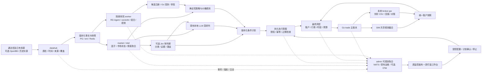

# NovaTrader 量化智脑与自动交易总体实施方案

| 项 | 定义 |
|---|---|
| 版本 / 日期 | v1.1 / 2026-10-15；研究起始于2026-10-14 |
| 目标 | 减少用户找数据、盯盘、读新闻、核对订单的负担，逐步形成可解释、可恢复、可控的自动交易系统 |
| 当前交付 | 研究/总体设计完成；首批N0–N3部分已实施并通过针对性验证，详见[集成记录](实施记录/首批集成-2026-10-15.md)，未完成门槛继续按任务书推进 |
| 实施主线 | **N0–N9**；旧 P0–P11、D0–D5 保留历史记录，后续排序以本文为准，模块需求/设计/进度继续记录具体合同 |
| 不变的基础 | Go/Kratos；PostgreSQL/ent/pgvector；Redis/NATS；Tauri 2 + Vue3/Pinia/dockview；东财量化终端 CSV 文件单主通道 |
| 不变的布局 | 监控：原纤维画布 + HUD + 终端带；盯盘：原工作台 + 一张票 + 图表/情报/账户联动 |

## 1. 产品最终要回答什么

打开软件十秒内，用户应能回答：**系统是否在正常工作；今天适合做什么；哪些持仓需要处理；哪些股票值得继续看；买卖要等什么条件；当前哪些事项被风险或缺数阻断。** 深入一层能查事实、处理过程、反证与配置，再深入能查版本、原始记录、订单和对账。

专业性来自一致的事实和可执行的条件，科技感来自空间层次、精密视觉与真实反馈。增加能力时优先减少操作和重复判断，不用更多卡片把海量数据重新交还用户。

最终“交给系统资金与账户”拆为四种责任：研究负责提出可检验假设；决策负责形成条件计划；风控负责决定可否执行；交易负责维护订单与资金真值。模型输出不能同时承担这四种责任。

### 1.1 用户看到的三个层次

| 层 | 默认显示 | 展开后 |
|---|---|---|
| 系统层 | 可以盯盘 / 数据不足 / 停止新开仓；最重要的 1–3 项异常 | 主机、服务、数据源、模型、消息消费者、数据路径、配置生效和恢复记录 |
| 市场层 | 市场状态、主线变化、风险变化、今日关注与持仓行动 | 市场广度、板块轮动、量价、资金、公告/新闻证据与冲突、候选筛选原因 |
| 行动层 | 等待 / 可准备 / 需减仓 / 暂不交易 / 待核对 | 触发区间、失效点、有效期、允许股数、风险预算、审批、订单、成交和账户影响 |

“没有机会”“尚未分析”“数据缺失”“策略不支持”是不同状态。“已提交”“券商接收”“已成交”也是不同状态，禁止互相代替。

## 2. 2026-10-14基线与当时必须先补的缺口

本节保留方案制定时的基线。2026-10-18实现状态以[AI任务书](AI分阶段实施任务书.md)和[最新集成记录](实施记录/N3-02-03-监控与盯盘集成-2026-10-18.md)为准，不能把下表历史“未实施”当作当前代码状态，也不能把当前隔离通过当作真实实盘验收。

以当前手写代码及工作区修正为依据；本次不是生成代码逐行安全审计，也不是交易日全链路验收。详细证据见[实时链路审计](研究资料/实时链路与自动执行差距核实-2026-10-14.md)。

| 能力 | 当前判断 | 下一步 |
|---|---|---|
| 多源采集、行情/因子、情报、四维研判、规则信号 | 已有主干 | 核验真实覆盖、时点可用性、统一事实快照 |
| Go 回测、搜索、前推、防未来检查、提案审批 | 已有主干 | 数据版本与偏差证明、独立绩效审计、研究作业隔离 |
| 风控规则、持久 Kill Switch、SIM 账本与撮合 | 已有主干但跨服务缺口关键 | 先闭合账户合同，再验证恢复、幂等与信号编排 |
| 原监控与盯盘 UI | 已有，可继续深化 | 保留布局；第一批已补连线检视、白话行动、源时间/单位/账本语义和模拟确认 |
| 深海控制台配色与图表主题 | 配色、玻璃霓虹材质与三种显示质量已实现 | 完整尺寸/告警矩阵和目标硬件负载仍待验证 |
| 整个环境真实逐边追踪、同页配置生效 | 局部 / 待补 | 观测合同、采样器、配置版本/回执、真实事件样例 |
| 自动信号→订单→回报→账户闭环 | 未完成 | 后端持久执行意图、最终风控、恢复/对账；不依赖桌面开着 |
| 实盘 CSV 网关、回报/撤单/对账 | 未完成 | 保留既定通道，隔离联调，逐项准入 |
| 六个外部项目、Jev 新接入 | 未实施 | 选择性 POC，不同时安装成另一套系统 |

### 2.1 四个第一优先问题

1. **trade→risk 账户合同错位**：当前 `AccountView` 与风险消费者期待的 `AccountPayload` 不一致，资金/持仓尚不能视为可靠闭环。完整快照与对账差异事件还需分开。
2. **WS 重启与缺口恢复**：admin 进程内 seq 重启归零，前端保留旧 seq，存在丢弃新消息的路径；500 帧缓存之外没有显式补齐协议。
3. **事件元数据与脉冲不一致**：WS 丢失信封字段，部分解析字段与真实信号/批次载荷不匹配；画布结构连接尚不能证明逐记录因果。
4. **自动执行编排缺失**：没有获批信号→唯一持久意图并固定订单 ID→必要确认→提交前最终风控→同 ID 提交→回报与状态回写的完整实现。前端确认和本机待核对记录不能代替后端保证。

这四项先修，UI 原型与研究可以并行；涉及可交易状态、实盘和“实时”指标的完成声明必须等待真实合同验收。

## 3. 外部能力怎样选取

| 项目 | 采用位置与价值 | 当前许可核验 | 排期 / 边界 |
|---|---|---|---|
| [OpenBB](https://github.com/OpenBB-finance/OpenBB) | M01 可选外围/宏观 provider，统一来源与单位 | Apache-2.0；数据权利另核 | N4；先 1 个宏观域，不替换 A 股主源；V5 不套用 V4 示例 |
| [RD-Agent](https://github.com/microsoft/RD-Agent) | 盘后假设→因子/模型实验→候选提案 | MIT | N6；Linux 隔离作业、固定预算、无交易凭据，Go 回测复核 |
| [vectorbt](https://github.com/polakowo/vectorbt) | 批量参数和因子筛选 | 当前 Apache-2.0 + Commons Clause | N6 可选；商业用途核验许可，PRO 单列；不替代 A 股准入引擎 |
| [PyPortfolioOpt](https://github.com/PyPortfolio/PyPortfolioOpt) | 目标权重、分散度/风险贡献研究 | MIT | N6；Go 再落股数、现金、T+1、限额；不可行时不偷偷放宽约束 |
| [QuantStats](https://github.com/ranaroussi/quantstats) | 同一费用后账户净值的绩效核验和报告 | Apache-2.0 | N6 首先做；信号回撤不冒充账户回撤，基准显式输入 |
| [LEAN](https://github.com/QuantConnect/Lean) | 可选离线事件回测对照、未来多资产实验 | Apache-2.0 | 后置 POC；不新增第二个生产账本/执行器，不能直接连接现有东财文件单 |
| [NautilusTrader](https://github.com/nautechsystems/nautilus_trader) | 不接入运行时。借鉴订单四态、晚到成交、成交去重、盯盘单再次风控、止盈止损互斥、外部人工单 | LGPL-3.0；只读设计 | 不变量见[参考文档](参考-nautilus-trader.md)，验收落在 N7、N8。不替换 Go 账本，不做第二套内核 |
| [Jev](https://docs.typesafe.ai/concepts/system-one) | 情报相关性、证据检查、任务路由的快速判断 | 商业托管模型；开放权重未核实 | N5 影子实验；不是交易引擎，不能保证股价预测准确或本地部署 |
| A-Stock-Data | 盘后日线/近期历史补数与独立备源思路 | 先前核验 Apache-2.0；逐源数据条件另核 | N4 按能力移植，不运行远程技能文件；同上游不算独立备源 |

上表是选型建议，接入前固定版本、提交、依赖锁、许可快照和输入输出。精确版本边界、官网来源与 POC 见[数据/AI/回测研究](研究资料/数据-AI-回测开源调研-2026-10-14.md)、[组合/绩效/执行研究](研究资料/组合-绩效-执行开源调研-2026-10-14.md)、[A-Stock-Data 研究](A-Stock-Data接入与看板调研-2026-10-14.md)。可选 POC 未通过就保留已有实现，不让外部框架成为交易闭环前置条件。

## 4. 总体架构：一份事实，快慢分工，一本账

### 4.1 三类负载

- **确定性快链路**：新鲜快照→规则因子/条件触发→执行意图→最终风控→订单。报价和账户有效才允许进入；风险计算不等长文生成。
- **异步理解链路**：新闻去重/实体/事件→Jev 可选筛查→本地模型解释→证据化观点。过期任务取消、低信心弃权，结果只引用对应输入版本。
- **盘后研究链路**：冻结 dataset→研究/筛选/优化/报告→Go 验证→提案→影子/SIM 晋级。重作业限制资源，不抢盘中关键链路预算。

继续使用现有 NATS/JetStream 和调度，不因 Jev 新增另一条总线。**Jev 是模型，JetStream 是已有消息基础设施**。矩阵和大报告保存为可校验产物，消息只带身份、状态和引用。

### 4.2 部署职责

| 节点 | 职责 | 隔离原则 |
|---|---|---|
| DGX/Linux | Go 服务、PG/Redis/NATS、本地模型、适用的 AkShare/TCP 采集角色、可选研究 worker | 采集、模型、研究分别有资源/并发预算；Python 不直写业务数据库 |
| Windows 交易机 | 通达信及其旁运行的官方/local 行情 pyworker（按实际能力使用文件）、东财量化终端、未来 broker-gw | 行情与交易边车分离；网关只有指定订单/回报目录与必要权限；终端失联禁止假装已接单 |
| Tauri 桌面 | 可见状态、解释、确认、配置与异常处理 | 不保管第三方模型 key，不做账本真值，关闭客户端不终止后端授权的 SIM 任务 |

## 5. 先定义的领域合同

以下均是**拟新增/修订的版本化合同**，不能直接当作现有 API 使用。先改手写 proto/领域类型/ent Schema，再由仓库既定工具生成代码；所有业务写入经 Go data 层与 ent。

| 合同 | 必须包含 | 失败语义 |
|---|---|---|
| EventEnvelopeV1 | event/trace/causation/correlation ID；schema、source、entity/version；source_time、received_at、published_at；payload | 不识别版本/必填缺失→隔离或拒绝，不能空对象当成功 |
| AccountSnapshotV1 | account_id、SIM/LIVE、generation、as_of、equity、可用/冻结资金、日初权益、持仓含可卖、在途单、对账状态 | 重复/逆序隔离且不覆盖有效新快照；无有效快照或当前快照过期才账户未知并停止新开仓；对账摘要不得覆盖完整快照 |
| Observation / DatasetManifest | event_time、available_at、received_at、修订、单位/币种/复权、真实 provider、hash、证券池/日历版本、质量 | 不能证明当时可用→排除历史训练；修订不静默覆盖 |
| DecisionSnapshotV1 | snapshot/cutoff、引用事实/信号/模型/策略版本、缺口、赞成/反证、生成与有效期 | 事实不同版本不拼成同一结论；过期计划需重新评估 |
| ConditionalPlanV1 | plan/version、方向/证券、触发与失效、价格规则、股数/风险预算、执行日/有效期、账户/持仓代际、授权状态 | 未批准/过期/错账户/版本变更→不可执行；修改生成新版本 |
| ExecutionIntentV1 | 唯一业务键、plan/version/account、触发快照、请求 hash、固定订单 ID、最终风险决定、授权证明、状态/版本 | 同键同请求返回原结果；不同请求冲突；UNKNOWN 查原单，不重建新单 |
| ConfigRevisionV1 | base/revision、参数白名单、校验/影响预览、保存人、目标服务、各服务加载版本/错误、生效时段 | 保存≠加载；部分生效显示差异，受限参数变更使待执行计划失效 |
| ResearchRun / Artifact | manifest、代码/环境/模型版本、全部试验数、预算、seed、结果/失败/审批、产物 hash | 失败也留痕；不可只保存最佳结果；候选不能直接改生产策略 |

账户金额采用现有精度合同；API/显示中的比例、百分点、元、股、手必须显式定义。证据与资金记录的 schema 演进需要兼容与回填计划。

## 6. 实时与可恢复：让“看见流动”有依据

### 6.1 统一时间链

保存：源时间→接入→校验→缓存/落库成功→排队/开始/结束→发布/消费/确认→推送→桌面收到/可见。UTC 存储，上海时间展示；单机耗时用单调时钟，跨机精确耗时前核验时钟偏差。源时间未知时只报告“接入到屏幕”，不写“源到屏幕”。行情年龄、新闻年龄、账户年龄、计划有效期分别判断。

### 6.2 推送与消息恢复

- WS 使用 `server_epoch + topic_seq`，携带 head/oldest 水位。重启、序号超前、500 帧覆盖、gap→显式 `resync_required`→快照及水位→后续增量，避免恢复窗口漏帧。
- 行情按证券/数据类型合并最新值；当前全局单槽合并需修。订单/风险按实体版本处理，独立订单不能只保留最后一条消息。慢端丢帧必须计数并恢复，关键状态从业务查询重建。
- JetStream 至少一次投递；长期资金幂等靠数据库唯一约束、状态 CAS、请求 hash 和事务，不依赖短去重窗口或进程内 map。
- outbox 增加 claim/lease、重投、退避、死信/隔离和最老年龄，发布后标记失败可安全重投。新关键主题明确登记持久策略、保留和 ACL。
- NATS 积压使用每个真实消费者的 pending、ack_pending、redelivered 和最老年龄。全流 LastSeq 减过滤消费者的 deliveredSeq 不能标作积压量。
- 前端共享 typed store，snapshot+delta；域级 single-flight、dirty/尾随合并、可见面板按需订阅。把业务更新与渲染帧率分离，消除多面板重复全量请求。

### 6.3 第一轮性能目标——待实测基线后冻结

| 指标 | 候选目标 | 必须同时报告 |
|---|---|---|
| 自有行情接收→Redis 可读 | P95 ≤300ms，P99 ≤1s | 外源等待另算；记录批次/证券数与拒收率 |
| 批次可读→规则状态 | P95 ≤500ms | 冷/热状态、CPU/GC、增量量级 |
| 风险/订单状态提交→桌面可见 | P95 ≤1s，P99 ≤2s | 队列、重连、可见窗口、失败率 |
| WS 入站→可见更新 | P95 ≤100ms；压力下持续 ≥30FPS | 关键状态不等动效；长任务/内存/重同步 |
| 最终风险纯规则计算 | P99 ≤50ms | HTTP 全程另测，现有 200ms 超时仍安全拒绝 |
| 环境采样 | 连接1–2s，资源2–5s，重探针10–30s | 采样时刻/年龄/覆盖，避免每窗口探 GPU/数据库 |
| Jev/本地模型 | 按模型、队列、任务单独测 | P50/P95/P99、超时、覆盖、费用、输入长度；无既定速度承诺 |

以上不是当前测得性能。当前盘中默认 3 秒采集、部分 UI 10/30 秒轮询，不应宣传为毫秒级市场行情。源到屏幕目标必须符合真实源频率/授权；达不到标出能力边界。

压力验收：5000 证券、20–50 可见节点、1/3/8 面板、正常/10倍突发、30分钟运行；记录源/接入/推送/渲染分段、请求量、长任务、内存、订阅数、丢帧/恢复。后台资源应下降，恢复后水位一致，关键订单/风险不丢。负载来自录制或合成数据并明确标记。

## 7. 监控面板：同一个画布深入到运行、数据和配置

### 7.1 原布局的内容升级

| 原位置 | 新内容 | 操作 |
|---|---|---|
| 顶部 HUD | 可盯盘/可交易原因；新鲜覆盖；关键路径延迟；账户对账；待处理异常；授权与账本 | 点击直达根因节点/边/订单；摘要不把未知记为正常 |
| 纤维画布 | 采集→市场/情报→模型/规则→计划→风控→订单/回报；基础设施与研究为可折叠层 | 聚焦单条真实 trace、按账户/证券/服务过滤、锁定布局、回到全景 |
| 节点 | 运行/业务就绪/数据年龄/负载/权限独立状态；最近输入与输出量、错误、排队 | 同页详情抽屉五页签：概览、数据、处理、配置、历史 |
| 连线 | subject/生产者/消费者、记录/秒或字节/秒、P95、pending/最老年龄、拒绝/重投 | 样例→完整事件→关联 trace；结构依赖/实测路径分开 |
| 原终端带 | 按严重度聚合的事件、配置加载、研究任务、订单/UNKNOWN、对账 | 固定一条、过滤、定位上游、查看处置结果；不会自动滚走用户正在读的内容 |

画布增加可折叠“主机与基础设施”“数据与决策”“执行与对账”“研究”域。默认保留现有主链位置，展开域才显示内部节点；布局迁移保留用户节点偏移和已有保存方案。

### 7.2 整个环境的覆盖清单

| 域 | 需要可见的真实指标 |
|---|---|
| 主机/进程 | DGX/Windows/桌面登记、CPU/内存/磁盘与剩余空间/网络/时钟偏差；Go 堆/GC/goroutine；worker 心跳和退出原因 |
| GPU/模型 | 利用/内存/温度/功耗可用项、模型加载、并发/队列年龄、token、超时、降级、费用；无法采到的项显示未接入 |
| PG/Redis/NATS | 池等待、查询/缓存延迟、连接、容量/命中；每个关键消费者积压与重投、outbox/死信 |
| 数据源 | 真实 provider、配额、时段能力、预期/已收/新鲜/拒收覆盖、分市场年龄分位、切源/补数与质量样例 |
| 情报与决策 | 原文→去重→实体→事实→研判→候选的数量与耗时；证据冲突、旧消息、模型弃权与计划失效 |
| 交易 | 可用/冻结资金、可卖量、待确认/提交/UNKNOWN/在途/成交、保护覆盖、broker 心跳与回报延迟、账差 |

“整个环境”以登记清单为范围，HUD 显示覆盖率和未接入项。指标标签使用有限的服务/源/阶段；股票/trace 等高基数身份进入可检索事件与日志，避免时序库爆炸。先复用现有运维采样，必要时接 OpenTelemetry/Prometheus 标准出口；PG 仍为业务与审计真值，不将每个高频样本永久写业务表。

### 7.3 配置闭环

从节点进入配置：读取当前值与服务加载版本→编辑白名单参数→类型/范围/依赖校验→影响预览→保存版本→逐服务加载回执→核验效果→回滚到新修订。

预览至少包括受影响的数据域/策略/队列、需重启或下个交易日生效、将失效的计划和预算差异。冲突用 base revision 拒绝；未接入预览时显示不支持，不能伪造“无影响”。普通采样/显示参数可直接保存；账户、风控、交易权限遵循已有角色与授权，密钥只设不回显。重启和切模式是独立受审计命令，不混入自动保存。

异常显示根因、影响范围、最近正常时间、推荐处置及结果。自动恢复仅用于明确幂等的技术动作；涉及交易状态先对账，不能盲目重发。

## 8. 盯盘面板：先给明白结论，再给专业证据

### 8.1 保留 dockview 与一张票

默认继续原工作台。上方已有状态/行动区域改为一行白话摘要与最多三项重点；左侧保留待处理/已执行/漏选队列；中部保留当前票与图表；右侧保留市场/板块/情报面板组；下方保留账户/委托/成交。用户可保存不同密度布局，不因新增能力清空原布局。

联动上下文 `symbol + market + time_range + snapshot_id + plan_id + account_id + link_group`。点击股票联动图表、情报与票；组件可锁定。**切换股票不得静默切换账户或提交动作**，执行前始终显示账本和授权。

### 8.2 信息深度

| 区域 | 首屏结论 | 可下钻信息 |
|---|---|---|
| 市场摘要 | 强/弱/分化、主线变化、适合等待还是研究机会；来源不足则无结论 | 涨跌家数、成交额及同时点比较、涨停/炸板/梯队、板块扩散、波动、外围驱动与数据覆盖 |
| 股票摘要 | 为什么关注、当前处于什么结构、离触发还差什么 | 多周期价格/量/相对强弱、流动性、板块联动、公告事件、财务风险、四维分歧和反证 |
| 持仓摘要 | 继续观察/触发保护/可卖不足/待核对；按风险优先排序 | 成本/可卖/在途、退出条件、风险贡献、相关暴露、保护失败原因 |
| 推荐队列 | 少量符合模板且信息完整的候选，说明排名依据 | 全部筛选漏斗、落选原因、证据覆盖、模型/规则来源、过期/撤销历史 |
| 账户摘要 | 净值、今日损益、现金/冻结/敞口、风险预算剩余 | 同口径净值、回撤、集中/行业/相关性、回合绩效、费用滑点、对账 |

摘要中任何“市场判断”必须指向确定性状态规则或已版本化模型，注明有效时间。不得把综合分85直接译为85%上涨概率；不同模型评分也不能直接平均后称概率。

### 8.3 条件买卖计划的标准读法

**仅为产品文案示例，金额与股票均为虚构，不是交易建议：**

> 先等待。价格回到 10.20–10.35 元，且量价触发条件成立后才可准备买入；超过 10.50 元不追。计划 10:30 失效。入场后跌破 9.95 元进入退出流程；实际成交取决于可卖量、停牌和流动性。当前账户信息未核对，因此不能下单。

同一张票固定显示：**动作、触发条件、距离/是否满足、失效条件、有效期、执行日、建议/允许股数、风险预算、主要反证、阻塞原因、下一步**。价格来自规则，允许股数来自当次账户和风控；模型解释这些数字的依据，不能自由编数。

图表增加入场带、失效线、目标/情景带、事件标记与真实成交点。未来拖动线条只编辑草稿，生成新计划版本并重算风险；最终提交遵守适用确认，图上的计划线不代表已挂单。

T+1、停牌、跌停无流动性、跳空、费用和滑点必须进入计划/执行状态。“止损触发”不等于“止损成交”，“预计损失”不等于最坏损失保证；可卖不足要显示下一可处理时点与人工事项。

### 8.4 预测买入点的渐进实施

1. 先把现有模板的规则入场区间、触发/失效和前瞻结果做完整；这是可核验的条件计划。
2. 有 PIT 数据与足够前瞻样本后，再研究 1/3/5 个交易日等明确期限的收益分布、达到入场/退出区间的概率、波动与成本后期望；定义标签、样本池和基准。
3. 时间切分、walk-forward、purge/embargo 与封存测试，纳入退市、停牌、复权、涨跌停/T+1/交易成本；按市场阶段和流动性报告校准与退化。
4. 通过影子/SIM 后才显示概率，并同时给期限、样本量、校准版本和不确定性；未通过只显示规则条件与“预测尚未验证”。置信区间不是价格保证。

预测模型、Jev 的文本判断和四维解释分别标注来源。Jev 第一阶段不承担数值价格预测。[专业盯盘信息层级建议](研究资料/专业盯盘信息层级建议-2026-10-14.md)补充账户与订单读法。

## 9. 视觉：深海霓虹玻璃控制台

这是用户最新要求的**下一阶段视觉合同**：在已实现深海配色上加强毛玻璃、半透明、霓虹光晕与科技层次。取代旧文档“玻璃仅三处、发光仅三处”的范围限制；保留数据真实性、可读性、A股红涨绿跌及性能要求。详见[视觉规范第七节](1.视觉需求.md)。

| 层 | 材质 / 色彩 | 使用位置 |
|---|---|---|
| 空间底 | 原深蓝黑 `#050D17`，低对比精密网格、有限静态青蓝径向光 | 原监控画布与工作台背景；不做持续扫描/星空抢注意 |
| 玻璃壳 | 深蓝半透明，候选 alpha 0.72–0.90、blur 12–18px、1px冷边/顶部微反光 | HUD、节点外壳、票头、摘要、详情/配置抽屉 |
| 数据背板 | 更高不透明度 0.94–1.00，稳定底色、弱分隔 | 表格/K线/订单/证据正文，背景线不穿字 |
| 交互强调 | 冰青 `#45E0FF` + 电蓝 `#769DFF`；选中轨/端口/路径局部柔光 | 当前节点/票/联动组/生效状态，焦点不依赖发光 |
| 语义告警 | 琥珀预警、玫红风险；红涨/绿跌沿用当前 token | 同时有标签/图标/原因，风险色不等于涨跌色 |

建议新增统一材质 token：glass-bg/glass-border/glass-blur/glow-soft/glow-active/grid-opacity，仍由 `tokens.css` 单源管理，图表脚本读取实时主题。

科技感的重点是细轨、端口、空间层、真实高亮路径与精确数字。数字采用等宽/tabular-nums，正文和报价不加模糊、渐变文字或常驻 text-shadow；普通文字最不利合成背景对比目标≥4.5:1。模型只展示可审计的处理阶段/证据摘要，不能伪称暴露内部思考链。

动效只响应真实事件，关键状态先更新再动效；未知/零流量静止，断流不播假粒子。默认一次最多突出一条聚焦路径，告警只短时强调并保留静态标识。视觉不是吞吐量计量器，数值/窗口/单位仍直接显示。

性能模式：完整 / 节能 / 减少动态；可关闭 blur/glow，实体背板保留。避免几十个独立大面积 backdrop-filter，按层合成；渲染与数据处理预算一起压测。亮色主题用深青蓝强调和实底层次，不能把暗色玻璃直接反相。

验收矩阵：监控/盯盘/配置/订单 × 暗/亮 × 普通/紧凑 × 在线/断流/数据缺失/关键告警；1366×768、1920×1080、窄窗口与多屏比例。保持布局恢复、图表缩放、键盘操作；无数字遮挡和光晕吞字。效果截图来自真实页面，演示数据必须标记。

本地视频主要借鉴工具组件联动、判断流程、多人协作状态与空间材质，不复制数百机器人数量、虚构吞吐或收益。具体采样证据见[视频研究](研究资料/本地视频界面研究-2026-10-14.md)，官网依据见[Jev/Longbridge 研究](研究资料/Jev与Longbridge官方调研-2026-10-14.md)。

## 10. 研究与组合：让海量处理变成可审查提案

### 10.1 数据先满足当时可用

财报报告期不等于公告时刻，当前公告日缺失时回退报告期的记录不得用于训练可用时间。宏观观察期与发布时间/修订分开，当前按观察期覆盖的存储不能证明历史 PIT。已有退市字段不代表退市行情和历史证券池齐全。建立不可变 manifest、原始 hash、available_at、revision、证券/名称/成分历史与公司行为对拍；缺口进入训练排除原因。

先引入已验证的补数能力和一个 OpenBB 宏观域，不重复包已有同源快照。按真实上游故障面统计独立备源，按字段/市场/时段验收，不用“库支持A股”推断全市场实时能力。

### 10.2 外部研究流水线

冻结数据→明确假设/标签/预算→受限 worker→全部产物与失败日志→泄漏/复现/统计检查→Go 事件回测→提案审批→影子→SIM。RD-Agent、vectorbt 和组合优化可退出或替换，生命周期归现有 Go 任务层管理。

研究容器无交易密钥、无生产数据库写权限、无交易服务路由、无宿主 Docker socket；只读输入、独立输出、CPU/GPU/内存/磁盘/墙钟/token/费用/迭代限额。生成代码和序列化模型按不可信产物处理。封存测试只作最终检验，不能让 Agent 看结果后无限反复调优。

QuantStats 读取同一费用后账户 NAV 与显式基准序列；净值包含初始点，处理入金/出金与收益频率。报告资金曲线与信号样本表现分栏，盈利天数不标交易胜率。

PyPortfolioOpt 输出目标权重、假设、可行性与约束残差；Go 按证券规则落股数并重做现金/在途冻结/T+1/费用/风险约束。HRP 和等风险贡献方法区分；求解失败不伪装有效组合。先给影子建议，再形成有版本的调仓计划。

研究晋级看样本外净表现、回撤/换手/容量、稳定性、成本恶化、不同市场状态和失败样本。改善不足就不上线；回滚策略版本不自动删除既有持仓的有效保护计划。

## 11. 自动交易路线与失败处理

### 11.1 阶段与授权

| 阶段 | 系统行为 | 开放条件 |
|---|---|---|
| 建议 | 汇总事实和条件计划，解释阻塞与反证 | 数据/事实来源明确，不触发资金动作 |
| SIM 人工确认 | 用户核对同一计划后模拟委托 | 已有第一批衔接继续完善，后端独立复检 |
| SIM 自动（L1） | 获授权计划由后端自动监测、提交、撮合、对账 | N7 的幂等、恢复、风控与演练全部通过 |
| LIVE 半自动（L2） | 限定账户/策略/预算，人工确认真实单 | 连续≥20个真实交易日证据、准入、文件单/回报/对账联调、明确用户授权 |
| 未来 LIVE 自动（L3） | 在独立授权策略/时段/额度内自动执行，持续撤权与监控 | N9 独立验收和用户授权；当前 L3 仍保留且按 L2 处理 |

连续20日只是半自动准入的一部分，不是全自动开关。交易日记录按日期幂等，证明实跑覆盖、缺口、故障演练和账实一致，不能调用计数器凑天数。

### 11.2 订单与风险闭环

后端唯一意图并固定 client_order_id→原子领取/资金预留→必要人工确认→提交前重新检查最新账户/行情/计划版本/授权并执行最终风控→同 ID 提交→接收/UNKNOWN→部分/全成/撤单/拒单→账本与信号回写。确认期间的风险预检不能复用为最终许可；预留、确认过期与释放使用状态机避免长期冻结。将本地事务和外部副作用分开设计；提交每个断点可恢复。

- 100 个并发请求只能形成一个有效意图；唯一键与状态 CAS 在数据库保障，多实例仍成立。
- UNKNOWN 优先查询/对账原单，不能因超时换 ID 再下单；人工操作和自动执行也共享同一去重边界。
- 实盘撤单等待真实确认，合并晚到成交后重算剩余量再决定追价；不能先本地 cancelled 就报新单。
- broker-gw 处理部分写、重复文件、目录权限、磁盘满、重启扫描和回报重放；CSV 接受只表示文件状态，券商回报才决定订单状态。
- 风险拒绝、账户过期、时钟异常、行情断流、对账差异时停止新开仓并说明原因。普通模型超时不阻塞确定性监控；计划是否允许规则降级由版本化策略规定。
- **当前 Kill Switch 政策不变**：L0，仅人工卖出放行，自动退出也停止；界面明确“保护暂停，待人工处理”。若未来允许保护退出，须独立政策/授权/演练，不能在本方案实施中偷偷放开。
- 恢复先完成账户/订单对账、数据与授权核验；Reset 后不自动回原模式。暂停新开仓、撤在途、停止所有自动动作区分命令和后果。

## 12. N0–N9 实施顺序与交付门槛

每阶段拆为小批次，先合同、后实现、再故障/性能/视觉验收。可并行分支合并前重新核验依赖。不用固定工期掩盖数据/终端/硬件的不确定性。

| 阶段 | 工作包与主要目录 | 前置 | 必须交付与完成门槛 |
|---|---|---|---|
| **N0 合同与基线** | events；trade/risk 账户；真实脉冲；API 类型；基线证据 | 无 | 真实 producer JSON→consumer 合同测试；SIM/LIVE、缺字段/乱序/过期安全失败；账户/对账事件分离；建立验收清单 |
| **N1 可恢复推送与 store** | admin/gateway/hub、web/ws、api/stores/业务刷新 | N0 | epoch/gap/水位恢复；500帧覆盖/重启/慢端/多窗口；行情按键合并；订单风险不丢；store 与查询一致 |
| **N2 观测与配置** | admin ops、各服务采样、events/outbox、config、monitor详情 | N0/N1 | 全登记环境与消费者；逐边真实指标/样例；配置校验/预览/加载回执/冲突/回滚；未知/单位/统计窗清楚 |
| **N3 科幻 UI 深化** | tokens、monitor、workspace、view、viz、M12 | 材质可并行；观测依赖N1/N2；持久计划/图表编辑依赖N5-01 | 原布局内完成玻璃霓虹和信息层级；节点/边/配置闭环；联动上下文、白话票/持仓/图表条件；截图矩阵与性能门槛 |
| **N4 PIT 数据与增量源** | datahub、pyworker、ent/schema、backtest/source | N0；可与N2/N3并行 | N4-01必需：immutable manifest、可用时间/修订/历史池；N4-02可选：1个历史补源+1个OpenBB宏观域POC；质量/断流/限流/对拍；不合格数据排除训练 |
| **N5 事实计划与 Jev 影子** | intel/brain/strategy/rules、领域DTO、决策台 | N0/N1；历史验证依赖N4 | DecisionSnapshot/ConditionalPlan持久版本；反证/缺口/失效；Jev可选适配、中文测试/费用/时延/弃权，失败可退出；无模型交易权限 |
| **N6 研究/绩效/组合** | backtest、独立research-worker、ent、报告/研究面板 | N4-01；N2任务观测，不依赖OpenBB成功 | 先QuantStats口径，再可选vectorbt/RD-Agent/组合；固定数据/环境/全试验留痕、Go复核、人工提案；LEAN后置独立POC |
| **N7 SIM 自动闭环** | strategy/trade/risk、intent/schema、outbox、SIM | N0/N1/N2；N5计划合同，不要求Jev/RD成功 | 唯一intent/订单、资金冻结、服务端复检、信号回写、UNKNOWN/崩溃/撤单晚成交/T+1演练；关桌面也正常；连续交易日证据开始 |
| **N8 文件单与L2准入** | Windows broker-gw、M09、admission、账户/回报/对账UI | N7，终端协议/目录核实 | 先隔离目录模拟与终端联调；连续≥20交易日及完整准入；限账户/策略/额度人工实盘确认；本阶段不开放L3 |
| **N9 未来自动实盘** | 授权/风险/执行/撤权/运维、独立设计决策 | N8及独立用户授权 | 明确允许资产/策略/时段/单日/单笔/回撤/流动性限额、自动撤权和保护政策；更长稳定运行/故障证据与逐级扩大，不因模型评分直接开放 |

### 12.1 三道不可省略的验收门

1. **合同与恢复门**：跨服务结构一致、所有未知/旧数据安全失败；重启/缺口/乱序/缓存覆盖可恢复真实状态。
2. **时效与覆盖门**：时间链、逐边指标和 UI 压测有环境/样本/失败率；目标与实测分栏，来源未知不冒充实时。
3. **资金一致性门**：并发只一意图；提交断点和撤单竞态最终账一致；UNKNOWN有处置；回报/对账/Kill有效；真实连续日证据后才进入相应授权阶段。

## 13. AI 怎样逐步执行

直接使用[AI分阶段实施任务书](AI分阶段实施任务书.md)。每次只选一个无阻塞任务或一组互不写同文件的任务，读当前代码确认历史记录没有过期。先说明本次范围，再完成合同、实现和有意义的验证；不为通过截图而伪造后端数据。

每个任务交付：变更文件/合同、失败语义、执行过的测试与结果、真实或模拟环境标记、截图/trace/报告证据、未完成与回滚方式。相应模块固定三文档同步更新，主计划状态只在证据达标后改变。

`go build`、前端构建或页面好看都不能独立证明交易阶段完成。性能值需要实测；AI不得擅自换技术栈、加第二本生产账、执行实盘单、扩大账户权限或把研究候选直接晋级。

### 13.1 第一批可立即落地

顺序：**N0-01 账户合同 → N0-02 事件/脉冲 → N1-01 恢复协议 → N1-02 共享store → N2-01 真实边观测**。N3-01 玻璃霓虹材质可与只读研究并行，但数据缺口明确标记，先不改变任何交易授权。

### 13.2 外部依赖与待验证项

DGX实际硬件/模型端点与负载、通达信授权与数据覆盖、Tushare等配额、真实终端文件格式/回报/撤单能力、Jev访问/数据处理条款/API额度、历史数据质量与许可、用户可接受的风险/预算。这些在对应阶段核验；当前先完成不依赖它们的合同、恢复、观测和UI任务。

## 14. 与旧文档的关系及本次完成范围

| 旧材料 | 本方案如何承接 |
|---|---|
| 优化实施总体方案 P0–P11 | 已完成内容保留；之后的实施优先级按N序列，数据/研判/回放/模拟/实盘能力纳入N4–N8 |
| 业务深化 D0–D5 | D0合同→N0/N1；D1配置→N2；D2追踪→N2/N3；D3/D4行动→N3/N5；D5自动执行→N7–N9 |
| 旧视觉仅三处玻璃/发光 | 按最新用户要求被第9节和视觉规范第七节取代；原布局、涨跌语义、真实性保持 |
| 只使用本地模型、暂不扩模板 | 当前生产设置保持；Jev/研究扩展为可选未来POC，先影子/盘后隔离。新模板仍经版本审批和准入，不自然语言直接执行 |
| 历史全景概念/视频 | 仅提供局部视觉与交互灵感，不能作为功能/吞吐/收益验收 |

研究批次形成资料、总体方案与任务书。2026-10-15首批实施已交付账户合同、事件外壳/outbox元数据、恢复协议、共享刷新、网关入口观测和玻璃霓虹材质；证据及限制见[首批集成记录](实施记录/首批集成-2026-10-15.md)，任务状态以任务书为准。没有接入付费Jev、没有安装六个量化框架、没有连接真实账户或启用自动实盘。后续阶段仍逐项验收，已有351项前端测试不复用为本批证据。

文档交付核验：29个任务ID无重复；五段视频44个采样帧及16张证据图片可读，源文件大小与元数据一致；本地文档链接检查与`git diff --check`通过。视频为分段抽帧研究，非完整逐帧观看；本批不产生新的业务测试或实时性能结论。
